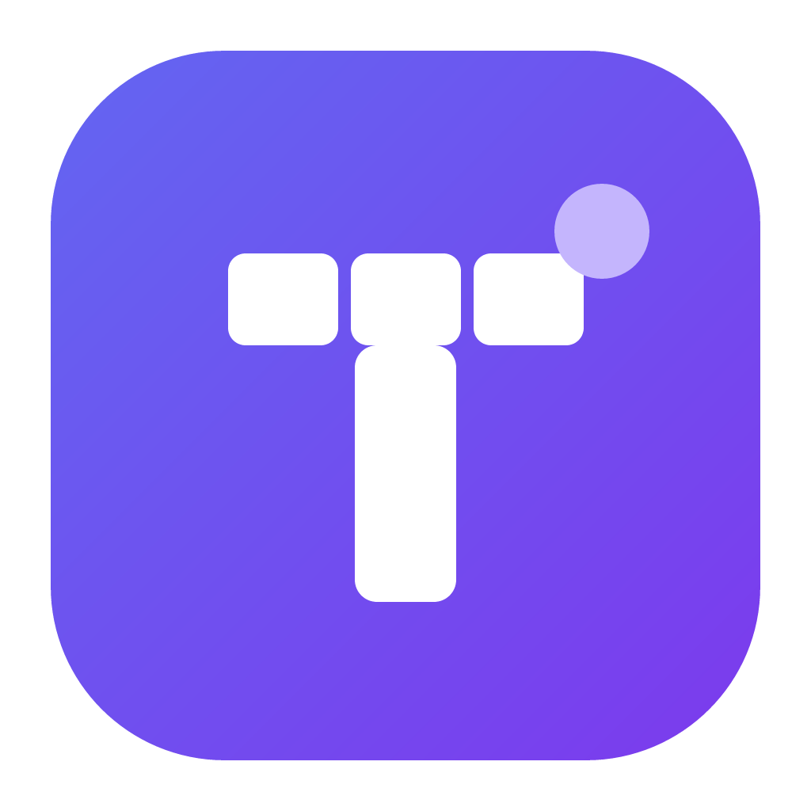
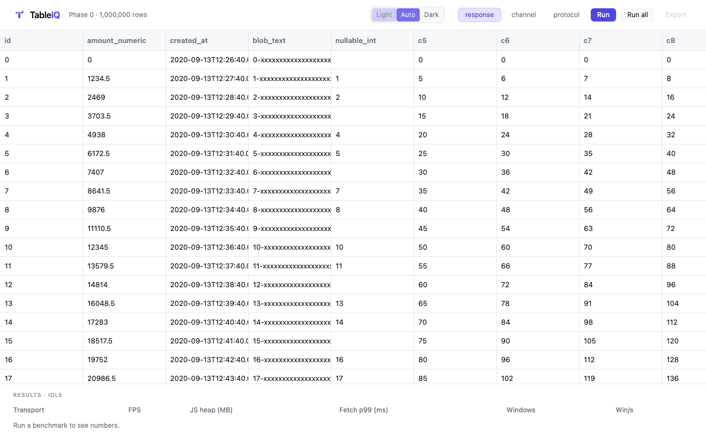
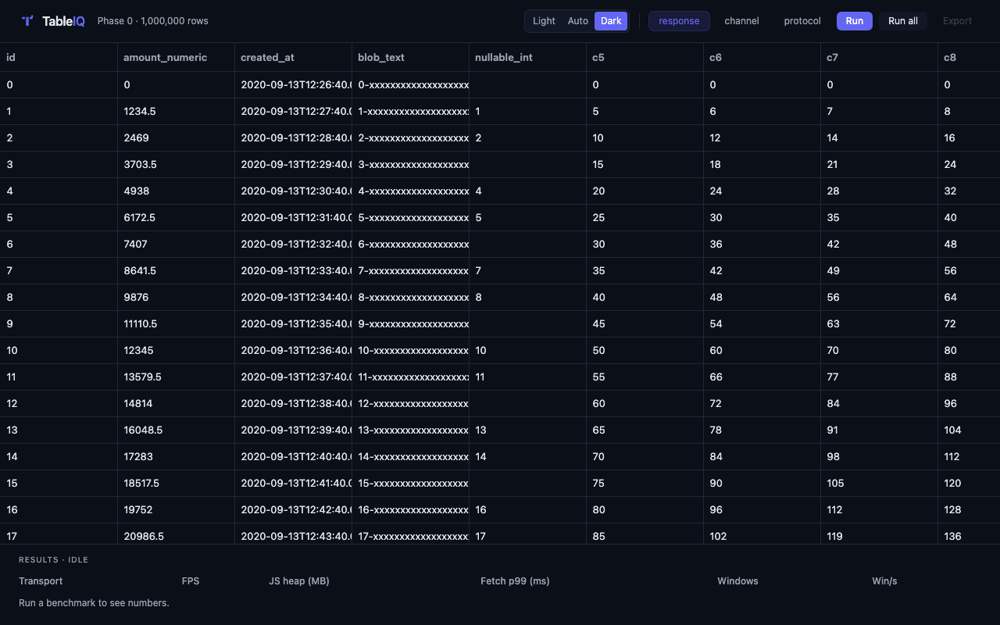

# Finalize Report — TableIQ Phase 0.5 (Branding & Identity)

**Branch:** `branding-identity` · **Date:** 2026-05-21 · **Workflow:** Rudy's Workflow

## Task-done summary

Established TableIQ's brand and the design-token foundation Phase 1 builds on — before any real product UI exists.

- **Name & wordmark:** **TableIQ** (one word); wordmark `Table` + `IQ`-in-accent ([`<Wordmark>`](../../src/components/Brand.tsx)).
- **Mark:** "cells-T + spark" T+IQ monogram. App icon = indigo→violet gradient tile ([icon-tile.svg](../../src/assets/brand/icon-tile.svg)); inline theme-adaptive glyph ([`<BrandMark>`](../../src/components/Brand.tsx)). Full OS icon set generated via `pnpm tauri icon` (.icns/.ico/png/Square*), plus favicon.
- **Themes:** light / dark / **auto** ([`ThemeProvider`](../../src/theme/ThemeProvider.tsx) + [`<ThemeToggle>`](../../src/components/ThemeToggle.tsx)); persisted; `auto` follows `prefers-color-scheme`. Data grid gets matching light/dark themes via `gridTheme()`.
- **Tokens:** indigo primary (`#4f46e5` light / `#6366f1` dark) + violet `--accent` reserved for AI; full table as CSS vars wired into Tailwind 4 `@theme` ([src/index.css](../../src/index.css)). Type: Inter + JetBrains Mono.
- **Source of truth:** [DESIGN.md](../../DESIGN.md).
- **Metadata:** `productName`/window title → `TableIQ`; default window 1280×800.
- **UX directive captured for Phase 1:** keep TablePlus's familiar flow (connection manager → sidebar tree + tabbed grid/editor + status bar), enhanced (unlimited tabs, command palette, AI panel).

## Test + QA results

- **Unit (vitest):** 10 pass total — incl. 5 new theme tests (`resolveTheme` light/dark/auto; `gridTheme` light/dark surfaces + brand accent).
- **Build:** `pnpm build` (tsc + vite) clean; `pnpm tauri icon` produced the full set; icon renders correctly (rounded gradient tile, cells-T, spark).
- **QA (headless Chromium, 1280×800):** app renders in **light and dark**; theme toggle switches the whole shell + the canvas grid; body bg confirms tokens (`#0b0f17` dark); wordmark + glyph legible; **zero console errors**.

## Evidence

App icon:

Light theme:

Dark theme:

## "Checked thoroughly" statement

Verified by: 10 green unit tests (theme logic TDD'd), a clean type-check + build, the generated OS icon set, and a headless dogfood rendering both light and dark with zero console errors and confirmed token-driven theming across shell + grid.

## Follow-ups

- Bundle Inter + JetBrains Mono woff2 for offline/local-first (currently system-install + fallbacks).
- Apply tokens to the real Phase 1 shell (this phase branded the interim bench view).

## Per-stage cost (this session, cumulative)

| Stage | Model | Input | Output | Cache read | Cache write | Cost (USD) |
|---|---|---|---|---|---|---|
| 1. Brainstorm (approved plan) | opus | 48,877 | 149,179 | 6,285,835 | 449,449 | $29.78 |
| 2-3. Spec + Plan (Phase 0) | opus | 2,188 | 79,306 | 4,190,537 | 90,758 | $13.97 |
| 4-7. TDD + Frontend + Impl (Phase 0) | opus | 24,403 | 312,707 | 79,116,736 | 417,510 | $150.32 |
| 1. Brainstorm (branding) | opus | 629 | 59,039 | 9,277,351 | 72,953 | $19.72 |
| 2-7. Spec+Plan+Impl (branding) | opus | 7,330 | 73,542 | 40,311,445 | 95,055 | $67.88 |
| **Total** | | **83,427** | **673,773** | **139,181,904** | **1,125,725** | **$281.66** |

*Branding phase ≈ $87.60. Best-effort attribution; sanity-check against `/cost`.*
