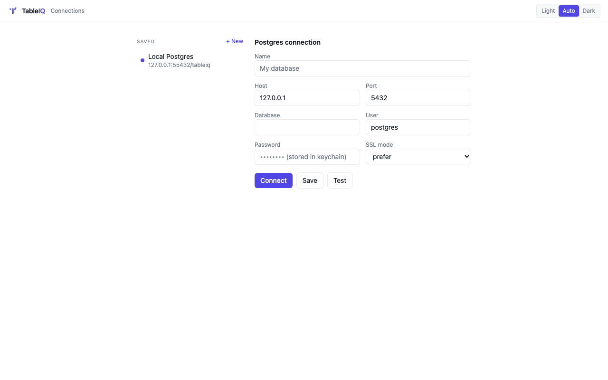
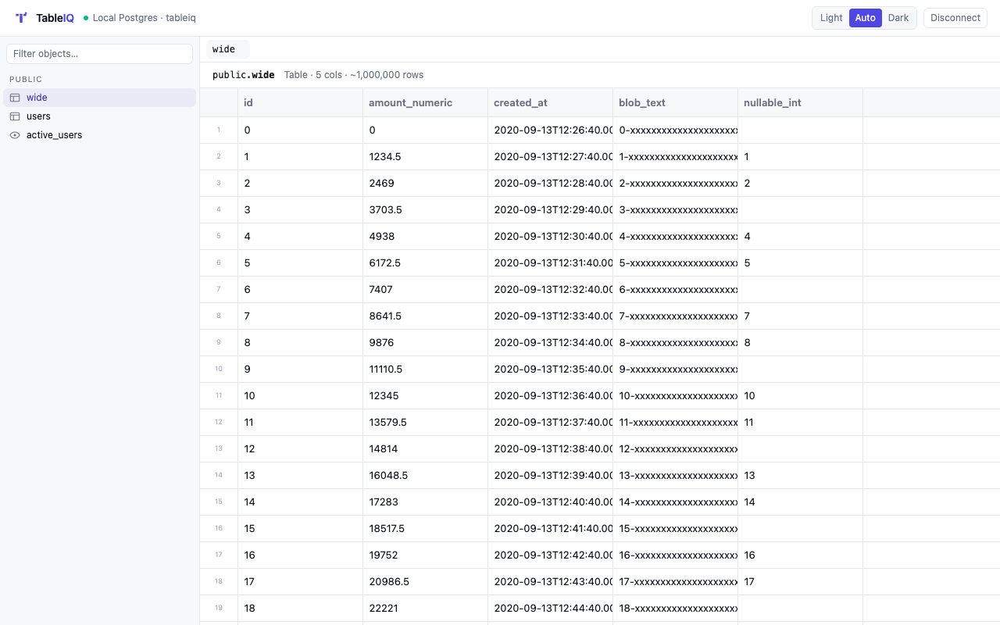
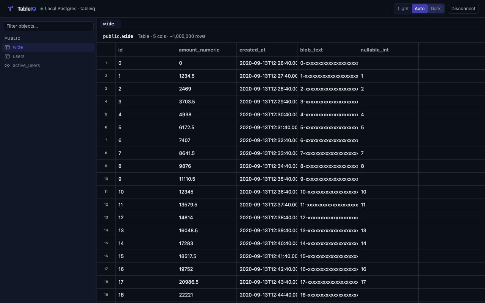

# Finalize Report — Phase 1 · Slice 1 (Connect & Browse)

**Branch:** `phase-1-connect-browse` · **Date:** 2026-05-21 · **Workflow:** Rudy's Workflow

## Task-done summary

Turned the Phase 0 spike into a real database client: save a Postgres connection → connect → browse
the schema in a sidebar tree → open a table into the windowed grid. TablePlus-familiar, enhanced.

**Rust core**
- Generalized `SqlDriver`: `introspect()` (schemas → tables/views → columns via `information_schema`),
  `row_estimate()` (fast `pg_class.reltuples`), `open_window()` (display-first, identifier-safe
  windowed read). [src-tauri/src/drivers/postgres.rs](../../src-tauri/src/drivers/postgres.rs)
- Connections: JSON store in the app config dir + passwords in the **OS keychain** (`keyring`).
  [src-tauri/src/connections.rs](../../src-tauri/src/connections.rs)
- `ConnState` session registry + IPC commands (list/save/delete/test/connect/disconnect/list_objects/
  open_table/get_table_window). [src-tauri/src/ipc/connect.rs](../../src-tauri/src/ipc/connect.rs)

**Frontend**
- `ConnectionManager` (saved list + Postgres form, Test/Save/Connect).
- TablePlus-style `MainShell`: header (connection status + theme + disconnect) · object-tree sidebar
  with filter · tab bar (unlimited tabs) · `TableView` on a generalized `DataGrid` window source.
- Reuses Phase 0 Arrow decode + LRU window cache + transport, and Phase 0.5 tokens/theme. Browser-mode
  mocks let the full flow be QA'd headlessly.

## Test + QA results

- **Rust:** 17 pass — 13 lib unit (incl. 3 connection-store/url-encode/upsert) + 1 cursor integration +
  **3 live-Postgres introspect/browse** (finds `public.wide` + columns + nullability; positive row
  estimate; `open_window` returns the correct slice — a test caught and fixed a lexicographic-ordering
  bug). `cargo build` clean.
- **Frontend:** 13 pass (arrow decode 5, theme 5, tree filter 3); `pnpm build` (tsc+vite) clean.
- **QA (headless Chromium, mock backend):** full flow — connection manager → select saved → Connect →
  `public` tree (wide/users/active_users with table/view icons) → open `wide` tab → grid shows
  `~1,000,000 rows` and scrolls; **light and dark** both; **zero console errors**.

## Code review (self-review of risk areas)

- **SQL safety:** values bound as params; identifiers via `quote_ident` (doubles `"`) sourced from the
  catalog → no injection. **Read-only:** browse path only `SELECT`s. **Concurrency:** commands clone
  the `Arc<PgDriver>` out of the `Mutex` before any `.await` (no lock across await). **Secrets:**
  passwords only to the keychain, never to disk/JSON. No issues found.

## Evidence

## "Checked thoroughly" statement

30 automated tests (17 Rust incl. live-Postgres introspection/browse + 13 frontend), clean
type-check/build, a documented SQL-safety/concurrency/secrets self-review, and a headless dogfood of
the entire connect→browse→open-table flow in light and dark with zero console errors.

## Follow-ups (next slices)

- Real-Tauri QA of the keychain + live-DB UI path (headless QA used mocks; the Rust path is covered by
  integration tests). Deep-`OFFSET` → keyset paging. Exact counts on demand. Then Slice 2 (SQL editor +
  inline editing) and more engines.

## Per-stage cost (cumulative session)

| Stage | Model | Input | Output | Cache read | Cache write | Cost (USD) |
|---|---|---|---|---|---|---|
| 1. Brainstorm (approved plan) | opus | 48,877 | 149,179 | 6,285,835 | 449,449 | $29.78 |
| 2-3. Spec + Plan (Phase 0) | opus | 2,188 | 79,306 | 4,190,537 | 90,758 | $13.97 |
| 4-7. TDD + Frontend + Impl (Phase 0) | opus | 24,403 | 312,707 | 79,116,736 | 417,510 | $150.32 |
| 1. Brainstorm (branding) | opus | 629 | 59,039 | 9,277,351 | 72,953 | $19.72 |
| 2-7. Spec+Plan+Impl (branding) | opus | 8,470 | 97,647 | 49,379,023 | 126,462 | $83.89 |
| 1. Brainstorm (slice1) | opus | 12 | 22,320 | 2,643,384 | 22,743 | $6.07 |
| 2-7. Build (slice1) | opus | 7,003 | 142,225 | 45,635,247 | 151,950 | $82.07 |
| **Total** | | **91,582** | **862,423** | **196,528,113** | **1,331,825** | **$385.82** |

*Slice 1 ≈ $88. Best-effort attribution; sanity-check against `/cost`.*
