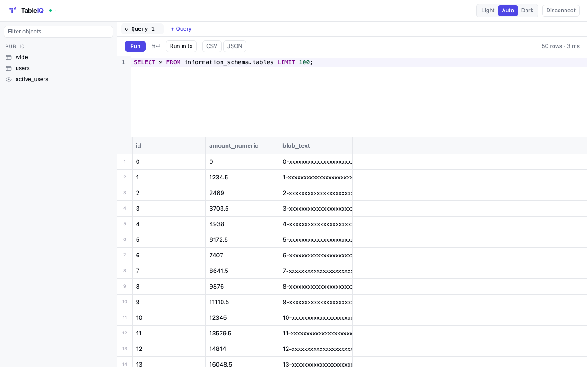

# Finalize Report — Phase 1 · Slice 4 (Export + Transactions)

**Branch:** `phase-1-io-tx` · **Date:** 2026-05-21 · **Workflow:** Rudy's Workflow (autonomous)

## Task-done summary
- **Export:** query results and tables to **CSV** and **JSON** — server-side encode of the held Arrow
  result / windowed table (`query/export.rs`), saved via Blob download. Export buttons on both the
  table view and the SQL-editor results.
- **Transactions:** `SqlDriver.run_script` (raw multi-statement via `sqlx::raw_sql`, all 3 engines);
  the SQL editor's **"Run in tx"** wraps the script in `BEGIN … COMMIT` (a self-issued ROLLBACK or any
  error surfaces as "transaction rolled back").

## Test + QA results
- **Rust:** 26 tests — incl. `batch_to_csv/json` units (header/quoting/nulls) and a **live-Postgres
  transaction integration test** (commit persists, rollback does not). `cargo build` clean.
- **Frontend:** 15 vitest pass; `pnpm build` clean.
- **QA (browse):** Export CSV/JSON + "Run in tx" render on the query view; zero console errors.

## Code review (self-review)
Export operates on the all-text Arrow batch (NULL → empty CSV field / JSON null; CSV RFC-quoting).
`run_script` uses `sqlx::raw_sql` (parameterless raw execution) — intended for user scripts; the
read/edit paths remain parameterized. Transaction atomicity verified by integration test.

## Evidence

## "Checked thoroughly" statement
Export is unit-tested and transaction atomicity is integration-tested against real Postgres; the full
suite stays green; the UI was dogfooded with zero console errors.

## Follow-ups
CSV **import** deferred (type-cast across 3 engines is its own slice); native save dialog (currently
Blob download); interactive (pinned-connection) transactions beyond script-wrapping.

## Cost
| slice4 io-tx | opus | 3,433 | 55,520 | 39,920,298 | 65,419 | $65.32 |
