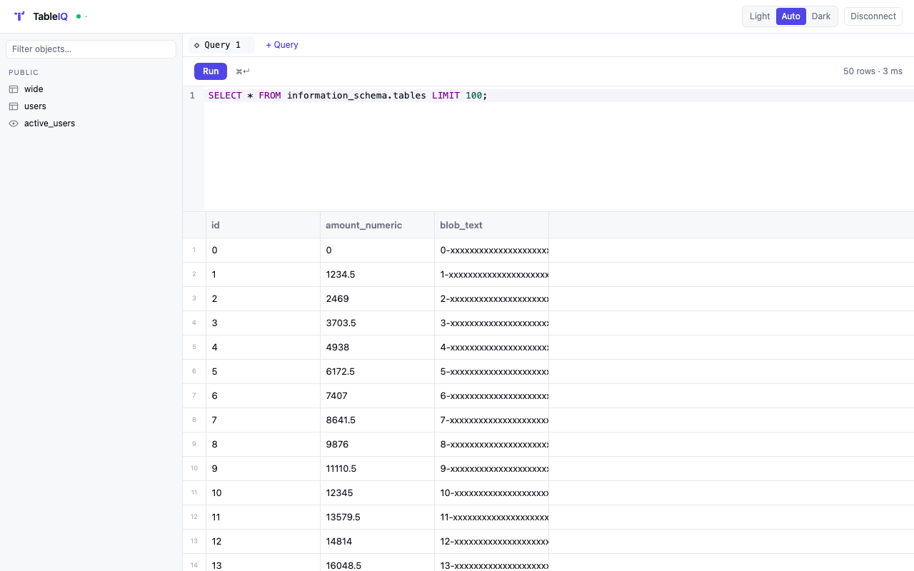
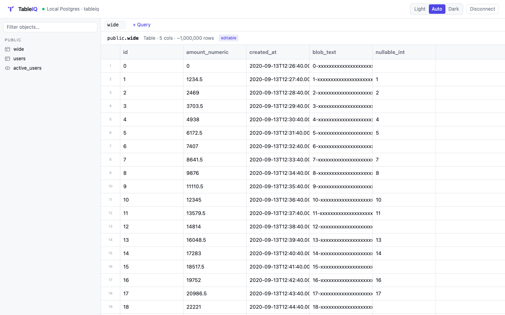

# Finalize Report — Phase 1 · Slice 2 (Query & Edit)

**Branch:** `phase-1-query-edit` · **Date:** 2026-05-21 · **Workflow:** Rudy's Workflow

## Task-done summary

Added a SQL editor and inline cell editing to the connect/browse client.

**Rust**
- `SqlDriver`: `run_query` (single statement, capped at 50k, held server-side + windowed),
  `primary_key` (catalog), `apply_edit` — optimistic-concurrency UPDATE built by `build_update_sql`
  (identifier-safe, per-column `udt` casts, `IS NOT DISTINCT FROM` match; **0 rows ⇒ conflict**).
  [src-tauri/src/drivers/postgres.rs](../../src-tauri/src/drivers/postgres.rs)
- IPC: `run_query`/`get_result_window`/`primary_key`/`apply_edit` + a result registry.
  [src-tauri/src/ipc/connect.rs](../../src-tauri/src/ipc/connect.rs)

**Frontend**
- CodeMirror 6 SQL editor tab ([SqlEditor](../../src/components/SqlEditor.tsx) +
  [QueryView](../../src/components/QueryView.tsx)): Run / ⌘↵, results in the grid, `N rows · M ms`
  status, truncation notice, errors.
- Editable grid: `DataGrid` gains `onEdit` + optimistic overlay + `onCellEdited`; `TableView` detects
  the PK and gates editing (no PK → "read-only · no PK"); edits go through the `buildEdit` RowKey
  payload → `apply_edit`; conflict reverts the cell with a notice.
- Tabs now have `kind: table | query` + a "+ Query" action.

## Test + QA results

- **Rust:** 20 pass — incl. 2 `build_update_sql` unit tests + a **live-Postgres query/edit round-trip**
  (`primary_key` → `["id"]`; text + numeric edits re-read correctly; stale original ⇒ 0 rows conflict;
  `run_query` truncation flag) on an isolated `edit_demo` table. `cargo build` clean.
- **Frontend:** 15 pass (incl. 2 `buildEdit` tests). `pnpm build` clean.
- **QA (headless Chromium, mock backend):** New Query → Run → results grid with **"50 rows · 3 ms"**;
  open `wide` → **"editable"** badge (PK detected); light/dark; **zero console errors**.

## Code review (self-review of risk areas)

- **SQL safety:** `apply_edit`/`run_query` bind all values; identifiers via `quote_ident`; UPDATE is
  fully parameterized (unit-tested shape). **Edit safety:** writes only via the PK + original-value
  optimistic match; 0 rows ⇒ conflict (never silent). **Concurrency:** `Arc` cloned out of the mutex
  before `await`; result registry mutex released before encode. No issues found.

## Evidence

## "Checked thoroughly" statement

35 automated tests (20 Rust incl. a live-Postgres edit round-trip with conflict detection + 15
frontend), clean build/type-check, a documented SQL/edit-safety self-review, and a headless dogfood of
the SQL editor (run → results) and the editable-table path with zero console errors.

## Follow-ups

- Real-Tauri QA of the cell-edit gesture (headless canvas editing is hard to drive; the round-trip is
  integration-tested). Multi-statement scripts, schema-aware autocomplete, no-PK (all-columns) editing,
  INSERT/DELETE rows, NULL-entry UX, streaming huge query results. Then Slice 3 (more engines).

## Per-stage cost (cumulative session)

| Stage | Cost (USD) |
|---|---|
| Phase 0 (brainstorm/spec/plan/impl) | $193.07 |
| Phase 0.5 branding | $103.61 |
| Slice 1 connect-browse | $103.40 |
| Slice 2 query-edit | $103.32 |
| **Total** | **$504.39** |

*Full per-stage breakdown via `cost-table.py`; best-effort, sanity-check against `/cost`.*
