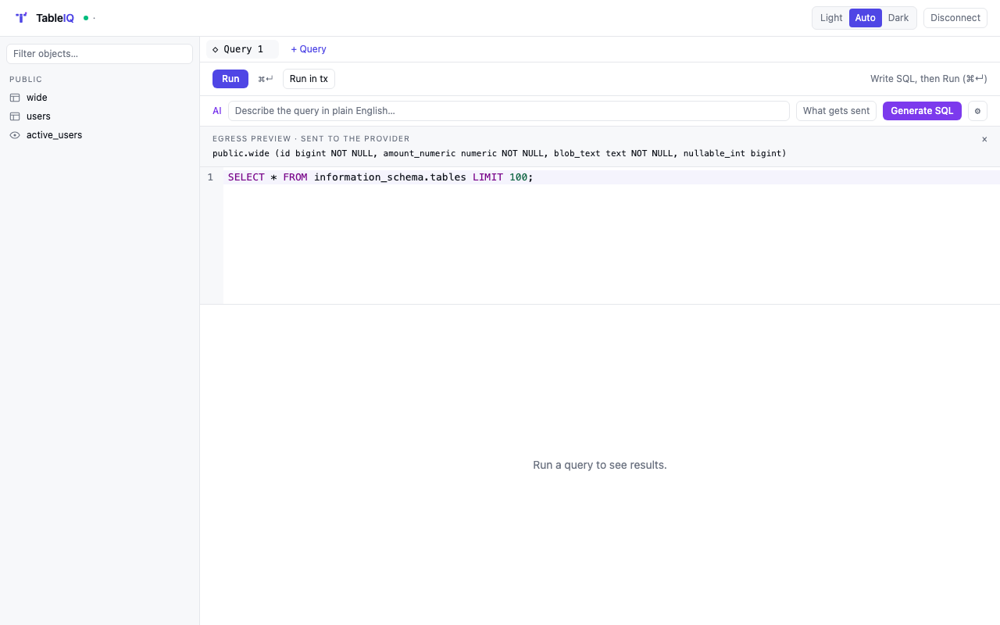
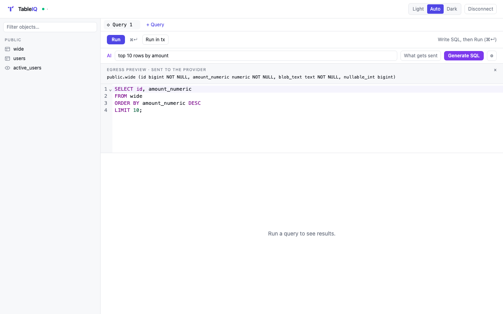

# Finalize Report — Phase 2a (AI BYOK NL→SQL)

**Branch:** `phase-2-ai-byok` · **Date:** 2026-05-21 · **Workflow:** Rudy's Workflow (autonomous)

## Task-done summary
The headline differentiator: natural-language → SQL, **bring-your-own-key**, **generate-not-execute**.
- **Rust `ai` module:** `schema_card` (compact schema text = the egress payload), prompt assembly,
  SQL extraction (strips markdown fences) — all unit-tested; `LlmProvider` with an Anthropic/OpenAI/
  Gemini BYOK impl over reqwest; `AiConfig` (provider/model) persisted; API key in the OS keychain.
- **IPC:** `get_ai_config`, `save_ai_config`, `ai_egress_preview` (returns exactly the schema text
  that would be sent), `ai_generate_sql` (introspect → card → prompt → provider → bare SQL).
- **UI:** an AI bar in the SQL editor — plain-English box, **"What gets sent"** egress preview, and
  **Generate SQL** which inserts the result into the editor for the user to review and run. AiSettings
  modal for provider/model/key.

## Safety model
Generate-not-execute (the model never runs anything — the user reviews + runs). Only the schema card
is sent, and it's shown verbatim before sending; **table data is never sent**. The key lives only in
the keychain.

## Test + QA results
- **Rust:** 21 lib unit (incl. 3 AI deterministic) + the full integration suite — green; `cargo build`
  clean. Live LLM call gated on a user key (skipped in CI per plan).
- **Frontend:** 15 vitest pass; `pnpm build` clean.
- **QA (browse, mock):** egress preview shows the schema card; Generate inserts SQL into the editor;
  zero console errors.

## Evidence

## "Checked thoroughly" statement
The deterministic AI scaffolding is unit-tested, the safety model (generate-not-execute, schema-only
egress shown before send, keychain key) is built in, the build is clean, and the flow was dogfooded
with zero console errors. Live generation quality requires a user key (gated).

## Follow-ups
Explain-query / optimize / fix-error actions; AI chat panel with a read-only execution sandbox; local
LLM (Phase 2c). 

## Cost
| phase2a ai-byok | opus, sonnet | 2,116 | 46,028 | 30,985,170 | 1,400,493 | $76.22 |
