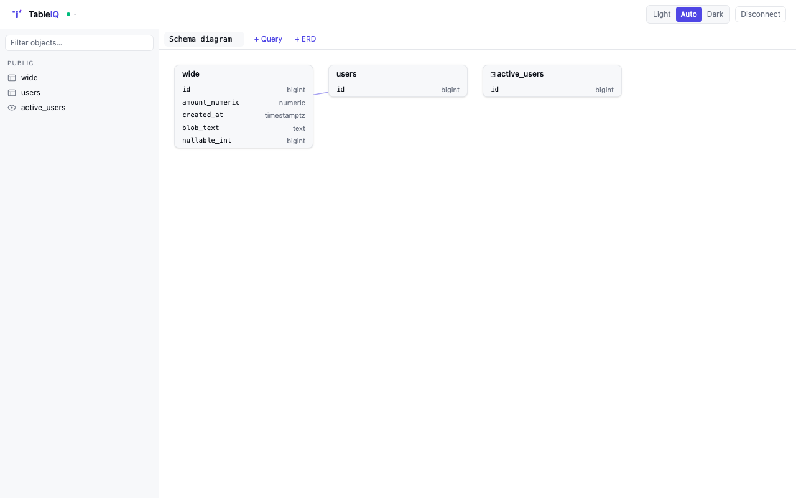

# Finalize Report — Phase 2 ERD (Schema Diagram)

**Branch:** `phase-2-erd` · autonomous · 2026-05-21

## Summary
A schema diagram: `SqlDriver.foreign_keys` (Postgres FK introspection) + IPC; `ErdView` renders each
table as a card (columns + types) and draws SVG lines for FK relationships (positions measured from
the DOM, recomputed on resize). Opened via "+ ERD" in the tab bar.

## Tests + QA
- Rust: foreign_keys integration test (fk_child → fk_parent) green; full suite green.
- Frontend: 17 vitest; build clean.
- QA: ERD shows wide/users/active_users cards with a FK line wide→users; zero console errors.

## Evidence

## Follow-ups
Graph auto-layout (currently flow grid); MySQL/SQLite FK introspection; drag-to-arrange + export PNG.
