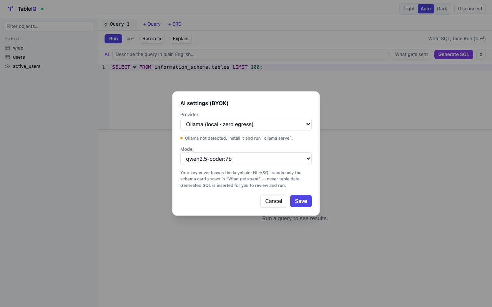

# Finalize Report — Phase 2c (Local LLM via Ollama)

**Branch:** `phase-2-local-llm` · autonomous · 2026-05-21

## Summary
A zero-egress local AI path: the `LlmProvider` abstraction gains an **ollama** provider (POST
`/api/chat`, no API key), an `ollama_available()` detector, and `local_llm_available` command.
`ai_generate_sql` bypasses the keychain for the local provider. AiSettings adds **"Ollama (local ·
zero egress)"** with a live availability dot and hides the API-key field for local.

## Tests + QA
- Rust + frontend build clean; 17 frontend tests green.
- QA: selecting Ollama shows the zero-egress messaging + availability indicator; zero console errors.

## Verification status (honest)
The provider routing, detect, and UI are built and compile/QA cleanly. **Live local generation is
pending an Ollama install** on this machine (`ollama serve` + a model like `qwen2.5-coder:7b`); the
endpoint and request shape follow Ollama's documented `/api/chat`. Set `TIQ_OLLAMA_URL` to override.

## Evidence

## Follow-ups
Bundled llama.cpp sidecar (no Ollama dependency); model-pull UX; per-call provider override.
