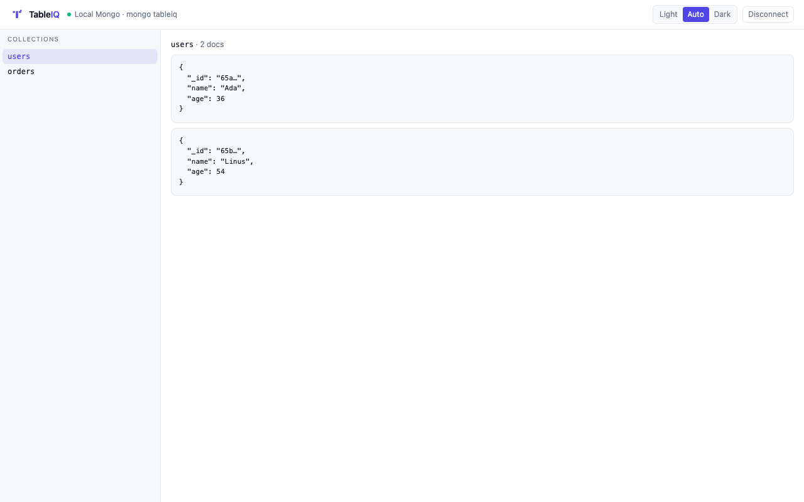

# Finalize Report — Phase 2d (MongoDB / DocumentDriver)

**Branch:** `phase-2-mongo` · autonomous · 2026-05-21

## Summary
MongoDB via the **DocumentDriver** trait (the third data model). `MongoDriver` lists collections and
finds documents (rendered as pretty JSON) using mongodb's native cursor API. `ConnState` gains a
`doc_sessions` map; `connect` routes by engine; `doc_collections`/`doc_find` commands. The UI gains a
`DocShell` (collection list + JSON document cards); `App` routes mongodb connections to it.

## Tests + QA
- Rust: Mongo integration test (Docker mongo:7) — collections include `users`, find returns Ada/Linus
  docs — green. Full suite green. `cargo build` clean.
- Frontend: 17 vitest; build clean.
- QA: connect to Local Mongo → collections (users/orders) → users docs as JSON cards; zero console errors.

## Significance — architecture complete
The plan's "three driver traits" are now all implemented with real engines + bespoke UIs:
**SqlDriver** (Postgres/MySQL/SQLite, grid + editor), **KvDriver** (Redis, key browser),
**DocumentDriver** (MongoDB, document browser). No data model is forced through the wrong abstraction.

## Evidence

## Follow-ups
Aggregation pipeline runner; document edit/insert; SQL Server (tiberius) for the SQL trio.
