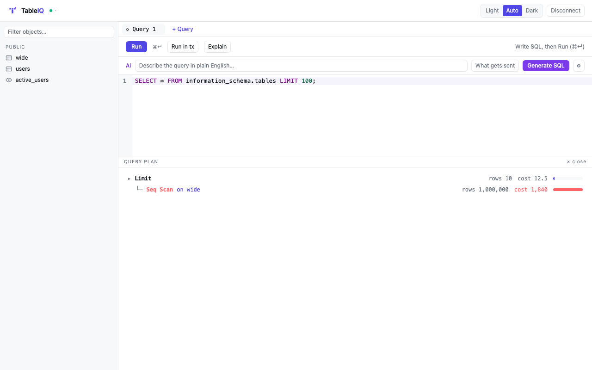

# Finalize Report — Phase 2b (Query-Plan Visualization)

**Branch:** `phase-2-plan-viz` · autonomous · 2026-05-21

## Summary
EXPLAIN → readable plan tree. Rust `explain_json` (Postgres `EXPLAIN (FORMAT JSON)`), IPC
`explain_query`; frontend `flattenPlan` (tested) + `PlanView` rendering an indented node tree with
per-node rows/cost and **cost bars that highlight expensive nodes in red**. "Explain" button in the
SQL editor toolbar.

## Tests + QA
- Rust: explain integration test (real PG plan tree) green; full suite green.
- Frontend: 17 vitest (2 new plan-flatten); build clean.
- QA: Explain renders Limit → Seq Scan with the Seq Scan flagged hot (cost 1,840, full red bar); zero console errors.

## Evidence

## Follow-ups
ERD/schema diagram (FK graph) — next; MySQL/SQLite EXPLAIN parsing; EXPLAIN ANALYZE timings.
