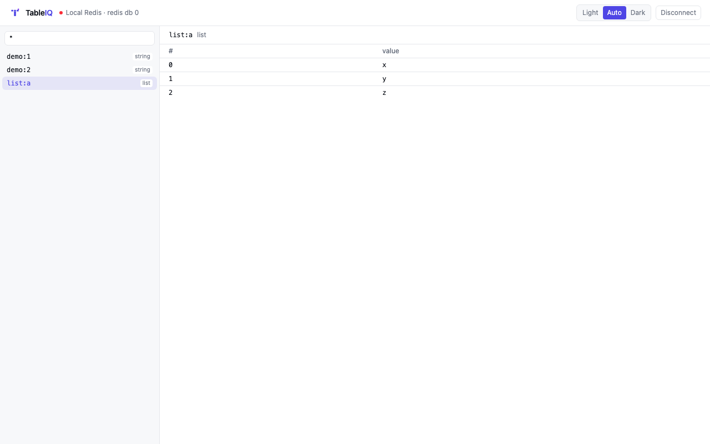

# Finalize Report — Phase 2d (Redis / KvDriver)

**Branch:** `phase-2-redis` · autonomous · 2026-05-21

## Summary
Redis support via the **KvDriver** trait (the second data model). `RedisDriver` does SCAN (with
TYPE+TTL) and per-type value reads (string/list/set/hash/zset). `ConnState` now holds a separate
`kv_sessions` map; `connect` routes by engine; `kv_scan`/`kv_get` commands. The UI gains a dedicated
`KvShell` (key list with type badges + a value table), and `App` routes redis connections to it.
Connection form gains a Redis engine.

## Tests + QA
- Rust: Redis integration test (Docker redis:7) — scan finds `demo:*`, string GET = "hello",
  list `list:a` returns #/value rows — green. Full suite green. `cargo build` clean.
- Frontend: 17 vitest; build clean.
- QA: connect to Local Redis → key list (demo:1/demo:2/list:a with type badges) → list value table;
  zero console errors.

## Significance
Validates the plan's "three driver traits" architecture (SqlDriver + **KvDriver**) with a real,
non-SQL engine and a bespoke UI — no abstraction leak.

## Evidence

## Follow-ups
Redis value editing/TTL set; MongoDB (DocumentDriver — third trait) next; SQL Server (tiberius).
