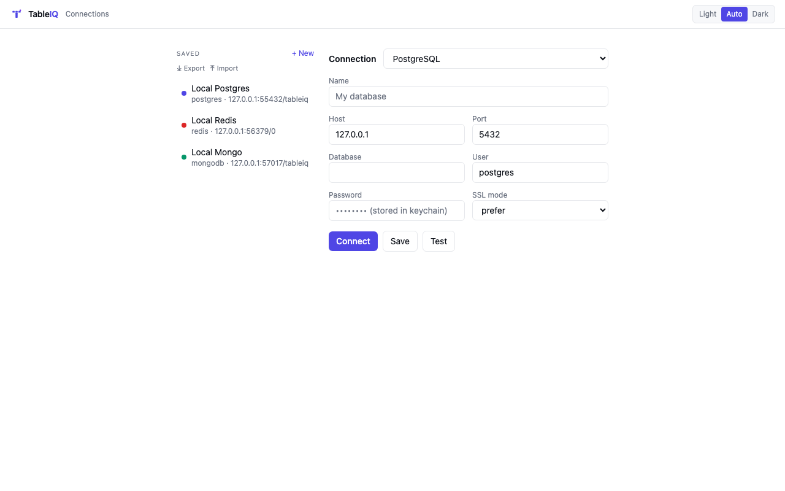

# Finalize Report — Phase 3 (Sharing + Cross-Platform CI)

**Branch:** `phase-3-share-ci` · autonomous · 2026-05-21

## Summary
- **Optional local-first sharing:** export saved connections to a shareable JSON bundle and import
  them back. **Secret-free by construction** — passwords are only in the OS keychain, never in
  `ConnConfig`, so a bundle can never leak credentials (recipients re-enter passwords). Buttons in the
  connection manager; `export_connections`/`import_connections` commands.
- **Cross-platform release pipeline:** `.github/workflows/release.yml` builds, signs, and packages
  TableIQ for macOS (universal), Windows, and Linux via `tauri-apps/tauri-action` on GitHub-hosted
  runners, with signing/notarization secret hooks.

## Tests + QA
- Rust: `bundle_export_import_roundtrip_is_secret_free` (asserts no "password" in the bundle) + full
  suite green; build clean.
- Frontend: 17 vitest; build clean. QA: Export/Import render, zero console errors.

## Verification status (honest)
Sharing is fully built + tested. The release **workflow is configured but not executed here** —
producing signed/notarized Windows + Linux + macOS binaries requires GitHub's per-OS runners +
signing secrets, which a single-OS dev sandbox cannot provide. The workflow is the correct mechanism;
it runs on tag push.

## Evidence

