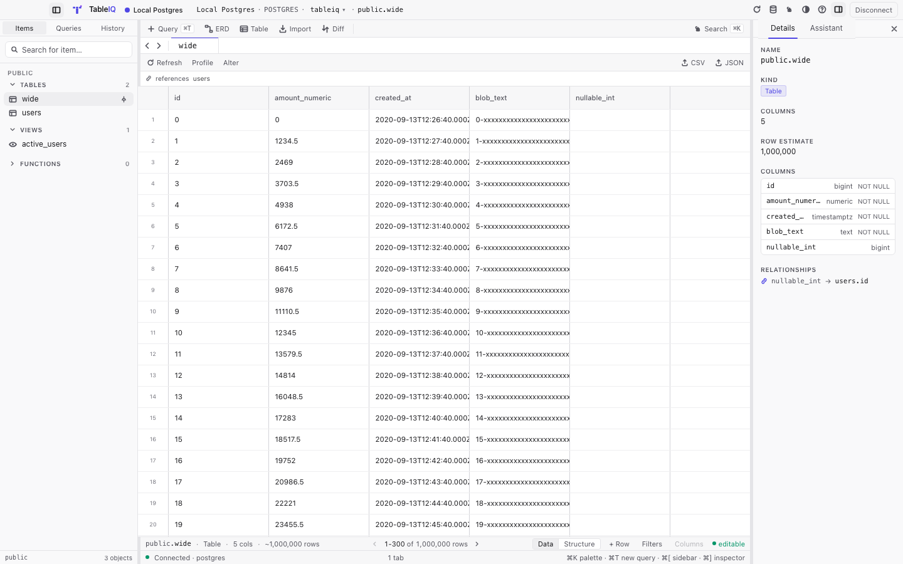
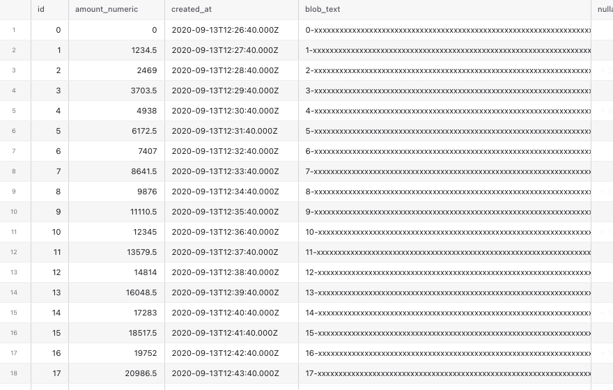
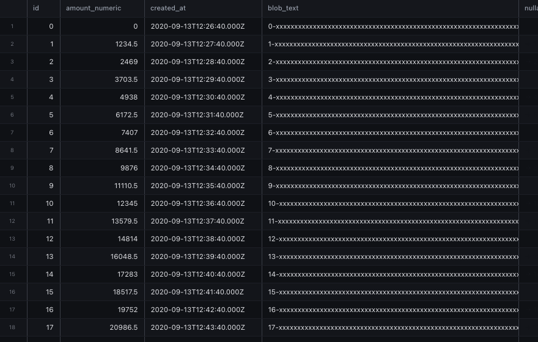
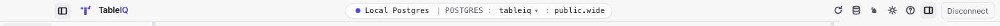
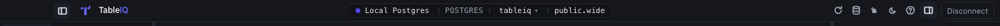
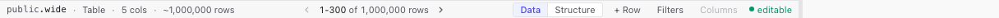
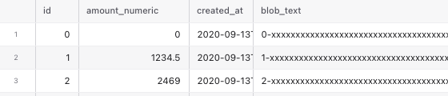

# Finalize — Slice 29: TablePlus parity (grid auto-fit + zebra, connection capsule, single bottom bar)

Date: 2026-06-02 · Branch: `slice-29-tableplus-grid-chrome` · Base: `main`

## Task

Make the TableIQ data grid + top bar + bottom bar an exact-feel replica of
TablePlus, **adapted to the TableIQ theme** and improved on UX. The user's
primary complaint: cells clip their data (a fixed max-width truncates values),
no alternating row colors, and the chrome should match TablePlus's top + bottom
bars icon-for-icon and function-for-function. Driven autonomously through the
full pipeline (brainstorm → spec → plan → TDD → frontend-design → review → QA →
finalize), running the app and screenshotting to drive the design.

## What shipped

### Data grid (the literal complaint)
- **Auto-fit column widths.** Each column sizes to its content (header + a 60-row
  sample) on first load, clamped to a 420px max. `created_at` and `blob_text`
  were truncated at the old fixed 160px; they now show full values. Pure,
  unit-tested (`fitColumnWidth` / `autoFitWidths`). A user's manual drag still
  wins and persists — verified in-app (see `qa-persisted-width.png`).
- **Zebra striping** on odd rows + a neutral **hover highlight**, token-driven
  for light + dark (`gridRowTints` + glide `getRowThemeOverride`).
- **Tighter rows** — 29px rows / 30px header (was glide's 34px default).
- **Numeric columns right-align** (`isNumericType`, tested; matches full names and
  Postgres short names like `int4`/`int8`/`float8`).

### Top bar
- **Centered TablePlus connection capsule** — a rounded pill carrying the whole
  context, `conn | ENGINE : database ▾ : schema.table`. The name opens the ⌘O
  connection switcher; the database segment opens the ⌘D database picker. Replaces
  the plain left-aligned breadcrumb + the redundant left connection chip.

### Bottom bar
- Active **Data / Structure** segment now reads with the **primary accent**
  (TablePlus's blue active tab) instead of flat neutral.
- **Single bottom bar.** The workspace fallback status bar was rendering *under*
  TableView/QueryView's own rich bar (stacked two-deep). It's now suppressed when
  a Table/Query tab owns one. TableView's loading/error states also render the bar
  so the window never flashes bar-less (the review-found regression, fixed).

## Files

| File | Change |
|---|---|
| `src/lib/autoFit.ts` (new) | `fitColumnWidth`, `autoFitWidths`, `isNumericType`, `MAX_AUTO_FIT` |
| `src/lib/autoFit.test.ts` (new) | 11 unit tests |
| `src/lib/theme.ts` | `gridRowTints(mode)` — zebra + hover tints |
| `src/lib/theme.test.ts` | +2 tests |
| `src/components/DataGrid.tsx` | auto-fit wiring, zebra/hover row theme, row/header height, numeric align prop |
| `src/components/TableView.tsx` | `rightAlignColumns` memo, stable status bar on load/error |
| `src/components/MainShell.tsx` | centered connection capsule, single-bottom-bar gate |
| `src/components/ui/StatusBar.tsx` | active segment uses the primary accent |

## Verification — checked thoroughly

- **`tsc --noEmit`**: clean.
- **Vitest**: **137 frontend tests pass** (was 134; +16 new/updated across
  `autoFit` and `theme`, of which 3 added in the review pass).
- **`/browse` QA** (browser-mock mode, light + dark, zero console errors):
  - Grid: full `created_at` values, zebra stripes, right-aligned numerics, tighter
    rows — light (`after-grid-light.png`) + dark (`after-grid-dark.png`) vs the
    clipped `before-grid-light.png`.
  - Top bar capsule renders centered, light + dark (`after-topbar-*.png`).
  - Single bottom bar with blue active "Data" (`after-bottombar-light.png`).
  - Data/Structure toggle switches views and returns the grid; ⌘D database picker
    opens from the capsule; **persisted column width is respected over auto-fit**
    (`qa-persisted-width.png` — a pinned 80px `created_at` stays narrow).

## Screenshots

Before (clipped, no zebra):

After — grid light / dark:

After — connection capsule (light / dark) and single bottom bar:

QA — persisted width survives auto-fit:

## Per-stage cost

> Attribution is approximate (session-window bucketing; the `2. design-system-tokens`
> row is a stray marker from a prior session). Sanity-check against `/cost`.

| Stage | Model | Input | Output | Cache read | Cache write | Cost (USD) |
|---|---|---|---|---|---|---|
| 1. Brainstorm | opus | 1,306 | 37,041 | 4,751,323 | 397,208 | $17.37 |
| 2. Spec | opus | 706 | 4,992 | 936,575 | 11,264 | $2.00 |
| 4. TDD + implement | opus | 9,284 | 108,739 | 34,967,272 | 154,686 | $63.65 |
| 7. Review | opus | 6,557 | 29,203 | 7,119,525 | 38,730 | $13.69 |
| 8. QA | opus | 26 | 8,653 | 3,119,069 | 6,343 | $5.45 |
| 9. Finalize | opus | 872 | 376 | 483,256 | 3,088 | $0.82 |
| **Total** | | **~61.7k** | **~195k** | **~51.5M** | **~704k** | **~$106** |

## Gate

Tests green, tsc clean, QA clean (no console errors, all touched interactions
verified). **Clean → proceeding to merge** (autonomous build mode).
