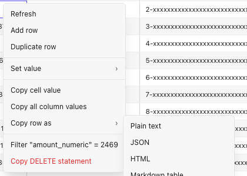
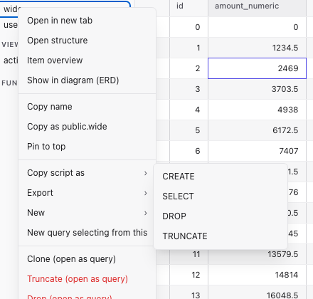
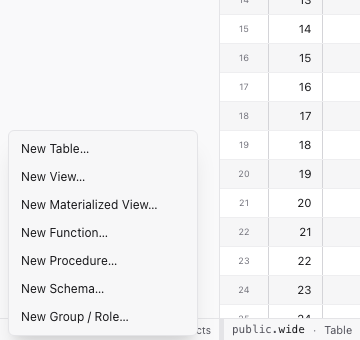
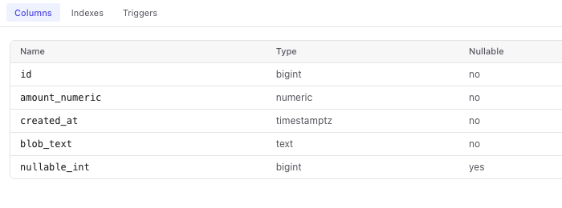

# Finalize — Slice 31: TablePlus interaction parity (context menus, sidebar, chrome)

Date: 2026-06-02 · Branch: `slice-31-tableplus-interactions` · Base: `main`

## Task

With real data flowing (`cartiq`), bring the interaction layer up to TablePlus:
rich right-click menus (table + row) with submenus, a sidebar `+` menu, Structure
sub-tabs, and confirm header tooltips. Driven autonomously.

## What shipped

### Foundational
- **ContextMenu submenus** — items can nest via `children`; the flyout opens on
  hover/click and flips left near the right edge.

### Pure logic (TDD)
- **`rowFormat`** — `plain` / `json` / `html` / `md` / `csv` / `csv-header` /
  `insert`. (`csv` is now values-only; `csv-header` adds the column line.) +8 tests.
- **`tableScript`** (new) — `buildTableScript` for `select` / `drop` / `truncate` /
  `create`, with `quoteIdent` escaping. +5 tests.

### Row context menu (data grid)
Refresh · Add row · Duplicate row · **Set value →** (Empty / NULL; DEFAULT
deferred) · Copy cell value · Copy all column values · **Copy row as →** (Plain /
JSON / HTML / Markdown / CSV / CSV with header / INSERT) · Quick filter by the
clicked cell · Copy DELETE statement. `DataGrid.onCellContext` now passes the full
row. Edge-state items (Set value, Copy DELETE) disable when the row isn't loaded
or the table has no PK.

### Table context menu (sidebar tree)
Open in new tab · Open structure · Item overview · Show in diagram (ERD) · Copy
name · Copy as `schema.table` · Pin to top · **Copy script as →**
(CREATE/SELECT/DROP/TRUNCATE — copies SQL, no execution) · **Export →** (CSV / JSON;
Import from CSV) · **New →** (Table / View / Materialized view / Function /
Procedure / Schema / Group) · New query · Clone / Truncate / Drop (open as a
reviewable query — never auto-execute on real data).

### Sidebar `+` + Structure + header
- Sidebar foot **`+`** → the same New-object menu.
- Structure view gains **Columns / Indexes / Triggers** sub-tabs (Columns live).
- Header icons already carry hover tooltips via `IconButton`/`ToolbarButton`
  (`title`), confirmed.

## Deferred (documented; menu entries are present but routed safely or disabled)
- Export **with column selection**, **Import from SQL** execution — disabled items.
- **Materialized view / Procedure** creation, **Schema / Group** — open a New
  Query with a template (no dedicated DDL backend).
- Structure **Indexes / Triggers** introspection — needs backend; tabs show a note.
- **DEFAULT** set-value, **row hard-delete** execution, **Quick Look** preview —
  not built (Copy DELETE statement provided instead of executing).
- Truncate / Drop **execute** — intentionally open as a query for review.

## Files
`ui/ContextMenu.tsx` (submenus) · `lib/rowFormat.ts` + test · `lib/tableScript.ts`
+ test · `components/DataGrid.tsx` (full row to context) · `components/TableView.tsx`
(row menu + Structure tabs) · `components/MainShell.tsx` (table menu + sidebar `+`).

## Verification — checked thoroughly
- `tsc --noEmit` clean. **146 vitest tests** pass (+13 new).
- Code review (1 agent): 3 findings, all fixed (edge-state guards + `quoteIdent`).
- `/browse` QA (mock workspace, zero console errors): row menu + "Copy row as"
  submenu, table menu + "Copy script as" submenu, sidebar `+` menu, Structure
  sub-tabs — all verified.

## Screenshots

## Per-stage cost
> Best-effort; this is the 3rd slice in one long session so window bucketing is
> skewed (the Brainstorm bucket absorbs most of the spend). Sanity-check `/cost`.

| Stage | Model | Input | Output | Cache read | Cache write | Cost (USD) |
|---|---|---|---|---|---|---|
| 1. Brainstorm (+impl) | opus | 105,754 | 704,427 | 268,142,119 | 2,140,989 | $496.78 |
| 8. QA | opus | 1,822 | 16,408 | 20,077,414 | 16,894 | $31.69 |
| 7. Review | opus | 1,360 | 9,679 | 13,447,084 | 17,348 | $21.24 |
| **Total** | | **~108.9k** | **~730.5k** | **~301.7M** | **~2.18M** | **~$550** |

## Gate
tsc + 146 tests green, review fixes applied, QA clean. **Clean → merging to main.**
