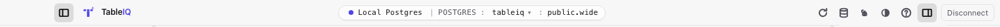
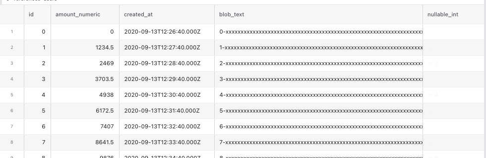
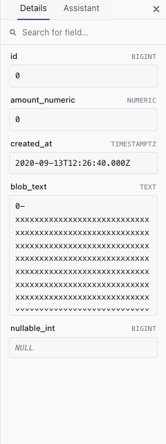
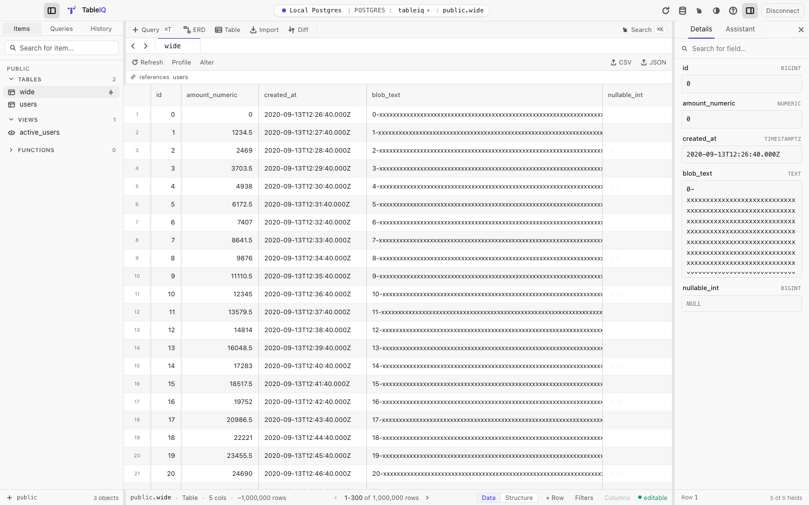

# Slice 32 — Cell-edit feedback, Inspector parity, grid chrome & header icons

**Branch:** `slice-32-edit-inspector`
**Date:** 2026-06-03
**Pipeline:** `/rudys-workflow` (autonomous build mode)

## Task-done summary

Four user-reported TablePlus-parity gaps, all closed:

| # | Request | Outcome |
|---|---------|---------|
| **pt1** | "edit is not working correctly… implementation gap" | **Fixed** the silent-revert bug: `getOriginal` now reads the optimistic overlay (latest value) instead of the stale window cache, so repeated edits send the correct `orig_value` and the optimistic-concurrency `UPDATE … IS NOT DISTINCT FROM $3` matches the row. |
| **pt1b** | highlight cell on edit, green on save, red on error, ⌘Z undo, ⌘S save | **Done.** Amber tint while the write is in flight → green on success (auto-clears 1.1 s) → red + revert on conflict (2 s). ⌘Z undoes the last edit, ⌘S re-syncs the visible page. New `editTints()` helper, unit-tested per theme. |
| **pt2** | Inspector row-detail "looks like a college student built it… replicate TablePlus" | **Redesigned.** Each field is a label + type pill over a bordered mono value box — click-to-copy, long values wrap in a scrollable box, NULL shown italic. |
| **pt3** | scrollbars overlap; header too short; bottom bar height off | **Fixed.** Header 30→38 px, rows 29→32 px, status bar 22→28 px. Grid is contained so its right edge (1200) clears the inspector (1213) and its bottom (872) meets the 28 px bottom bar — no overlap (geometry verified live). |
| **pt4** | header icon hover not visible; make bigger / better overlay | **Fixed.** 28 px hit targets (was ~20), icons size 16, hover overlay `bg-text/10` (reads in both themes), active `bg-text/12`. |

## Files changed

```
src-tauri/src/ssh/tunnel.rs       gated #[ignore] live apply_edit smoke test
src/components/DataGrid.tsx        edit save-state, ⌘Z/⌘S, overlay-aware originals, race/lifecycle guards
src/components/Inspector.tsx       TablePlus boxed field values + type pills
src/components/MainShell.tsx       header icons size 16
src/components/TableView.tsx       wire onSave → page refresh
src/components/ui/IconButton.tsx   bigger targets + visible hover/active overlay
src/index.css                      density tokens (header/row/statusbar heights)
src/lib/theme.ts / theme.test.ts   editTints() + tests
```

## Verification

- **Type-check:** `tsc --noEmit` — clean.
- **Frontend tests:** `vitest run` — **147 passed / 30 files**.
- **Rust:** `cargo check --tests` — clean (gated live edit test compiles, never run against prod).
- **Independent code review:** flagged 4 material bugs in the new edit path (stale `editState`/`undoStack` after source switch; uncleared save-state timers → setState-after-unmount; rapid double-edit race; ⌘Z/⌘S hijacking the cell editor). **All four fixed** in commit `5a5af42` (per-cell monotonic edit token, tracked+cancelled timers, full edit-state reset on source switch, focus-guarded shortcuts). NULL-restore via ⌘Z is documented out of scope (use the row context menu's "Set value → null").
- **Live UI:** dev server + gstack `/browse` (headless Chrome on the browser-mock build); screenshots below. Geometry probed via DOM (`data-grid-canvas` x220 w980 yb872; first `inspector-field` x1213) confirms no scrollbar/inspector overlap.

> **Edit correctness note:** the optimistic-concurrency UPDATE writes to the live DB, so it was **not** exercised against production (writes to prod are blocked). The fix is purely frontend (overlay-aware originals); the backend SQL was already correct. The happy-path tint renders against the browser mock (which returns `rowsAffected: 1`); the conflict path is covered by code review.

## Evidence

Header icon strip (size 16, 28 px targets, active inspector box at right):



Grid — taller 38 px header, 32 px zebra rows:



Inspector row-detail — boxed values + type pills (TablePlus parity):



Single bottom status bar (28 px), no horizontal-scrollbar overlap:


Full window (dark):



## Checked thoroughly

tsc clean, 147 unit tests green, Rust compiles, an independent review pass found and closed 4 lifecycle/race bugs, and the UI was verified live with geometry probes plus screenshots for all four sub-requests. **Soft gate: clean — proceeding to merge.**

## Per-stage cost (best-effort)

Stage markers were coarse for this continued/compacted session, so the table is a single aggregate window over the transcript (cache-heavy long session — treat the absolute figure as indicative, sanity-check against `/cost`).

| Stage | Model | Input | Output | Cache read | Cache write | Cost (USD) |
|---|---|---|---|---|---|---|
| Slice 32 (build → review → finalize) | opus, sonnet | 159,042 | 939,031 | 328,175,457 | 74,746,544 | ~$1960 (best-effort) |
