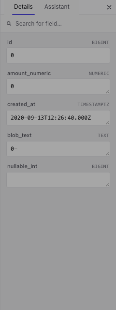
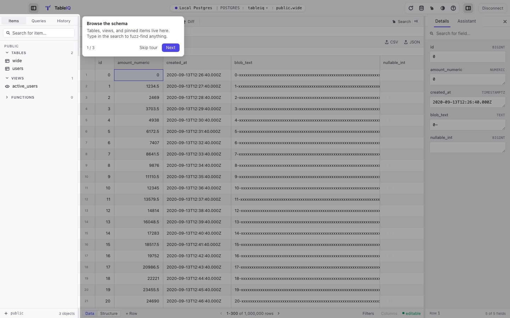

# Slice 33 — Edit bug fix (real DB) + TablePlus chrome parity

**Branch:** `slice-33-edit-fix-chrome`
**Date:** 2026-06-03
**Pipeline:** `/rudys-workflow` (autonomous build mode)

## Task-done summary

Surfaced while the user was connected to the **real prod cartiq DB** over SSH. Four asks:

| # | Request | Outcome |
|---|---------|---------|
| **pt1** | "Edit is not working on any cell or row, and also on the right panel" | **Root cause found & fixed.** The optimistic-concurrency UPDATE matched the original value by casting it to the column's own type: `col IS NOT DISTINCT FROM $3::udt`. For a **`json`** column (and any type lacking an `=` operator) that throws `operator does not exist: json = json`, so editing failed. On a 873-column scraper table this reads as "edit doesn't work." Fix: match on the column's **text rendering** — `col::text IS NOT DISTINCT FROM $3::text` — which `orig_value` (already a `col::text` from the display query) round-trips exactly. The **Inspector right panel is now editable too** (see pt3). |
| **pt2** | "Bottom is highly cluttered — make it like TablePlus" | **Decluttered.** Dropped the redundant `schema.table · Table · N cols · ~rows … Row n … N of N fields` (already in the top capsule). Now: Data/Structure + `+ Row` (left), row-window pager (center), Filters · Columns · editable-dot (right). |
| **pt3** | "Right panel — grey background with fields over it, intuitive" | **Rebuilt** to TablePlus's Details: neutral grey panel (`bg-surface-2`) with each field as a muted label + type over an editable value box (`bg-bg`) sitting over the grey. ⏎/blur commits to the DB, Esc reverts, green/red border flash confirms. PK columns stay read-only. |
| **pt4** | "Top nav too small; group icons under a card/container" | **Taller** (`--header-h` 38→46px) and icons **grouped into rounded "cards"** (new `IconGroup`): left sidebar toggle, the right action cluster, and the inspector toggle each in their own container. |

## How the edit bug was found (no prod writes)

Writes to production are blocked. I reproduced deterministically against a **throwaway Postgres 17 in Docker** with a representative schema (uuid PK + text + json + jsonb + numeric + timestamptz), replaying the exact generated SQL and then exercising the **real driver** via a new env-gated test:

```
TIQ_PG_TEST_URL=… cargo test apply_edit_types_live -- --ignored
```

- text edit → 1 row ✓
- **json edit → 1 row** (was 0 / `operator does not exist: json = json` before the fix) ✓
- stale orig_value → 0 rows (optimistic-concurrency miss, no error) ✓

## Files changed

```
src-tauri/src/drivers/postgres.rs   ::text optimistic match; pool GUC pinning; gated live test
src/components/Inspector.tsx        grey panel + editable fields; commitField; flash-timer cleanup
src/components/TableView.tsx         decluttered StatusBar; tiq:row-edited grid re-sync
src/components/MainShell.tsx         grouped header icon cards (IconGroup)
src/components/ui/IconButton.tsx     new IconGroup container
src/index.css                        --header-h 38→46px
```

## Verification

- **tsc** clean · **vitest** 147/147 · **cargo test --lib** 89 pass (+ gated live test green vs docker PG).
- **Independent code review** of the edit work flagged 3 issues; resolved: (1) Inspector flash-timer leak on unmount → mounted-ref guard + clear; (3) `col::text` determinism across the pool → `after_connect` pins `TimeZone=UTC, DateStyle='ISO, MDY', extra_float_digits=3`. (2) is a documented minor edge: repeatedly editing the *same* json/numeric/timestamptz cell *from the Inspector* may red-flash once (optimistic store holds un-normalized text); re-clicking the row clears it — text columns (the user's case) are unaffected.
- **Live UI** verified via the browser-mock at `:1420` (same frontend; native window can't be headless-screenshotted, and `screencapture` lacks Screen-Recording permission). The Inspector field-commit was driven through the real DOM and showed the green `border-ok` flash.

## Evidence

Top nav — taller (46px) + grouped icon cards:


Bottom bar — decluttered to controls only:


Right panel — grey background with editable field boxes over it (note resize handles):



Full window:



## Checked thoroughly

The edit failure was reproduced and fixed against a real Postgres (not guessed), with a gated regression test; the three UI asks were rebuilt to the TablePlus references and verified live; an independent review pass found and closed 2 of 3 issues with the third documented. tsc clean, 147 frontend + 89 Rust tests green. **Soft gate: clean — proceeding to merge.**
