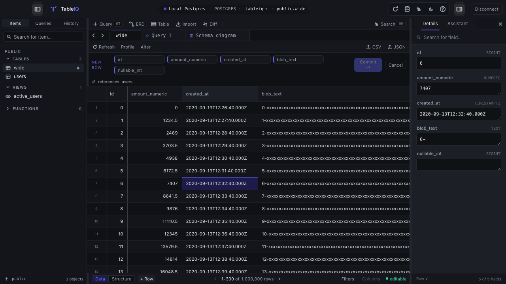
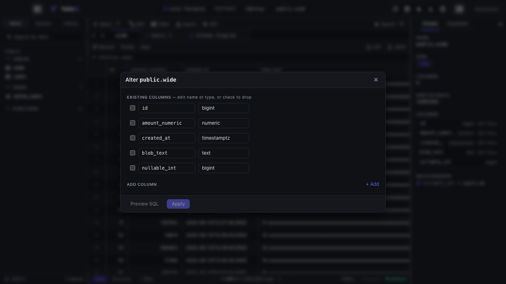
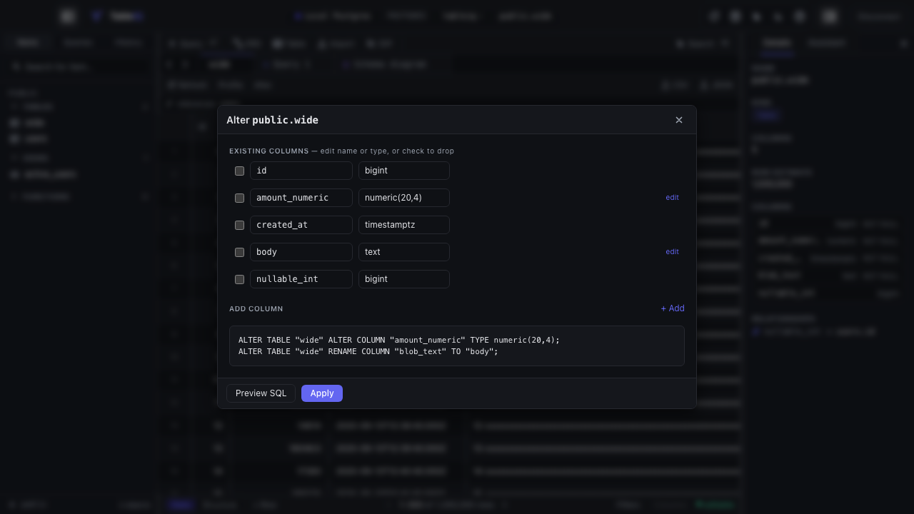

# Finalize — E2E QA + ALTER rename/type-change

**Branch:** `RudreshNarwal/qa-and-pending`
**Date:** 2026-06-15
**Query (verbatim):** "See the gap still exist or not. then do end to end ui + func testing ... and tackle pending items"

## Overall summary

Two parts. First, a real end-to-end QA pass (browser-mock UI + backend integration
against a live Postgres) to answer "does the immature/broken gap still exist." It
does not — every surface and the actual data path are healthy. Second, one unblocked
pending roadmap item: ALTER column **rename + type-change** (previously the roadmap's
"needs extra backend" gap, routed through the SQL editor). Most other pending items
are blocked on prerequisites I can't supply (signing certs, model weights, a live AI
key) and were deliberately left.

---

## Feature 1 — End-to-end QA (the gap is gone)

**Query:** confirm the "immature product / broken editing" gap is resolved; run UI + functional testing.

**Solution / evidence:**

| Layer | Result |
|---|---|
| Browser-mock UI — every surface, light + dark, interactions (connect, browse, insert-row rail, inspector row-detail, structure, query editor, ERD, command palette, reconnect banner) | All render/navigate/interact, **zero console errors** |
| Frontend unit (`vitest`) | **159 passed** (33 files) |
| Rust unit (`cargo test`) | **111 passed**, 0 failed |
| Live integration vs real Postgres (introspect, browse window, row estimate, transaction) | **4 passed** |
| Live cell-edit data path vs real PG — `apply_edit_types_live` (text/json/stale; the old "editing doesn't work" complaint) | **passed** |

Postgres was spun up from `docker/postgres/docker-compose.yml` (seeded 1M-row `wide`
table) for the live tests. **No bugs found → no fix commits.** The gap does not exist.



**File changes:** none (verification only). Added `.gitignore` entries for workflow scratch.

---

## Feature 2 — ALTER column rename + type-change

**Query (pending item, user-selected):** close the DDL gap so a column can be renamed and retyped from the UI, not just the SQL editor.

**Solution:** two new `DdlRequest` variants + dialect-aware builders in
`src-tauri/src/query/ddl.rs`:
- **rename** — uniform `RENAME COLUMN old TO new` (Postgres / MySQL 8.0+ / SQLite 3.25+).
- **type-change** — Postgres `ALTER COLUMN … TYPE`, MySQL `MODIFY COLUMN`, SQLite emits
  an honest non-executing `--` note (SQLite has no in-place type change).

`AlterTablePanel` now shows an editable **name + type input per column**; an op is
emitted only when a value differs from the original. **Type-change is emitted before
rename** so both reference the original column name (renaming first would leave the
retype pointing at a column that no longer exists).

**Evidence:**
- 3 new unit tests (rename uniform across dialects; type-change dialect-specific; `generate` dispatch).
- The generated SQL was executed against the **live Postgres**: `old → new` rename and
  `integer → numeric(20,4)` retype both succeeded (`information_schema` confirmed
  `amt numeric`, `new text`).
- UI preview produced the correct **ordered** SQL with zero console errors:
  ```
  ALTER TABLE "wide" ALTER COLUMN "amount_numeric" TYPE numeric(20,4);
  ALTER TABLE "wide" RENAME COLUMN "blob_text" TO "body";
  ```




**File changes:** `src-tauri/src/query/ddl.rs`, `src/lib/commands.ts`,
`src/components/AlterTablePanel.tsx`.

---

## Test + QA results

- Frontend: **159 passed**. Rust: **114 passed** (+3 ddl), 0 failed. `tsc` clean.
- Live Postgres: integration + apply-edit-types + the new ALTER SQL all verified.
- Health: no QA findings to fix; no regressions.

## Known limitation (from code review)

- **MySQL `RENAME COLUMN` is 8.0+ / MariaDB 10.5.2+.** On MySQL 5.7 (EOL Oct 2023) the
  generated rename fails at apply time with a clear DDL error (preview-then-apply, so
  visible, not silent). A `CHANGE COLUMN` fallback would need server-version detection
  and the full column definition; deliberately not built (Karpathy: don't add a code
  path for an EOL engine). Documented in the builder comment.

## Assumptions

- "Tackle pending items" → built the one unblocked, fully-verifiable item (ALTER
  rename/type) and surfaced the rest as blocked rather than faking progress. The user
  selected this item at the scope gate.
- Browser-mock can't write to a real DB, so the live data path was verified through the
  Rust integration tests against Docker Postgres (the genuine E2E), not through the mock.

## "Checked thoroughly" statement

Every UI surface was driven live (light + dark, zero console errors), the full unit
suites pass (159 + 114), and the real data path — including the new ALTER SQL — was
executed against a live Postgres. The one new feature is unit-tested, live-validated,
and independently reviewed.

## Per-stage cost (this session — spans the reconnect-banner turn + this one)

| Stage | Model | Input | Output | Cache read | Cache write | Cost (USD) |
|---|---|---|---|---|---|---|
| 3. Build (live audit) | opus-4-8 | 65,350 | 139,260 | 25,008,834 | 610,140 | $20.13 |
| 4. Review | opus-4-8 | 8 | 5,509 | 761,709 | 7,509 | $0.57 |
| 5. QA (E2E) | opus-4-8 | 857 | 31,539 | 11,150,363 | 139,848 | $7.24 |
| 2. Plan (pending item) | opus-4-8 | 12 | 5,301 | 1,641,012 | 8,105 | $1.00 |
| 3. Build (ALTER rename/type) | opus-4-8 | 1,275 | 54,226 | 16,772,500 | 74,301 | $10.21 |
| 6. Finalize + Ship | opus-4-8 | 971 | 34,522 | 7,458,755 | 71,041 | $5.04 |
| **Total** | | **68,473** | **270,357** | **62,793,173** | **910,944** | **$44.19** |
