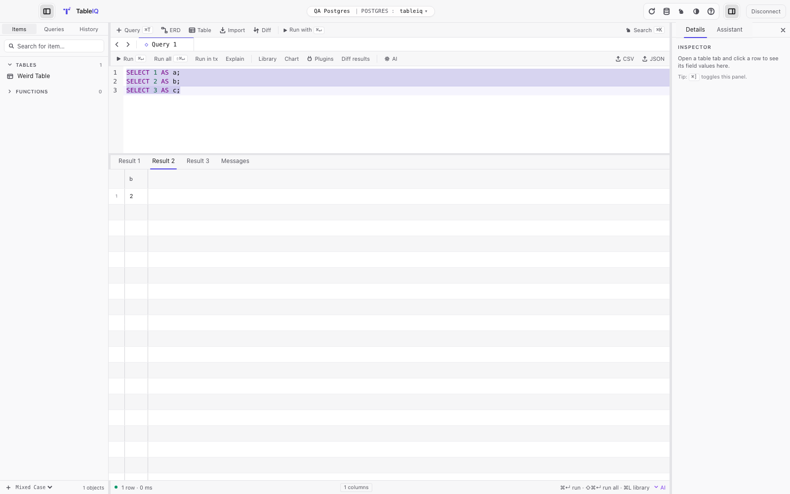
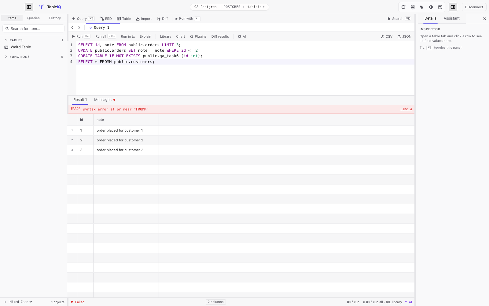
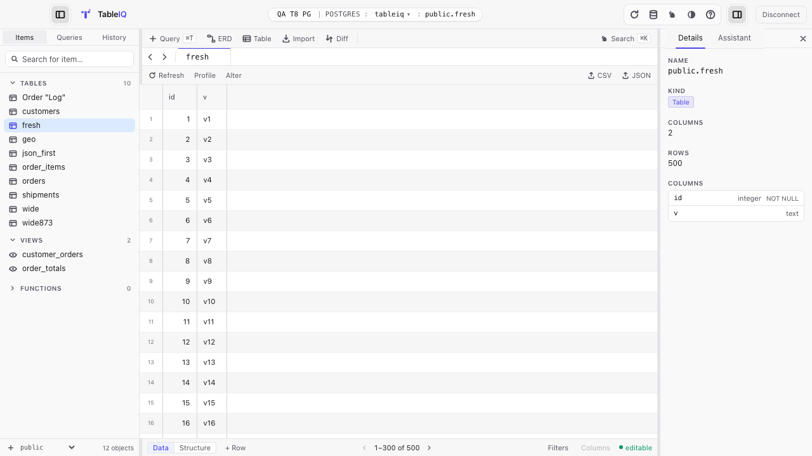
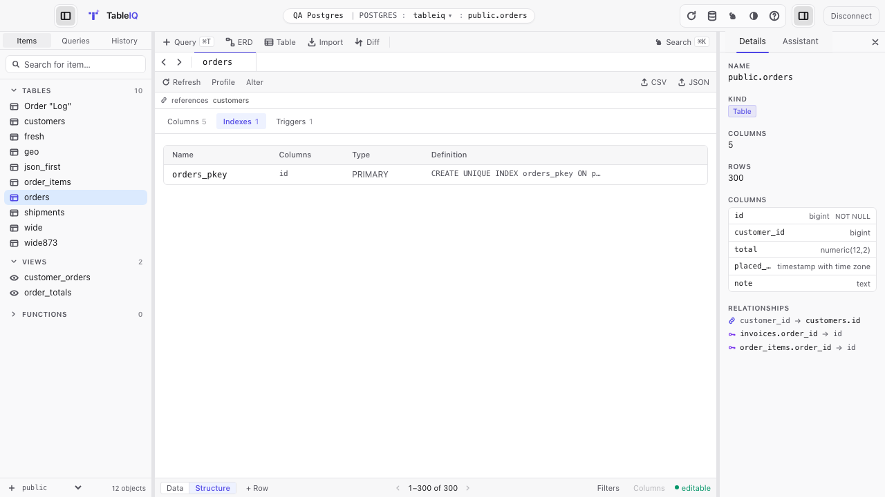
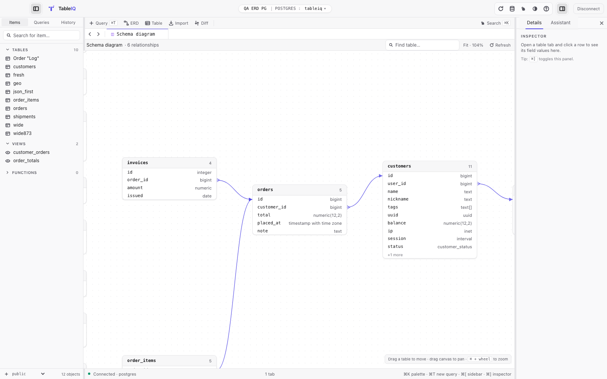
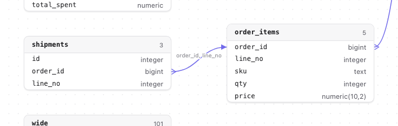
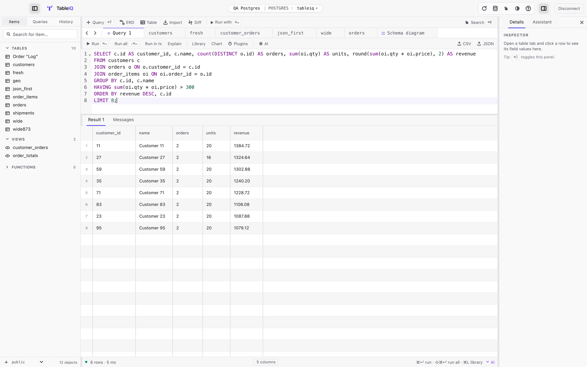

# Finalize — production readiness: Query tab, table loading, ERD arrows, and hardening

**Branch:** `RudreshNarwal/fix-sql-tab-and-ddl-arrows` → `main`
**Dates:** 2026-09-22 → 2026-09-24
**Scope:** 70 commits, 170 files, +11,452 / −6,449

## Query (original requirement, verbatim)

> Still SQL Query tab is not working fine as per Tableplus .. and table loading and column loading is not propper ..... also ddl disgram arrows are not proppper run the application test the gaps ... run a certain query on the database and res ... but please make it prod ready .. apart from this there are mutiple things that are required to produyctionise this apps please fix

---

## Why the previous round missed all of this

The last QA pass on this project reported "no gaps" and found nothing. It only ever exercised the **browser mock**, which ignores the SQL it is given, never returns an error, and serves the same synthetic rows for every table. Three independent code audits plus a live baseline capture found P0 bugs that only appear against a real database.

So the first thing built here was a way to test the real thing: a dev-only **IPC bridge** (a cargo `example`, so it can never ship) that serves the real Rust commands over localhost HTTP. The real React UI then runs in a normal browser against real Postgres, MySQL 8.4 and SQL Server. Every fix below was verified through that path, not through a mock.

**It earned its keep immediately.** The final QA pass found that **no cell in the application could be edited, on any engine** — glide-data-grid portals its cell editor through a `
` that `index.html` never mounted. Everything around it was correct, which is exactly why code review never caught it. One missing line, invisible to every unit test and to the mock.

---

## 1. "SQL Query tab is not working fine as per TablePlus"

**Root causes found:**
- **⌘↵ did not run anything.** CodeMirror's `basicSetup` binds `Mod-Enter` to `insertBlankLine`, and the editor's own keymap was registered after it, so the earlier binding won. ⌘↵ inserted a blank line, and the window-level fallback bailed because the event was already handled.
- **Postgres and MySQL wrapped every statement** in `SELECT * FROM (<your sql>) AS _q`. Anything ending in `;` failed, and so did every INSERT, UPDATE, DELETE, DDL, SHOW and multi-statement script. The baseline capture shows `SELECT 1;` returning `syntax error at or near ";"`.
- **SQLite skipped writes entirely** — it inspected the statement, saw no result columns, and returned success without executing it.
- All query tabs shared one editor instance, so tabs lost their SQL.

**Now:** statements execute as written on a pinned connection. ⌘↵ runs the selection or the statement under the cursor; ⇧⌘↵ runs all. Each statement gets its own result tab, plus a Messages list with rows-affected and timings. Errors appear inline with a **document-relative** line number that jumps the caret when clicked (MySQL reports statement-relative lines; the UI rebases them). Execution stops at the first failure. A run that opens a transaction without committing is rolled back and says so. Cancel works on Postgres and MySQL. SQL persists per tab across tab switches and reloads.

Also fixed along the way: duplicate column names in a join (`id`, `id (2)`) no longer show the wrong values; NULL is visually distinct from an empty string; binary values render as hex instead of panicking.

## 2. "Table loading and column loading is not proper"

**Root causes found:**
- **Row counts came from database statistics.** Postgres reports `reltuples = -1` for a table that was never analyzed and for every view; the code clamped that to 0, and the grid only fetched when the count was above zero. A 500-row table and every view rendered **empty**.
- **Every page used `ORDER BY 1`**, which errors outright when the first column is `json`, re-sorts the whole table per page, and pages unstably when column 1 is not unique.
- **Page errors were swallowed** and the failure was not cached, so every repaint — including mouse hover — re-issued the failed query. Moving the mouse over a broken table flooded the database.
- **One `TableView` instance was shared by all table tabs**, so a filter leaked into the next table and the error screen offered no way to clear it. The user got stuck.
- Postgres filters and inserts bound every value as text, so a filter on a bigint raised `operator does not exist: bigint = text`.
- MySQL 8 introspection **panicked outright** (uppercase, VARBINARY `information_schema` columns).
- Sidebar "Refresh" was a no-op; the default schema was whichever sorted first alphabetically; the open table was never highlighted.

**Now:** real 300-row pages with a working pager, ordered by primary key (or explicitly unordered when there is none), header-click sort, exact counts with a timeout and an honest "approximate" fallback, typed binds, per-tab isolation, an error view you can leave, and a Refresh that refreshes. Structure gained real **Columns, Indexes and Triggers** per engine — they were placeholders with no backend at all.

## 3. "DDL diagram arrows are not proper"

**Root cause:** edges were measured with `getBoundingClientRect()` — screen coordinates that already include pan and zoom — and then drawn *inside* the `translate(pan) scale(scale)` layer. The transform was applied twice, so an arrow sat at `pan*(1+scale) + scale²*x` while its card sat at `pan + scale*x`. An 80 ms CSS transition made the measurements stale on top of that. Separately, the Postgres FK query cross-multiplied composite keys (a 2-column key produced 4 edges, 2 of them wrong pairings) and dropped cross-schema keys; SQLite returned an empty target column for implicit references.

**Now:** geometry is computed purely in layout coordinates — arrow endpoints were measured at **0.00 px error** against the referenced row at every zoom, after panning and after dragging a card. One edge per constraint, self-references drawn as loops, composite and cross-schema foreign keys correct.

## 4. "Run a certain query on the database and see the result"

A join with aggregation over `orders` / `order_items` / `customers` was run in the app and the same query run through `psql` in the container. The numbers match exactly.

 (ground truth: `assets/prod-ready/qa-verified-aggregation-psql.txt`)

## 5. Production hardening

| Area | Before | Now |
|---|---|---|
| SSH bastion | accepted **any** host key — anyone on the path could intercept the password and all traffic | keys pinned by material against `~/.ssh/known_hosts` then the app's own store; a changed key is a hard refusal naming both fingerprints; unknown hosts trusted on first use and logged |
| SQL Server | connected in **cleartext**, password concatenated into a connection string | `tiberius::Config` built in code, `sslmode` mapped to a real encryption level, 15 s connect timeout |
| Crash safety | ~50 panicking row reads and 46 `lock().unwrap()`; a panicking command never answers, so the UI hangs | zero of either outside tests; poison-safe locking |
| Saved connections | non-atomic write + `unwrap_or_default()` — a truncated file silently emptied it and the next save wiped every connection | atomic write; a file that will not parse is quarantined, never overwritten |
| CSV import | MySQL escaping missed backslashes — an injection | dialect-aware escaping, tested with a real payload |
| WASM plugins | WASI on, no limits, plugin id joined onto a path | WASI off, 64 MiB / 10 s caps, path traversal rejected |
| Web surface | `"csp": null` | a real CSP; error boundary; an app log with a panic hook; failures surface instead of being swallowed |
| CI | ran only on tags | typecheck, tests, clippy and a build on every pull request, against seeded Postgres and MySQL services |

**Four blocking defects were caught by the final whole-branch reviews and fixed**, each reproduced before being fixed:
1. **The SSH host-key pin could be bypassed** by an attacker offering a *different key algorithm* — `check_known_hosts_path` only reports a mismatch when the algorithm name matches, so a different one read as "not recorded" and the app trusted it. Reproduced, then fixed by comparing key material.
2. **SQLite could mass-delete.** SQLite permits many NULLs in a non-INTEGER primary key, and null-safe matching degraded to `pk IS NULL` — one "Delete row" click removed **2 rows** in the reproduction. `apply_edit` was also missing the empty-PK guard in all four drivers.
3. **SQL Server left an uncommitted transaction open** on its single shared connection, silently enrolling every later edit and losing the work on disconnect.
4. **A batch commit could write to the wrong row** if a sort or page change landed mid-commit.

---

## Test and QA results

| Gate | Result |
|---|---|
| `cargo test` (live Postgres + MySQL 8.4 + SQL Server) | **204 passed, 0 failed** |
| `pnpm exec vitest run` | **282 passed** (41 → 42 files; 159 at branch start) |
| `pnpm exec tsc --noEmit` | clean |
| `pnpm exec vite build` | succeeds |
| `cargo clippy --all-targets -- -D warnings` | clean |
| `pnpm tauri build --debug` | succeeds |
| QA pass (real UI → real Rust → real DBs) | **45 checks: 42 passed as found, 3 bugs found → all 3 fixed and re-verified** |

QA bugs: cell editing impossible (missing portal div); an ERD composite label obscured by its own connector; SQL Server tests deadlocking against each other in `master`. Console errors across the whole session: none beyond the two deliberately induced failures.

**Review depth:** every task got an independent spec+quality review, then three adversarial whole-branch reviews (drivers, app/security, frontend) on the most capable model, then a scoped re-review of the fix wave confirming all nine fixes closed their holes rather than just their reproductions.

---

## Needs a human before release

1. **Click Export CSV once in the packaged app.** The native Save dialog path could not be exercised here — macOS denies this process assistive access. `write_text_file` was verified end to end through the real dispatch, but nobody has clicked the dialog.
2. **Open the SQL editor and a grid in a packaged build and check the console.** The CSP was verified on the connection screen only; CodeMirror and glide-data-grid are the reason for the `style-src` exception. Violations are wired to the app log.
3. **Choose a LICENSE.** Deliberately not picked.

## Deferred, with reasons

- **Auto-updater** — needs a signing keypair and a release endpoint (your decision). **Code signing** — needs Apple/Windows certificates.
- **SQL Server cancellation** — tiberius exposes no cancel API.
- **Per-tab database sessions** (an open transaction or `SET` surviving between runs) — a design change, not a bug fix.
- **`cursor_bounded_ram`** (the bounded-memory proof) is gated out of CI because it needs the 1M-row seed; worth a nightly job.
- Table tabs deliberately reset filter and sort on switch; result *sets* do not survive a page reload (only the SQL does) — TablePlus behaves the same.
- Low-severity residuals from the last re-review: a misplaced doc comment; a T-SQL `BEGIN TRY` read as an open transaction, producing a harmless extra notice; one dead function (`extractRunTarget`).

## Assumptions made during the run

- Paging follows TablePlus's model (300-row pages with a pager) rather than infinite scroll, since "as per TablePlus" was the stated bar.
- `SELECT 1;` returning an error was treated as a defect, not as an intentional restriction.
- QA ran against local seeded containers, never against any production database. Throwaway connection ids and a separate config directory were used throughout, and all were deleted afterwards.
- SQL Server was verified against `mcr.microsoft.com/mssql/server:2022-latest` under Rosetta; `azure-sql-edge` crashes on this machine.

## "Checked thoroughly" statement

Every claim above is backed by something runnable: 204 Rust tests against three live database engines, 282 frontend tests, 68 screenshots taken from the real UI driving the real backend, and a pre-fix baseline capture showing each headline bug failing before it was fixed. The three bugs the QA pass found were each reproduced, root-caused, fixed and re-verified in the running app — one of them (cell editing) had survived a full code review precisely because no test could see it.

## Per-stage cost

| Stage | Model | Input | Output | Cache read | Cache write | Cost (USD) |
|---|---|---|---|---|---|---|
| 3. Build (13 tasks + reviews + fix waves) | opus | 666 | 271,187 | 110,799,433 | 7,019,509 | $318.16 |
| 5. QA | opus | 18 | 7,714 | 4,957,690 | 21,838 | $8.42 |
| 6. Finalize | opus | 12 | 1,865 | 3,356,861 | 9,946 | $5.36 |
| **Total** | | **696** | **280,766** | **119,113,984** | **7,051,293** | **$331.95** |
