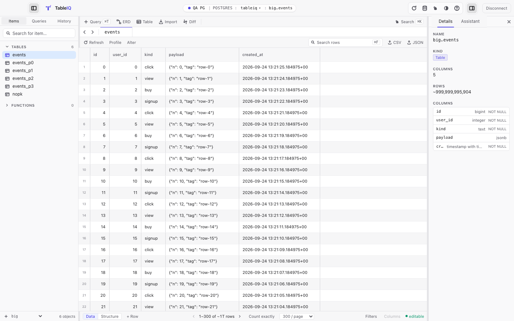
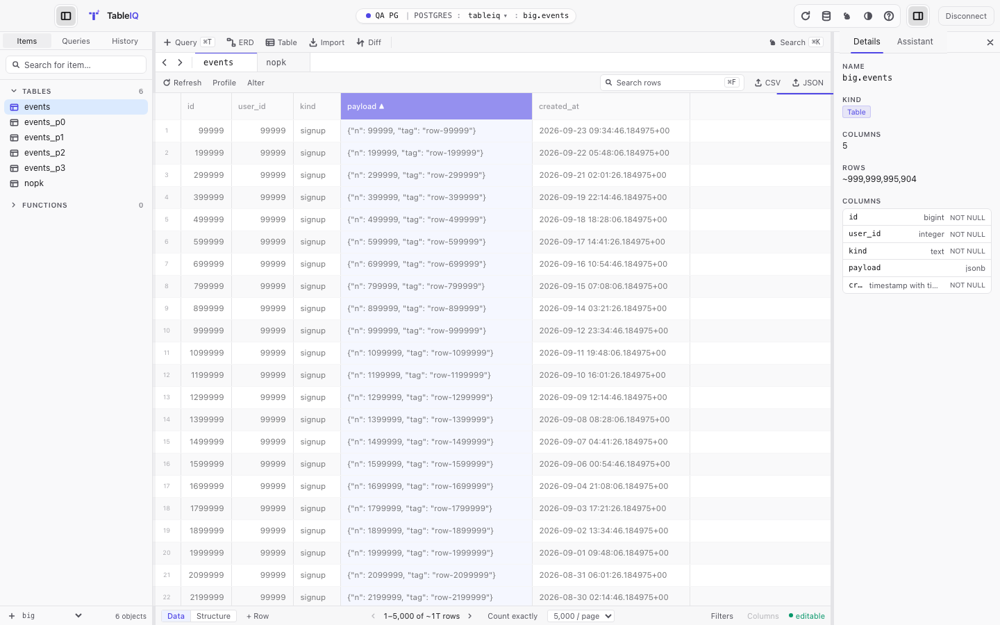
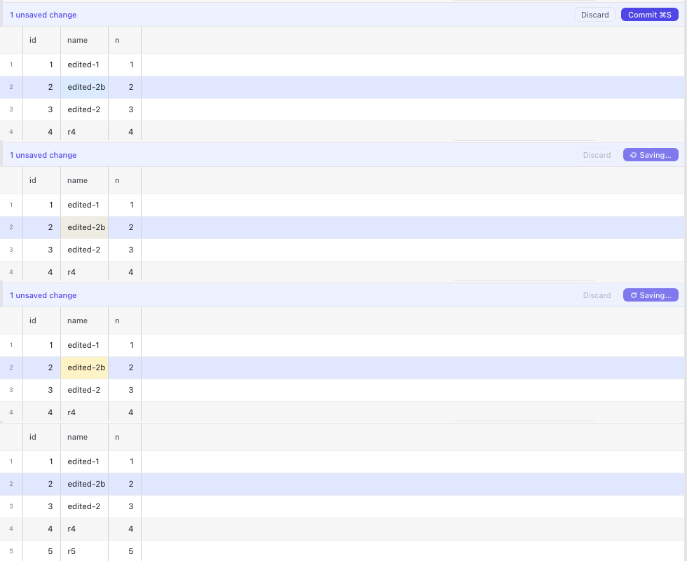
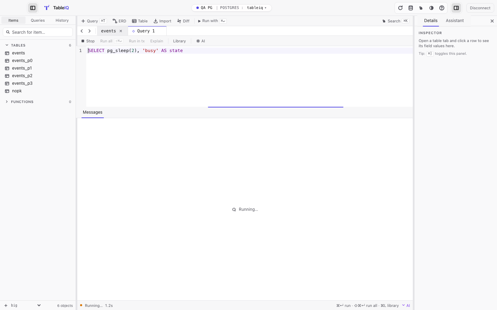
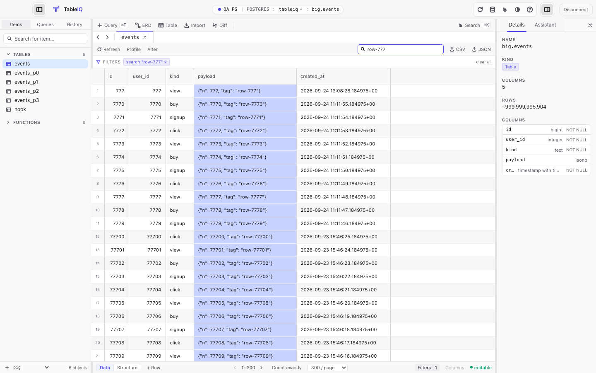
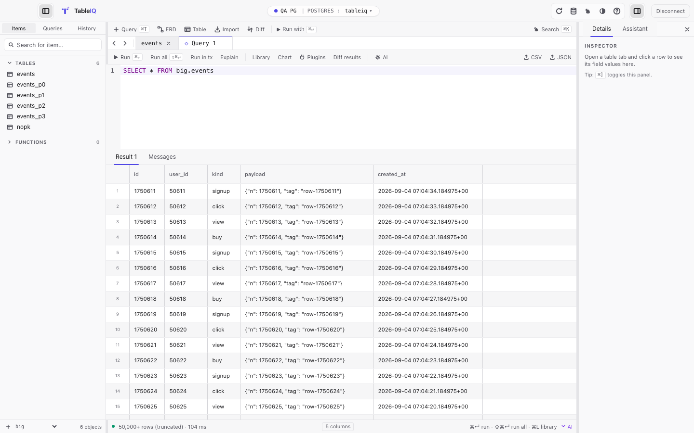
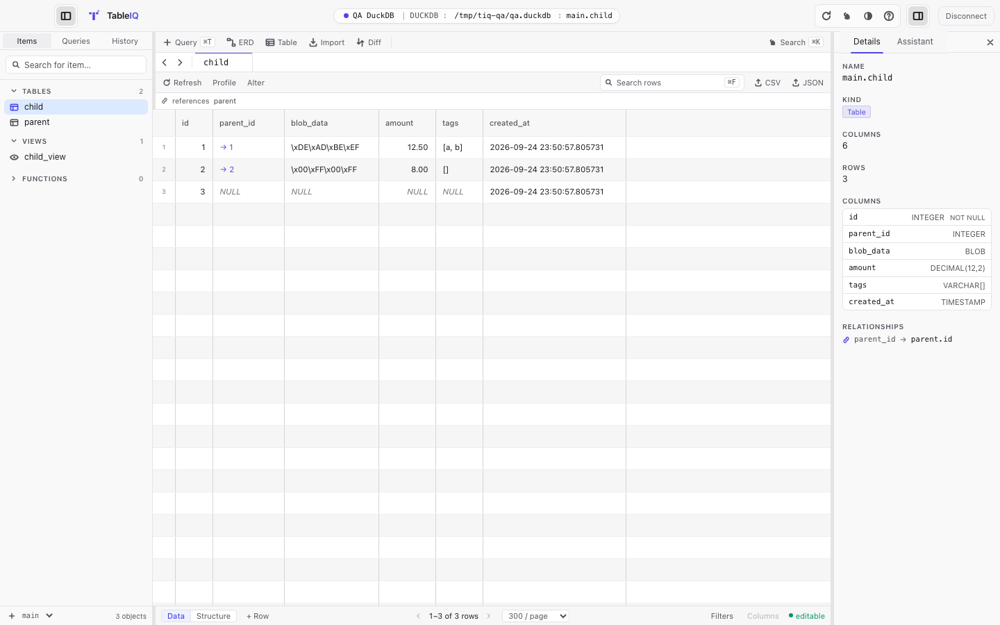
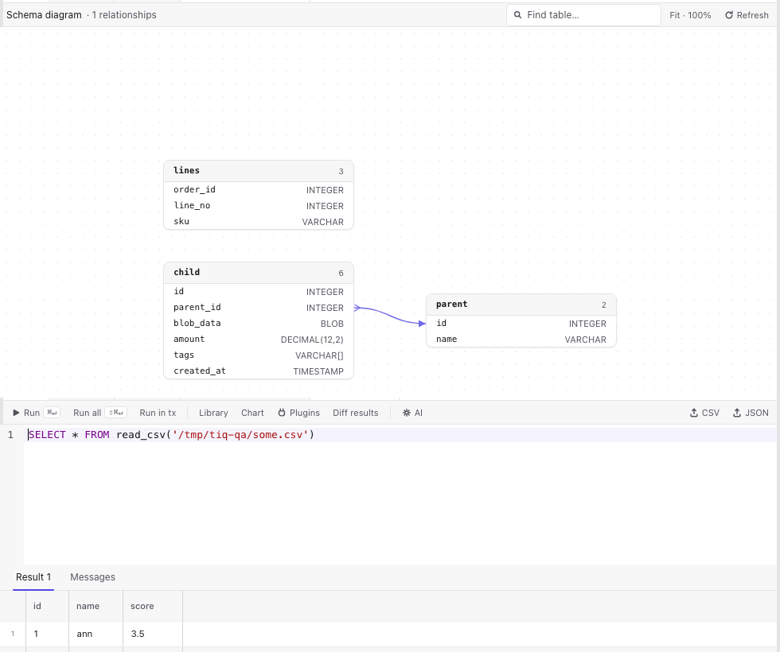

# Finalize: table UX, trillion-row speed, DuckDB

Branch `RudreshNarwal/table-ux-and-duckdb`, compared with `main` (`e0b040d`).
Plan: `docs/superpowers/plans/2026-09-24-table-ux-duckdb.md`.

## What the user asked for
1. Improve the table UX:
   - cell-edit transitions
   - search
   - larger data
   - a table loader, which was missing
2. Add DuckDB.
3. Check every transition (SQL execution, cell edit, table edit, save after edit) and improve it following UX best practice.
4. Show the total row count. The app must feel fast with no lag, even on trillions of rows. A Postgres table with 1T+ rows must load normally.
5. Run the desktop app at the end.

## What shipped
- **Trillion-row Postgres:** opening or paging a table never scans it.
  - **Row count:** an instant catalog estimate. For partitioned tables it sums the partitions; tables that were never analyzed are sized from their pages. `COUNT(*)` is skipped above 10M rows, and a cancellable "Count exactly" button replaces it.
  - **Deep pages:** keyset paging on the primary key. Tables without a primary key page by `ctid` via a TID range scan starting at block 0 (Postgres 14+).
  - **Less catalog traffic:** per-table metadata is cached.
  - **Tagged, bounded fetches:** every page fetch is tagged and bounded (15s filtered, 30s otherwise). A newer request for the same tab cancels the older one, the cancel runs on its own connection, and it matches by tag so it can't hit an unrelated query.
- **Query tab:** a read-only statement stops reading at the 50k cap. `SELECT * FROM big.events` (1T estimated) returns in 140 ms and shows "50,000+ rows (truncated)".
- **Search (⌘F):** searches every column on the server.
  - **Input handling:** debounced, Enter applies at once, Esc clears.
  - **Display:** a chip, and matching cells are highlighted.
  - **Bounds:** each search is bounded and cancellable. The escape character is `!`, which works on every engine.
- **Larger data:**
  - page size 100 / 300 / 1000 / 5000
  - row numbers continue across pages
  - total row count in the pager ("1–300 of ~1T rows")
- **Loader and transitions:** motion tokens, with every animation off under reduced-motion. Specifically:
  - a 150 ms-delayed progress bar and a dimmed (still interactive) stale grid
  - cell edits go staged, then a pulsing "saving", then a fading "saved"; errors stay
  - the unsaved-changes bar slides in, then "Saving…", then "Saved n changes"
  - deleted rows fade and inserted rows flash
  - Query tab: busy bar, live "Running… 1.2s", results fade in
  - panels open and close, and Apply shows a pending state
- **Edit safety:** while edits are staged, search, paging, page size, sort and filter are refused with "Commit or discard changes first".
- **DuckDB engine:** works with a `.duckdb` file or `:memory:`. Browse, sort, filter, search, keyset paging, edit, insert, delete, Structure, ERD and the Query tab (including `read_csv`) all work.
- **Engine wiring:** `is_file_engine` covers SQLite and DuckDB. An unknown engine now errors instead of silently opening Postgres.
- **Pre-existing bugs QA found and fixed:**
  - "+ Row" failed on serial/identity PKs.
  - The Structure tab went stale after Alter.
  - Alter could apply a stale preview or run twice.
  - Switch-database controls did nothing on file engines.
  - FK cells were almost invisible.

## Performance (Postgres fixture `docker/postgres/big.sql`: 20M real rows, stats faked to ~1T)
Measured through the real backend (IPC bridge, debug build), warm:

| Action | Budget | Measured |
|---|---|---|
| Row estimate | < 50 ms | 6 ms |
| Open + row count | < 300 ms | 1.5 ms (IPC); 32–88 ms click to rows painted |
| Page 1 | < 300 ms | 2.4 ms |
| Page at row 15M, keyset | < 200 ms | 2.3 ms |
| Page at row 15M, old OFFSET path | (for comparison) | 2,308 ms |
| Next at 5000/page, deep (UI) | < 200 ms | 28–39 ms |
| No-PK deep page (ctid) | < 200 ms | 4 ms |
| Exact count of 20M (on request) | — | 735 ms, cancellable |
| Typing a search | no freeze | 0 long tasks, 1 debounced request |

## Tests and QA
- Rust: `cargo test --locked` passed 292, failed 0, against live Postgres 16, MySQL 8.4 and SQL Server. `cargo clippy --all-targets -D warnings` is clean.
- Frontend: `vitest run` passed 362, 46 files. `tsc --noEmit` is clean; `vite build` passes.
- Browser QA through the IPC bridge against real PG, MySQL, SQLite and DuckDB, never the mock. Health went from ~82 to ~95. Every key flow was checked with `browse network` (all expected invokes returned 2xx) and `browse console --errors`. QA found 8 bugs and fixed all 8.
- Code review ran in two parts, backend and frontend. It found:
  - Backend: 1 critical (no-PK first page could start mid-table), 6 important, 5 minor. All fixed with regression tests.
  - Frontend: 4 important, 9 minor. All fixed.
- The desktop app was launched with `pnpm tauri dev` on the final commit. It built and ran with no errors in the log.

### Evidence
| | |
|---|---|
|  |  |
|  |  |
|  |  |
|  |  |

All 29 screenshots are in `assets/table-ux-and-duckdb/`.

## Assumptions and rulings
- **Scope:** autonomous mode, so the recommended option was taken wherever there was a choice:
  - DuckDB as a full engine plus `:memory:`.
  - Paged grid (not infinite scroll) with a page-size choice.
  - Server-side all-column search.
- **Desktop screenshots:** not possible, because macOS denies this process Screen Recording. The transitions were verified in the same UI through the bridge (same canvas and CSS); the desktop app itself was launched and runs.
- **Wide cells are not truncated:** a truncated value in an editable grid could be written back.
- **DuckDB crate is pinned to 1.2.2:** newer versions need arrow ≥ 55 and we're on 53. Consequences:
  - no query cancel on DuckDB
  - query results are built fully in memory before the cap applies
  - DuckDB files with newer storage versions may not open
- **Search timeouts:** an all-column search with no matches on a huge table times out at 15s, with a clear message. That's inherent to an unindexed contains-search.
- **Keyset fallback:** keyset runs only for primary-key types whose text form round-trips exactly (per-engine allow-list). Other types fall back to OFFSET, which is correct but slow at depth.

## Deferred
- An arrow upgrade (53 → 55+) to unlock a current DuckDB, DuckDB cancel and streaming.
- Insert row, delete row, "Set value" and saves from the Inspector still refresh and drop other staged edits.
- Query-result numbers are left-aligned (pre-existing polish).
- In dev, one "Query cancelled" 400 shows per open. React StrictMode runs effects twice in dev; it doesn't happen in a production build.

## Cost (best-effort, from session transcripts)
| Stage | Input | Output | Cache read | Cache write | Cost (USD) |
|---|---|---|---|---|---|
| 2. Plan | 106 | 53,261 | 8,494,527 | 2,388,246 | $61.52 |
| 3. Build | 102 | 38,900 | 4,538,631 | 76,833 | $11.17 |
| 4. Review | 138 | 62,538 | 9,762,702 | 402,130 | $26.88 |
| 5. QA | 30 | 11,489 | 2,925,503 | 18,479 | $5.60 |
| 6. Finalize | 6 | 1,752 | 602,001 | 1,785 | $1.07 |
| **Total** | | | | | **$106.23** |

This covers the coordinating session. Subagent transcripts may be under-counted, so check it against `/cost`.

**Checked thoroughly:** every item above is backed by live-database tests, a two-part code review with every finding fixed, and real-backend browser QA with network and console checks and screenshots. The performance numbers were measured on a fixture whose stats describe a trillion-row table.
