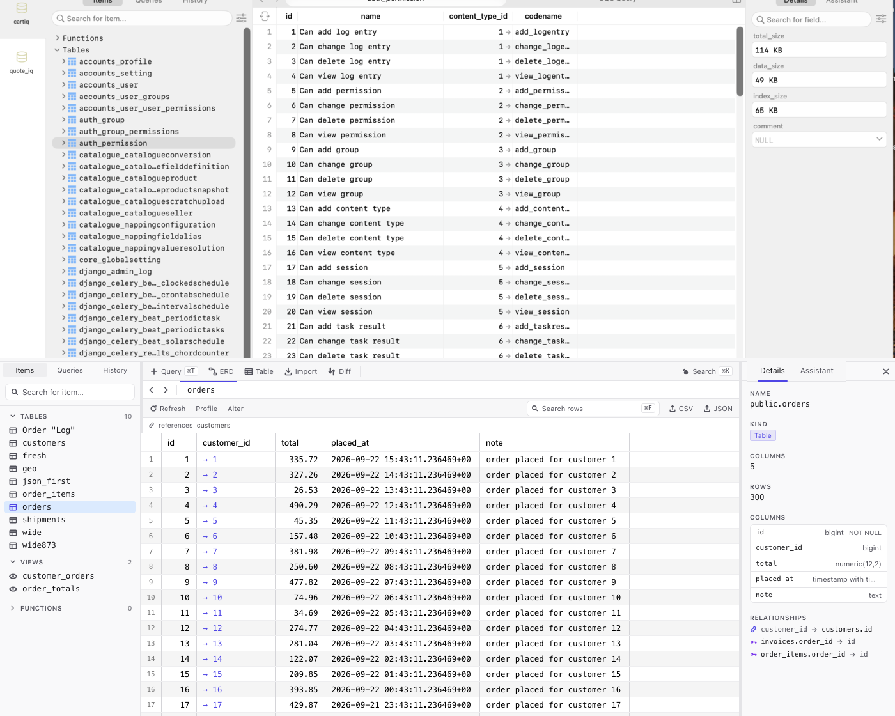
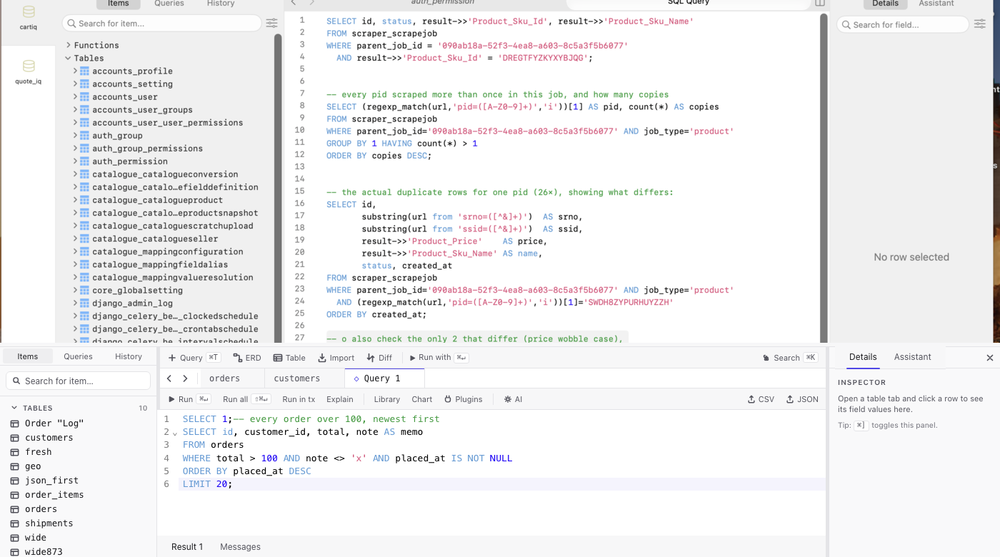
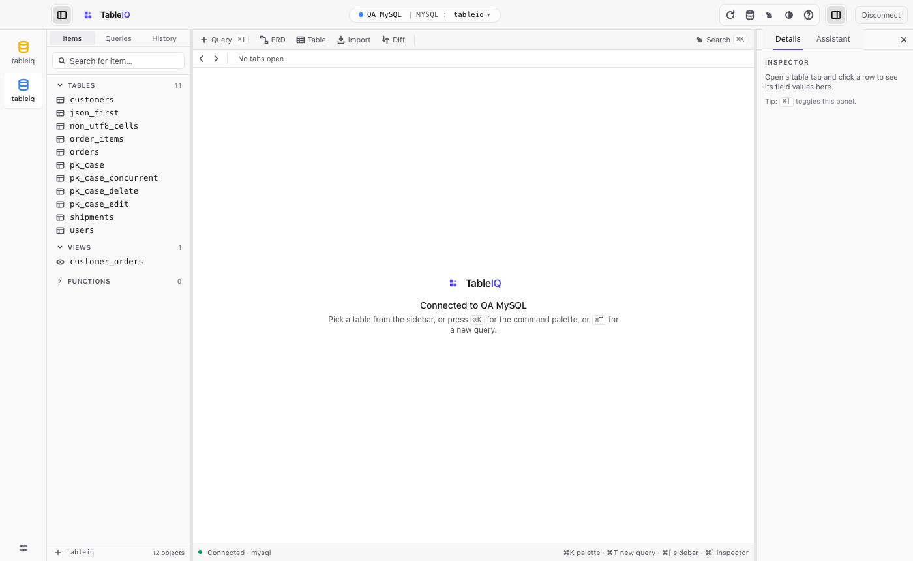
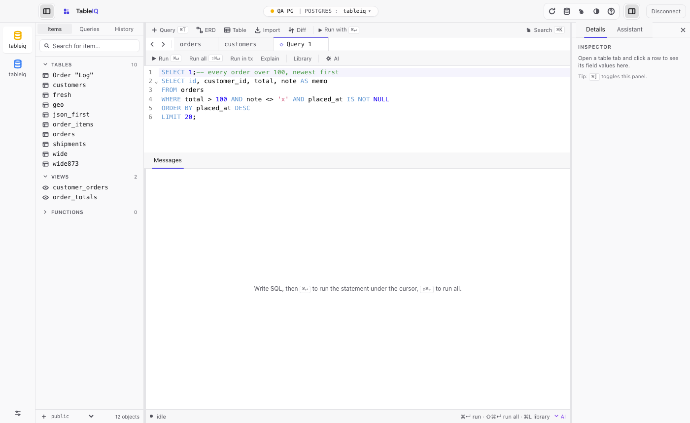
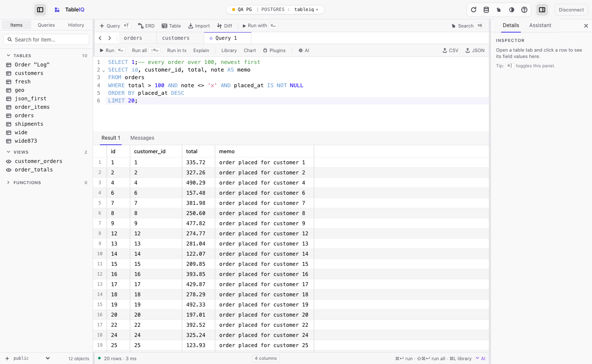
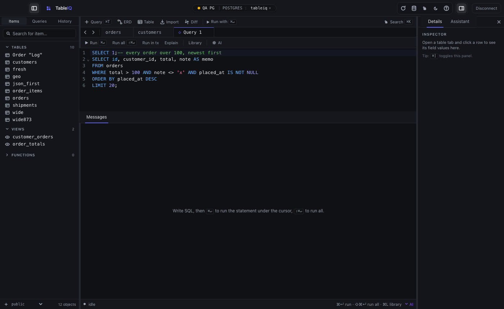
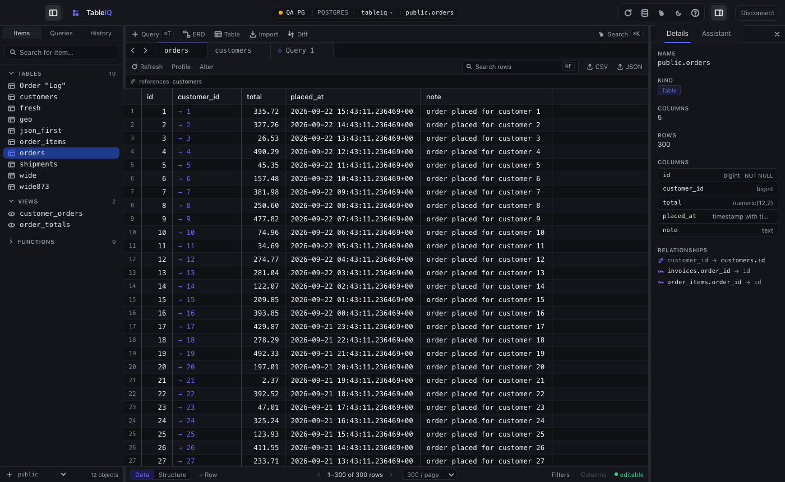

# Finalize — connection rail, TablePlus readability, SQL colours

Branch `RudreshNarwal/connection-tabs-readability` · base `main` (042297c) · 2026-09-26

## What was asked
Rudy compared TableIQ against three TablePlus screenshots and asked for:
1. The left rail TablePlus shows when several connections are open, so you can switch between them.
2. An answer to why TablePlus reads better (font or spacing?), plus a fix.
3. An answer to why its SQL editor reads better (colour), plus a fix.

## Why TablePlus reads better (measured, pixel-sampled from the screenshots)
**Both font and spacing matter, and so does contrast.**

TablePlus draws data (grid cells, sidebar tree) in **SF Mono at ≈12.5px**, in **tight rows**, with **pure-black text** and a white, black-text header. TableIQ used an **11.5px sans in 32px rows** with a grey header on grey. That combination makes small text float in tall rows and looks washed out.

In the SQL editor, TablePlus uses Xcode-style colours. Soft-blue keywords recede while black identifiers carry the eye. TableIQ ran CodeMirror's default palette (purple keywords, brown comments, green numbers), and used it **in dark mode too**.

| Metric | TablePlus | TableIQ before | TableIQ now |
|---|---|---|---|
| Grid row pitch | 24px | 32px | **24px** |
| Data glyph advance | 7.39px | ~6.2px (sans) | **7.53px** (12.5px SF Mono) |
| Sidebar tree pitch | 19px | 22px | **20px** |
| Cell / header text | #000 / #000 on white | #18181b / #52525b on #f7f7f8 | **#000 / #000 on white** |
| Keyword / string / comment / number | #6499D3 / #CF5478 / #449940 / #1A01F5 | #708 / #a11 / #940 / #164 | **same as TablePlus** (+ a dark palette) |

## What changed (6 commits)
- **Several connections open at once, plus a connection rail** (`ConnectionRail.tsx`, `connectionStore.ts`).
  - ⌘O now opens a connection *alongside* the current one instead of disconnecting it. The backend already kept a session per id.
  - The rail appears at the far left once 2+ connections are open. Clicking an item switches with no reconnect: the shell remounts and re-hydrates that connection's tabs.
  - × closes a single connection. Disconnect closes only the active one, and the last remaining connection takes over.
  - A ⚙ menu toggles between showing the database name and the connection name.
- **Readability** (`theme.ts`, `DataGrid.tsx`, `ObjectTree.tsx`, `autoFit.ts`, `index.css`):
  - Grid cells and the sidebar tree use SF Mono 12.5px.
  - Grid rows are 24/28px (row/header), tree rows 20px.
  - Text and header are black on a white header, zebra stripe is #f5f5f5, and column auto-fit is re-tuned to the mono advance.
- **SQL colours** (`lib/sqlHighlight.ts`, `SqlEditor.tsx`): one `HighlightStyle` driven by `--syn-*` CSS vars, so light and dark swap with the theme. The gutter is white, like TablePlus.
- DESIGN.md updated (type scale, density, rail, syntax palette).

## Tests + review + QA
- **Unit:** vitest **387/387** (was 366 on main).
  - New: 17 store tests (sessions, switching, close, tab isolation, `updateSession`, scoped cache clear), 2 SQL highlighter tests that parse real SQL, and updated theme/auto-fit tests.
  - `tsc` and `vite build` are clean. No Rust changes.
- **Whole-branch review** (fresh Opus reviewer). The critical finding and the important findings were all fixed, each with a failing test first where the code is testable without a DOM (this repo has no jsdom).
  - **Critical:** the next connection's first render used the previous connection's tabs, so a shared `query:1` key carried A's SQL into B.
  - **Important:** a schema refresh that finished after a switch landed on the wrong session.
  - **Important:** close paths were inconsistent and wiped every connection's metadata cache.
  - **Important:** the connection-lost banner didn't know which session had dropped.
  - Two findings were re-graded up to Important and fixed: text typed within 300ms of a rail click was lost (data loss), and the rail × was not keyboard-reachable (accessibility).
- **Browser QA through the real IPC bridge** (never the mock), live Postgres + MySQL, headless gstack browser:
  - Connected PG, then opened a table and a query tab.
  - ⌘O → MySQL: `connect` 200 and no `disconnect` of PG. The rail showed both connections.
  - Rail → PG: **zero** `connect`/`list_objects` calls, and tabs and SQL were restored.
  - Both connections had a "Query 1" tab. Four switches back and forth kept each connection's own text, both on screen and in localStorage.
  - Typed text and clicked the rail immediately: the text survived.
  - Label toggle works. × MySQL sent `disconnect` 200 and the rail hid. Disconnecting the last connection returned to the welcome screen.
  - Only `get_table_window` 400s appeared, all `"Query cancelled"`. That is the existing dev-mode double-mount supersede, not a regression.
  - **Bug found and fixed:** the rail's options menu was painted under the sidebar, because the rail's `backdrop-filter` becomes the containing block for fixed-position children (8019b2b).
- **Design review:** no remaining visual defects. The measured metrics are within about 2% of TablePlus.

## Assumptions and deliberate limits
- The rail shows only when 2+ connections are open, which is what TablePlus does.
- Switching connections remounts the shell. **Query results and undo history reset on a connection switch**; the tab list and SQL persist. Unsaved staged cell edits are dropped, the same as today's tab switch (pending.md §2a).
- A dropped *background* session is not flagged until its next request after you switch back to it. The banner is scoped to the session that dropped.
- The light keyword blue `#6499D3` is ≈3:1 on white, below WCAG AA. It is kept for TablePlus parity. `--syn-keyword` is a one-token change if you want AA.

## Deferred (minor, not fixed)
- A failed ⌘O where `connect` succeeds but `listObjects` fails leaves an orphan backend session. The same pattern exists in the welcome-screen connect.
- Closing a connection with a query still running leaves its result in the store until eviction.
- Quoted identifiers (`"Users"`, `` `order` ``) are coloured as strings.
- Two connections to same-named databases both read "tableiq" in the rail by default. The colour tag, tooltip and "Show connection name" toggle tell them apart.
- Grid headers are left-aligned; TablePlus centres them. glide has no header-alignment key.

## Checked thoroughly
Every claim above comes from a command run in this session. The unit suite was run after the last commit. Each browser flow was driven against the real Rust bridge with `browse network` read after each action. The screenshots in `assets/connection-tabs-readability/` are from those runs.

## Cost (this session's main transcript; subagents excluded; pricing best-effort)
| Stage | Model | Input | Output | Cache read | Cache write | Cost (USD) |
|---|---|---|---|---|---|---|
| 1-2. Research + plan (plan mode) | opus | 156 | 69,095 | 6,174,942 | 297,682 | $20.03 |
| 3. Build | opus | 180 | 59,303 | 14,699,867 | 129,462 | $28.93 |
| 4. Review | opus | 46 | 9,407 | 4,459,586 | 17,667 | $7.73 |
| 5. QA | opus | 284 | 99,931 | 38,245,066 | 356,354 | $71.55 |
| 6. Finalize | opus | 26 | 6,469 | 4,753,459 | 17,583 | $7.95 |
| **Total** | | **692** | **244,205** | **68,332,920** | **818,748** | **$136.18** |
