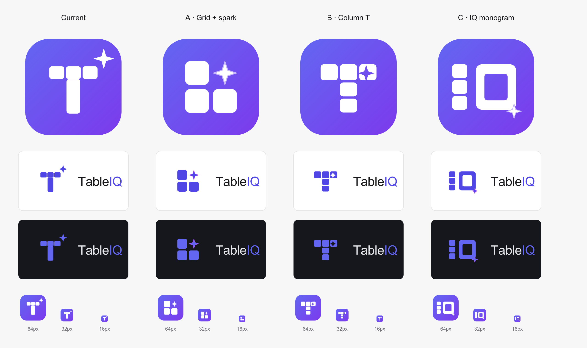
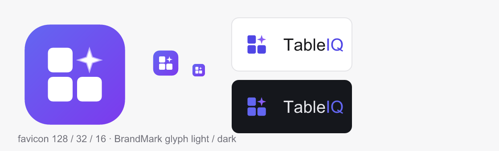

# Finalize: new logo — "Grid + spark"

Branch `RudreshNarwal/logo-grid-spark` · v0.3.1

The user asked for a rethink of the logo with the colours unchanged, chose variant **A**
of three, and asked for it everywhere.

**Mark:** a 2×2 table whose top-right cell *is* the 4-point AI spark. Grid = "Table",
spark = "IQ". Palette untouched: indigo→violet tile, white cells, `#C4B5FD` spark with a
white core; in-app the cells take `currentColor`/`--primary` and the spark keeps the
indigo→violet gradient.

**Applied to:** `src/assets/brand/icon-tile.svg` → `icon-1024.png` → the full Tauri icon
set (`src-tauri/icons/**`, macOS/Windows/Android/iOS, 56 files via `pnpm tauri icon`),
`public/favicon.svg`, `src/assets/brand/glyph.svg`, `<BrandMark>` in
`src/components/Brand.tsx`, and the Brand rule in `DESIGN.md`.

**Verified:** `tsc --noEmit` clean, `vitest run` 366 passed; the regenerated 256 px icon,
the favicon at 128/32/16 px and the in-app glyph on light and dark chrome were rendered
and inspected (below). Desktop screenshots aren't possible on this machine (Screen
Recording denied), so the in-app glyph is shown as a render of the same SVG.

