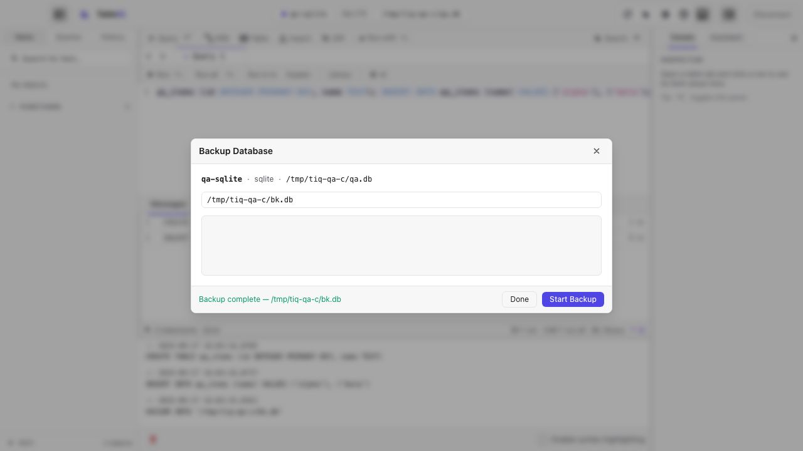
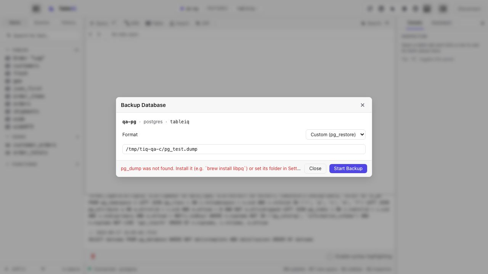
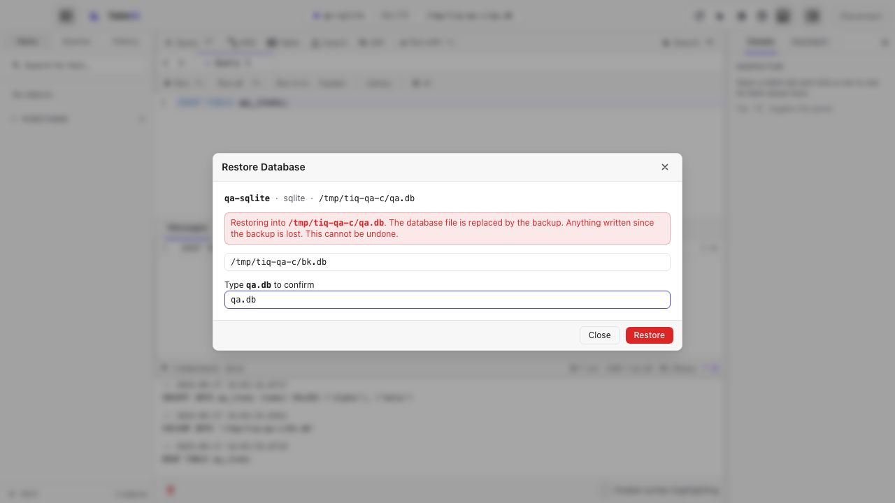
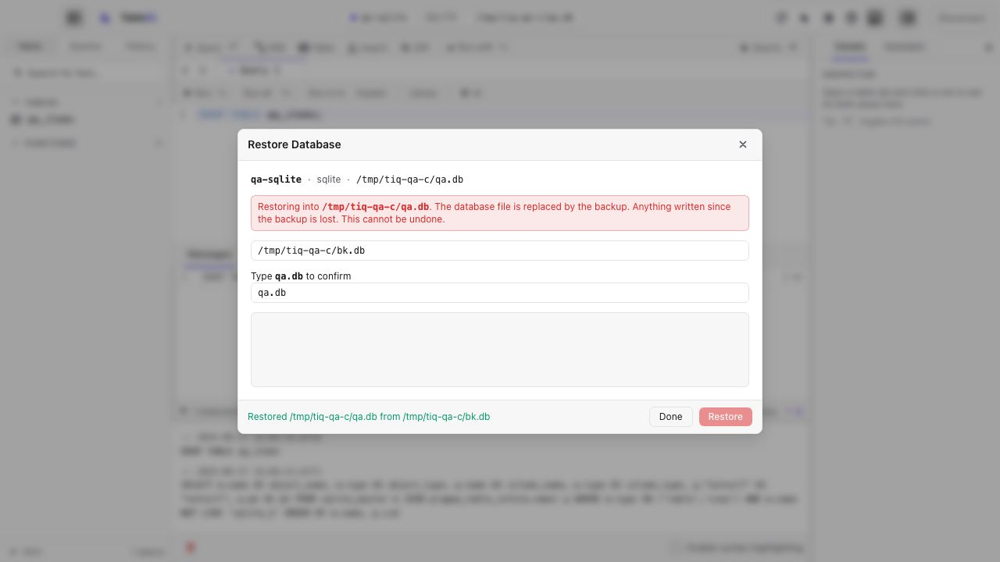
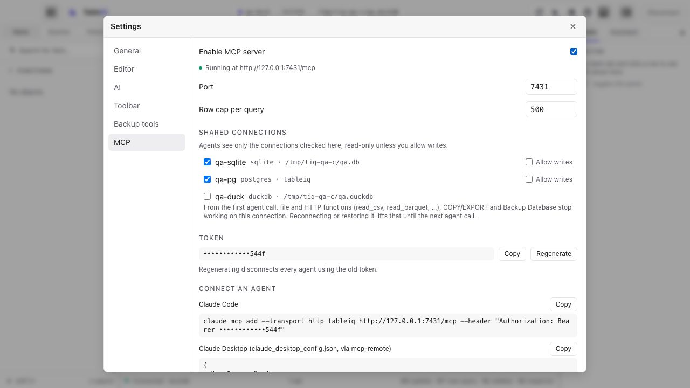
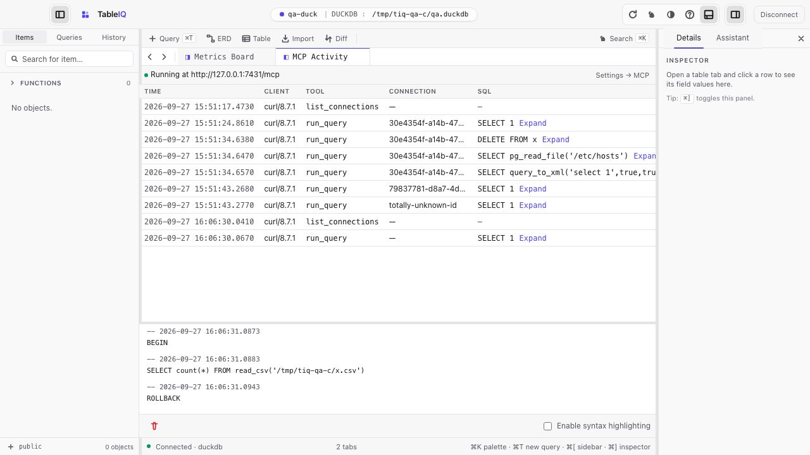
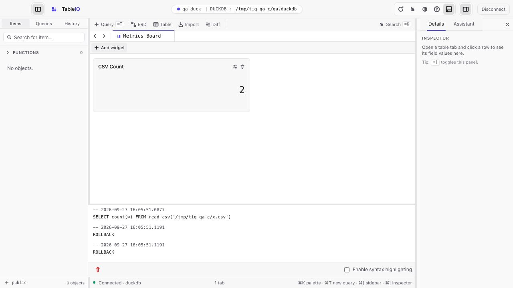
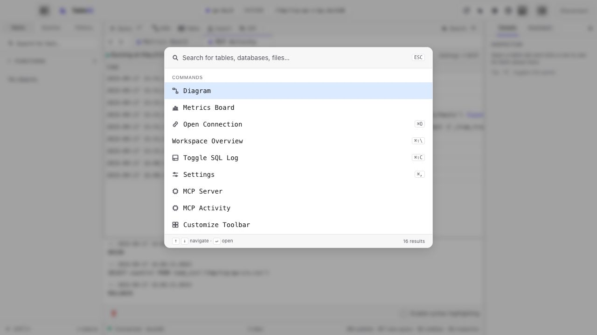

# Finalize: PR-C: Backup, Restore, MCP Server, MCP Activity

- **Branch:** `RudreshNarwal/backup-restore-mcp`
- **Base:** `origin/main` @ `015d9ef` (v0.6.0)
- **Date:** 2026-09-27
- **Plan:** `.context/plans/2026-09-26-palette-sqllog-settings.md`. This PR covers slices 12–15, plus prep slice 11b. PR-A (v0.5.0) and PR-B (v0.6.0) already shipped, so this closes out the plan. All 13 TablePlus ⌘K commands are now real.

## What shipped

| # | Feature | What the user gets |
|---|---|---|
| 11b | **Shell refactor** | MainShell's ⌘K command list and keymap move into hooks. A pure, tested `shortcutFor` decides key bindings. The title-bar action map is now type-linked, so a missing action fails to compile. No behaviour change. |
| 12 | **Backup Database** (⌘K) | **Postgres:** `pg_dump`, custom or plain format. **MySQL / MariaDB:** `mysqldump` / `mariadb-dump`. **SQLite:** `VACUUM INTO`. **DuckDB:** `ATTACH` + `COPY`. **SQL Server:** `BACKUP … TO DISK` to a path on the server. Every backup streams its log and shows Elapsed and a Cancel button. Tools are found from Settings → Backup tools, PATH, or Homebrew / Postgres.app. Passwords go to tools only through the environment and are scrubbed from their output. Backups go through the SSH tunnel. |
| 13 | **Restore Database** (⌘K) | A red confirmation dialog. You must type the database name (or, for SQLite / DuckDB, the file name), and Rust checks it again before touching anything. **Postgres:** `pg_restore --clean` or `psql`. **MySQL:** `mysql --one-database`. **SQL Server:** `RESTORE … WITH REPLACE` in single-user mode, after checking the backup belongs to this database. **SQLite / DuckDB:** an atomic file swap. It refuses any file that would write to a different database: MySQL `DROP`/`CREATE`/`USE` of another database, or psql `\connect`/`\i`/`\!` lines. |
| 14 | **MCP Server** (Settings → MCP) | An in-app MCP server over Streamable HTTP, so Claude Code or Claude Desktop can list and query the connections you choose. It listens on `127.0.0.1` only, requires a bearer token (kept in the keychain), and returns 403 to any browser `Origin`. It sees only connections you tick, and is read-only by default. Protections: a fail-closed SQL guard, per-engine function denylists, a read-only transaction wrapper, DuckDB file access switched off, and caps on concurrency, timeout, rows (500) and bytes (8 MB). Settings gives a copy-paste `claude mcp add …` line. |
| 15 | **MCP Activity** (⌘K) | Every agent tool call, with its time, client, tool, connection, SQL (redacted, expandable), row count, duration and outcome. The server status updates live. |

Metrics widgets (PR-B) now run through the same backend read-only wrapper, and the widget editor validates SQL against the backend guard when you save.

23 commits; 45 files changed, +9962 / −318.

## Tests
- **Frontend:** `pnpm test` passes 628/628. `tsc` is clean.
- **Rust:** `cargo test --lib` passes 310.
- **Live integration tests**, run with PG / MySQL / MSSQL and `TIQ_BACKUP_SHIM=1`:
  - `mcp_live` 6/6. These run over real HTTP on SQLite, DuckDB, PG and MySQL: auth, the allowlist, read-only enforcement, and refused file reads.
  - `restore_live` 11. Covers round-trips and wrong-target refusals, including a real two-database `--add-drop-database` dump, plus a scratch-only SQL Server restore.
  - `backup_live` 9. Includes a MySQL user without the PROCESS privilege.
  - `sqlserver` 14. Includes the SQL Server timeout: the user's query survives and waiters fail fast.
- **Lint and build:** `clippy -D warnings` is clean, and the bridge example builds.
- **PG / MySQL client tools** are not installed on this machine. Their pipelines were verified through a test-only `docker exec` shim. The real-tool tests run wherever the tools exist and skip otherwise.

## Review
Each task went through spec and quality review, with fix loops. Every round is in the ledger.
- **Task 13 (Restore): three rounds.** Checks now run before the session closes. Guards stop writes to another database. The confirmation became the file name. SQL Server: the session could be left on `master`, `WITH REPLACE` could overwrite another database's files, and MySQL `DROP DATABASE other` got through `--one-database` (reproduced live).
- **Task 14 (MCP): four rounds.**
  - **Critical:** an allowlisted DuckDB connection could read `~/.ssh` over MCP. Reproduced, then fixed with the instance lockdown and a denylist.
  - PG `pg_read_file` and `query_to_xml('…pg_read_'||'file…')` got around the guard.
  - A timeout didn't cancel on three engines, and four queries could wedge the server.
  - Wrapped reads drained the whole result, responses had no size cap, and a SQL Server self-KILL could kill the user's own query.

  All fixed and checked live.

The Opus final review of the whole branch returned "with fixes", 5 Important:
- A restore could race MCP's reconnect and silently lose data.
- Two race windows in the SQL Server timeout handler.
- A SQL Server reconnect could land on the wrong database.
- The shared guard broke v0.6.0 DuckDB and SQL Server widgets.
- A timeout that fired before the statement started said "cancelled", but the statement ran later.

All five were fixed in one wave and each fix was verified.

The /ship pre-landing and adversarial review found one more (P1): on a shared SQLite connection with writes allowed, `VACUUM INTO` / `ATTACH` could create or open any file (a `~/.zshenv` payload was reproduced in a scratch dir). `ATTACH` and `VACUUM` are now refused on SQLite whatever the write setting. It also fixed:
- SQL Server restore now closes only its own session.
- The restore dump scans moved off the async workers.
- MCP Activity's SQL column now has a width limit (QA ISSUE-002).
- Two CHANGELOG overstatements were corrected.

## QA (real IPC bridge, never the mock)
The real UI talked to real Rust commands on Docker SQLite / DuckDB / PG / SQL Server. The MCP endpoint was also probed with curl, the way an agent would call it.

- **Health: 93 / 100.**
- **Everything passed:**
  - SQLite, DuckDB and SQL Server backup and restore; the restore asks for the file name.
  - PG shows a clear message that `pg_dump` is missing.
  - Backup tools Detect finds the tools and rejects a relative folder.
  - MCP:
    - 401 without a token and 403 with an `Origin` header.
    - Only allowlisted connections are listed.
    - `DELETE`, `pg_read_file` and `query_to_xml` are refused.
    - An unknown connection id and an unshared one get the same error.
  - Activity lists every call, and its status header updates live.
  - The DuckDB `read_csv` widget works.
  - All four new ⌘K entries appear.

| Issue | Severity | Status |
|---|---|---|
| ISSUE-001: one `backup_job` poll returned 400 after closing a finished dialog (didn't reproduce) | low | deferred |
| ISSUE-002: MCP Activity's right-hand columns need horizontal scroll with no visible hint | low | fixed in /ship |
| ISSUE-003: the SQL log shows `VACUUM INTO` for a backup but nothing for a SQLite restore, which is a file swap, not SQL | low | informational |

Not tested: Cancel partway through a job. Local backups finished in under 300 ms.

### Evidence
| | |
|---|---|
| SQLite backup  | PG with no pg_dump: clear error  |
| Restore: type the file name  | Restore done  |
| Settings → MCP  | MCP Activity: refusals logged  |
| DuckDB widget (`read_csv`)  | ⌘K with the new commands  |

## Assumptions and rulings (full list in the SDD ledger)
1. **PG / MySQL client tools** are not installed, and none were installed without asking. Those pipelines were verified through a test-only `docker exec` shim.
2. **Restore never writes to a database other than the confirmed one.** The PG, MySQL and SQL Server guards are fail-closed and can reject some hand-written files. What's left needs a crafted file: MySQL fully qualified writes, and psql meta-commands in the middle of a line. See `pending.md` §2h.
3. **DuckDB shared with MCP:** file and HTTP functions, `COPY`/`EXPORT` and Backup stop working on that instance from the first agent call. Settings says so, and a restore or reconnect lifts the lock.
4. **SQL Server MCP timeout:** only a query that is actually running is aborted, and the old session is `KILL`ed only if its `login_time` still matches. That needs `ALTER ANY CONNECTION`; without it, the server session ends when its query does.
5. **DuckDB MCP queries can't be interrupted** on duckdb 1.2.2. See `pending.md` §2d.
6. **Widgets keep DuckDB file readers**, since it's the user's own SQL. MCP never gets them.
7. **Denylists can't be complete.** Settings tells users to share Postgres through a role without superuser, `pg_read_server_files` or `pg_execute_server_program`.
8. **Disk space.** The shared Rust build cache filled the disk, so the regenerable `target/debug/incremental` was deleted (11 GB) and builds now run with `CARGO_INCREMENTAL=0`.

No-harness exceptions: none. UI wiring is verified in the browser through the bridge; logic is covered by unit and live tests.

## Checked thoroughly
- TDD and spec-plus-quality review with fix loops on every task.
- Four review rounds on the security-critical MCP server.
- An Opus final review of the whole branch; its five Important findings were fixed and re-reviewed.
- Real-bridge browser and HTTP QA across four engines.
- Live tests: 628 vitest and 305 Rust lib tests, plus the MCP, restore, backup and SQL Server suites.

## Per-stage cost (controller transcript only, best-effort pricing; subagent transcripts not included)
| Stage | Model | Input | Output | Cache read | Cache write | Cost (USD) |
|---|---|---|---|---|---|---|
| 3. Build (PR-C S12-S15) | opus | 418 | 200,674 | 113,026,056 | 2,671,925 | $234.69 |
| 4. Review (PR-C) | opus | 66 | 40,356 | 20,605,574 | 2,626,166 | $83.18 |
| 5. QA (PR-C) | opus | 18 | 11,832 | 6,132,325 | 12,521 | $10.32 |
| 6. Finalize (PR-C) | opus | 16 | 3,868 | 6,167,881 | 15,704 | $9.84 |
| **PR-C subtotal** | | | | | | **$338.03** |
| Whole session (plan + PR-A + PR-B + PR-C) | | | | | | $783.01 |
