# Finalize: PR-A: connection loader, Queries/History tabs, Settings, ⌘K palette, ⌘. cancel, Workspace Overview, Customize Toolbar

**Branch:** `RudreshNarwal/palette-sqllog-settings` · **Base:** `origin/main` @ `e824b42` (v0.4.0) · **Date:** 2026-09-27
**Plan:** `.context/plans/2026-09-26-palette-sqllog-settings.md` (15 slices shipped as 3 PRs; this is PR-A = slices 1–7).

## What shipped

| # | Feature | What the user gets |
|---|---|---|
| 1 | **Connection loader** | Clicking a connection shows a spinner, "Connecting…" then "Loading schema…", an elapsed timer and a Cancel button on that card, and the other cards are disabled. ⌘O swaps and ⌘D switches show a progress strip under the title bar. A cancelled connect's late result is discarded and never surfaces as an error. |
| 2 | **Sidebar Queries / History** | The tabs are real now. Queries holds saved queries: this connection's plus global ones, with "+" to save the active query, F2 or double-click to rename, × to delete, and click to open a new tab. History shows this connection's runs grouped by day (Today / Yesterday / date) and refreshes live after each run. The chosen tab persists. The old Library drawer is retired. |
| 3 | **Settings (⌘,)** | A unified page with sections General (theme, rail label), Editor (font size, applied live), AI (the former drawer), Toolbar, Backup tools and MCP. The last two are placeholders filled by PR-C. |
| 4 | **⌘K palette** | "Search for tables, databases, files…", grouped Commands / Tables / Databases / Queries with icons and shortcut hints. The current database is marked. Entries: Diagram, Open Connection (⌘O / ⌘⇧K), Open Database (⌘D), Workspace Overview, Settings, Customize Toolbar, Cancel Running Queries and more. |
| 5 | **Cancel Running Queries (⌘.)** | Cancels every in-flight query and page fetch on the active connection and shows a neutral "Cancelled N queries" strip. The backend cancel keys are now namespaced per connection, which fixes a latent cross-connection collision. |
| 6 | **Workspace Overview (⌘⇧\\)** | A grid of every open tab across every open connection. Click a card to jump to it (switching connection if needed); × closes a tab, including tabs on a background connection. |
| 7 | **Customize Toolbar** | The title-bar icons are data-driven. Hide or reorder them in Settings → Toolbar (or right-click the title bar). The layout persists, and new items respect their default visibility. |

21 commits, 35 files, +2996 / −507.

## Tests
- `pnpm test` (vitest): **465/465 passing**. New suites cover the connection store (stages, cancel, stale results, switch), `groupByDay`, `savedQueriesForConn`, `prefs`, `commandGroups`, `tabsPersist` (overview focus/close, including the lost-update regression) and `toolbarPrefs` (ordering and the default-hidden regression).
- `pnpm exec tsc --noEmit`: clean.
- Rust:
  - `keys_for` unit test.
  - `saved_query_without_conn_id_deserializes` (serde back-compat).
  - Live `pg_cancel_all_stops_two_queries` against real Postgres: both `pg_sleep(30)` queries cancelled in about 55–92 ms.
  - `cancel.rs`, `table_page_live.rs` and `exec_live.rs` pass with `TIQ_PG_URL` set.
  - `cargo clippy --all-targets --features ipc-bridge -D warnings`: clean.

## Review
- Every task got a spec-plus-quality review, and fixes were re-reviewed until clean. The fix rounds per task, and every ruling, are in the SDD ledger.
- A whole-branch final review ran on Opus and returned "with fixes": 0 Critical, 4 Important, and 4 minors promoted to fix-before-merge. All 10 were fixed in one wave, and the re-review verified each one.
- The notable catches were:
  - Pressing Esc from any overlay cancelled an in-flight connect.
  - A cancelled connect later surfaced its timeout as a red error.
  - Picking the current database in ⌘K wiped every tab.
  - `queueMicrotask` versus `setTimeout` in the Settings Escape guard. A microtask checkpoint runs between native event listeners.
  - A stale snapshot in Workspace Overview meant two closes on a background connection undid each other.

## QA (through the real IPC bridge, never the mock)
- The real React UI ran against real Rust commands (`ipc_bridge` example) on Docker Postgres and MySQL. Every flow's `/__ipc/*` calls were checked, and all returned 200: `connect`, `list_objects`, `switch_database`, `run_query`, `get_result_window`, `save_query`, `list_saved_queries`, `delete_saved_query`, `cancel_all`, `delete_connection`.
- **Health score: 89.5 → 94.** The score before any fix was 89.5; the score after fixing ISSUE-001 and ISSUE-003 is recomputed with the same coverage.

| Issue | Severity | Status |
|---|---|---|
| ISSUE-001: Esc didn't reliably close Workspace Overview (focus-dependent handler) | high | **fixed** `a13b985` (window-level listener), verified live |
| ISSUE-003: Settings/Panel modal lacked `role="dialog"`/`aria-modal`/name | medium | **fixed** `b100a5d` (shared `Panel`), verified live |
| ISSUE-002: "Workspace Overview" palette row has no icon | low | deferred (Standard tier) |
| ISSUE-004: the in-tab "Query cancelled" message uses error red (the top strip is neutral) | low | deferred (pre-existing QueryView styling) |

Full QA report: `.context/qa/qa-report-pr-a.md` (local, not committed).

### Evidence
| | |
|---|---|
| ⌘K palette 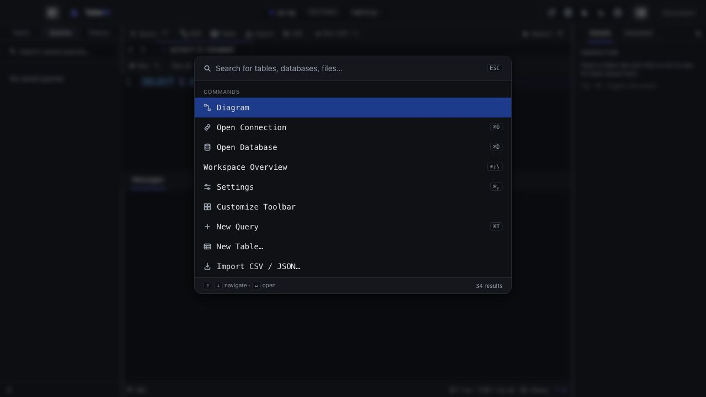 | Typing resets the selection 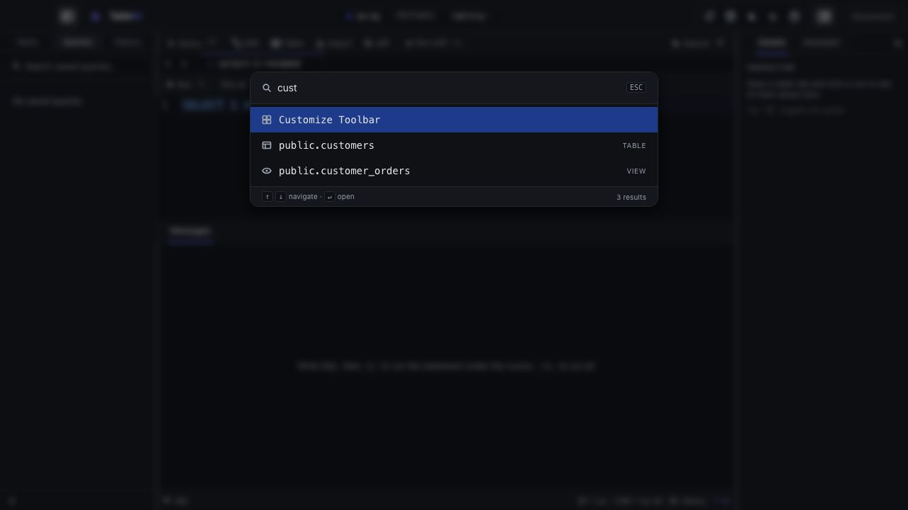 |
| Connect card loader 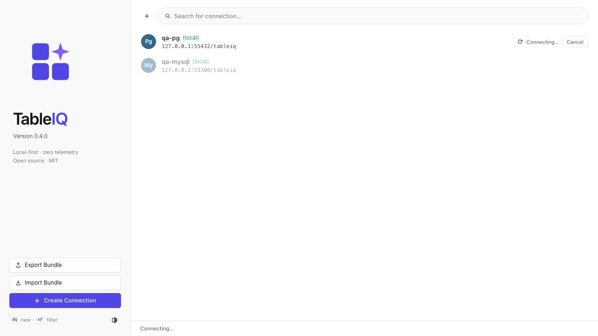 | ⌘O swap progress strip 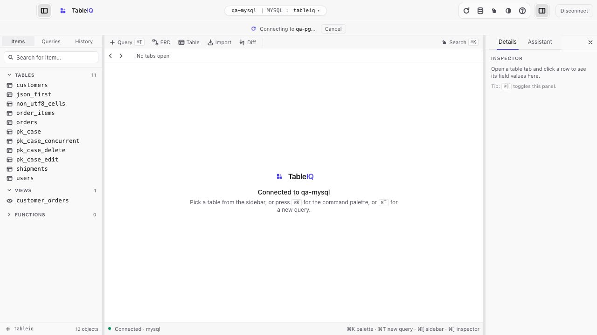 |
| ⌘D "Switching to postgres…" 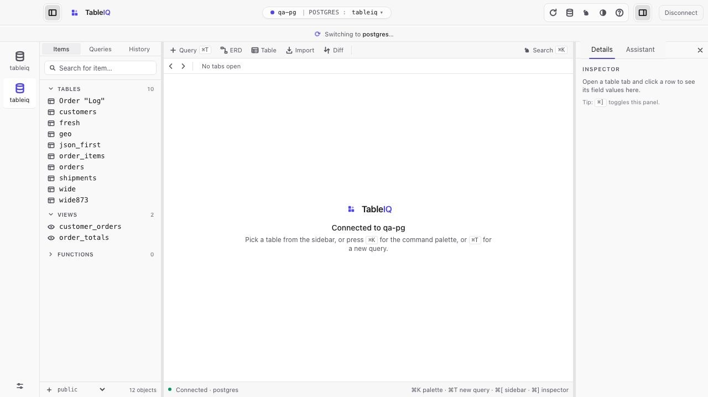 | History refreshes live 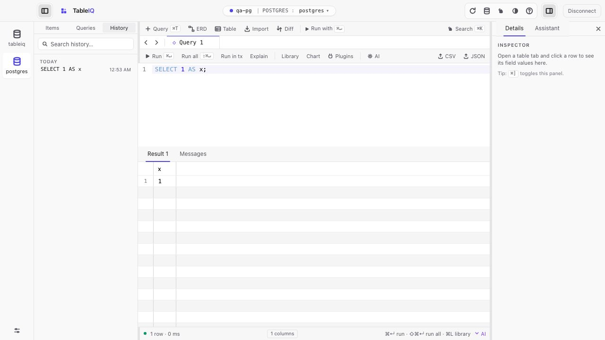 |
| Saved query opens in a new tab 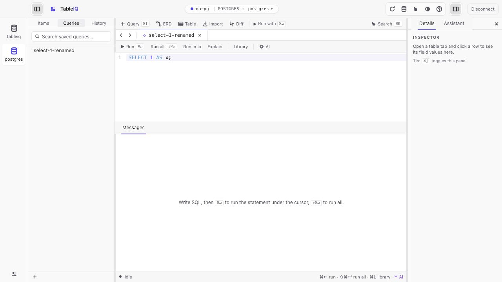 | Settings 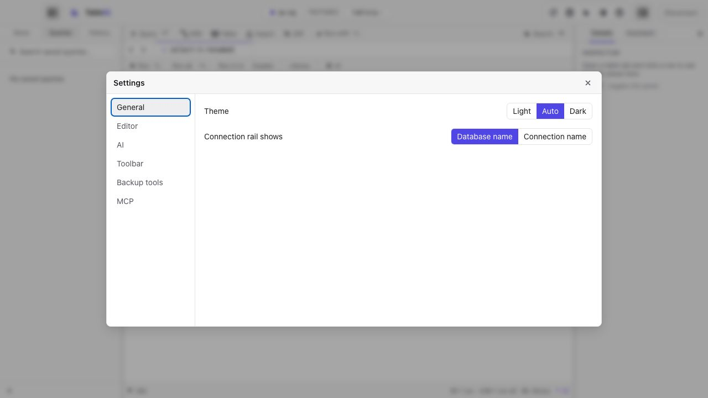 |
| Settings, dark theme applied live 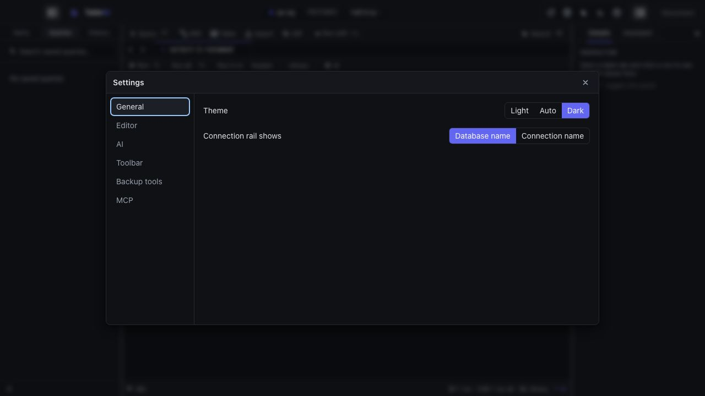 | ⌘. neutral cancel strip 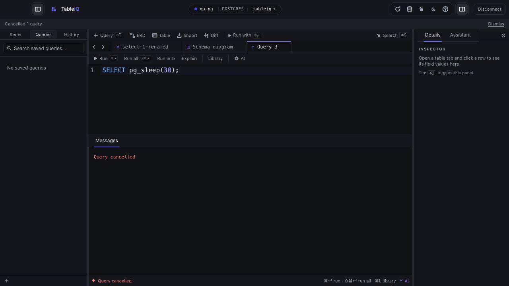 |
| Workspace Overview (2 connections) 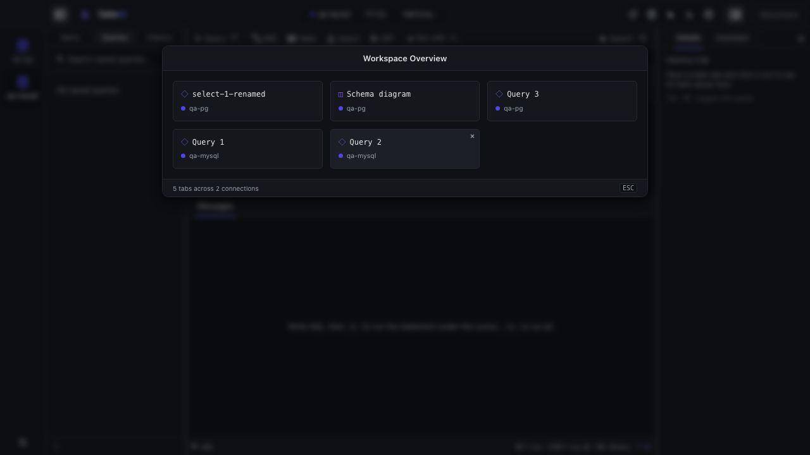 | Two background closes both stick 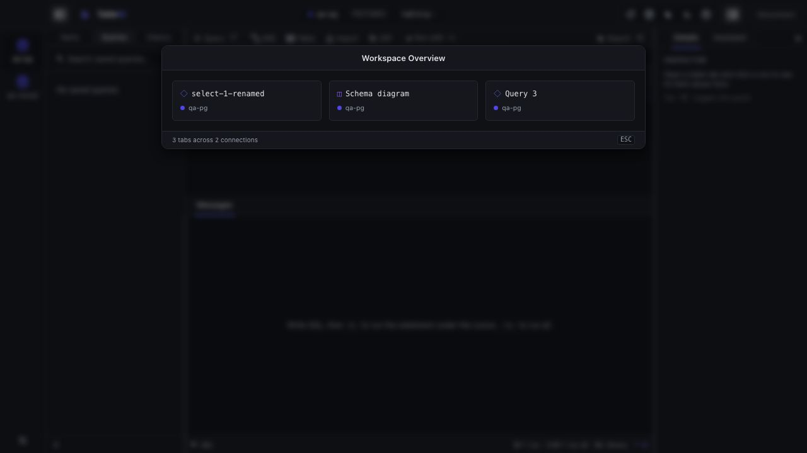 |
| Customize Toolbar 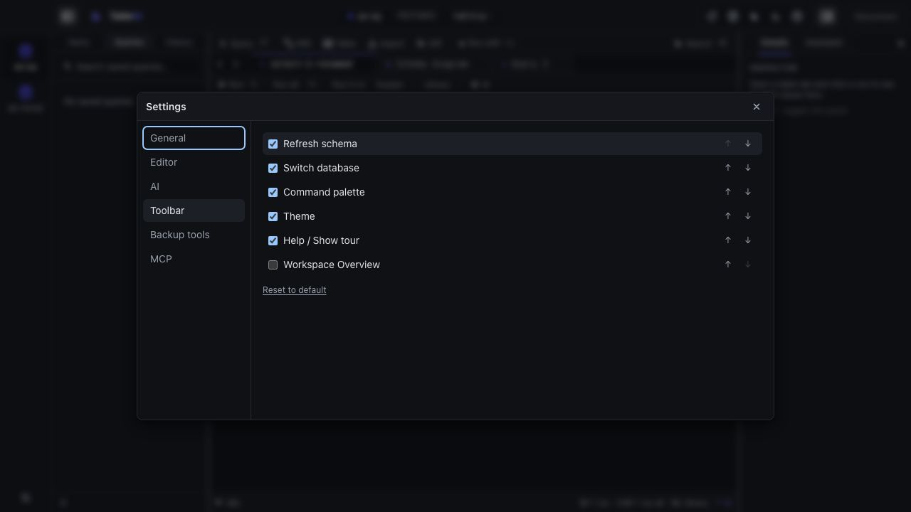 | Reordered and hidden, live 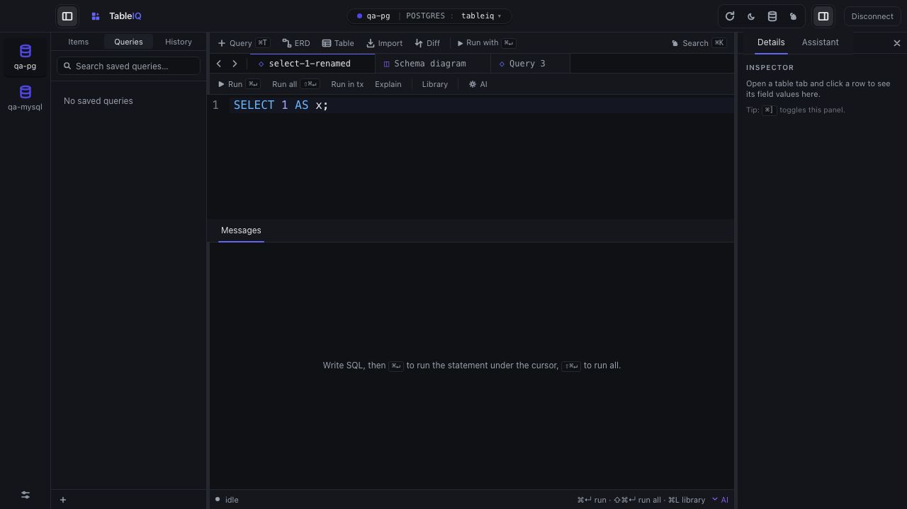 |
| ISSUE-001 after 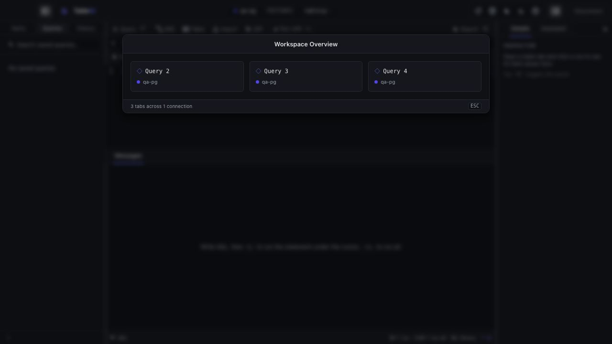 | ISSUE-003 after 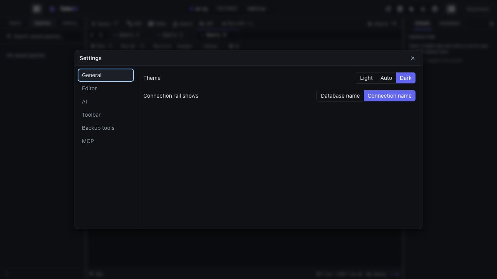 |

## Assumptions and rulings made during the run
1. **Branch.** Build started on this workspace's branch. That branch was renamed `replicate-filter-search` when a **second chat in the same Conductor workspace** began uncommitted filter-search work in the same worktree. One of my commits (`ae553b4`) accidentally swept in two of its hunks, so on its own it doesn't compile; the fix is `37e1563`. **PR-A must be squash-merged.** The build then moved to its own branch and worktree (`richmond-palette`). The other session's files were never touched. `replicate-filter-search` still carries 9 of my early commits; its owner should rebase onto main after this lands.
2. **⌘K stays the palette.** Open Database stays on ⌘D and Open Connection on ⌘O, with ⌘⇧K added as an alias. This is a deliberate deviation from TablePlus.
3. **Database switch is not cancellable.** Rust swaps the session before returning, so discarding the result would desync the UI.
4. **Reconnect banner.** It keeps its own spinner and has no Cancel.
5. **Saved queries are per connection plus global.** `conn_id` is optional and back-compatible. Renaming keeps the original `conn_id`.
6. **Sidebar replaces the Library drawer.** The Library button focuses the sidebar Queries tab.
7. **Deferred polish** (full list in the ledger, triaged by the final reviewer as OK to defer):
   - side-sheet connect status stages
   - aria-pressed versus radiogroup in Settings
   - palette listbox ARIA (pre-existing)
   - no debounce on history search
   - Workspace Overview arrow-key 2D navigation and focus trap
   - `titlebarActions` not type-linked to `TOOLBAR_ITEMS`
   - ISSUE-002 and ISSUE-004

**No-harness exceptions:** none. This repo has no React component-test harness (no RTL), so UI wiring is verified by tsc, code review and the browser QA above, while logic is unit-tested.

## Checked thoroughly
Every slice went through TDD where it had logic, plus a spec-and-quality review with fix loops. The whole branch then got an Opus final review (10 fixes, re-reviewed), and a real-bridge browser QA pass exercised all 7 features end to end against live databases with 2xx IPC calls. The two in-tier QA bugs were fixed and verified live. Tests: 465 vitest, plus Rust unit and live Postgres tests, with clippy clean.

## Per-stage cost (controller transcript only; subagent transcripts are not included, best-effort pricing)
The first five rows are this session's research and planning. They were bucketed under stale markers left by the previous run in this workspace.

| Stage | Model | Input | Output | Cache read | Cache write | Cost (USD) |
|---|---|---|---|---|---|---|
| 1-2. Research + plan (plan mode) | opus-4-8 | 44 | 21,067 | 834,182 | 241,566 | $2.45 |
| 3. Build | opus-4-8 | 20 | 21,758 | 704,465 | 55,330 | $1.24 |
| 5. QA | opus | 22 | 38,158 | 747,063 | 248,043 | $8.63 |
| 6. Finalize | opus | 38 | 31,503 | 1,732,875 | 503,778 | $14.41 |
| 3. Build (PR-A S1-S7) | opus, unknown | 468 | 226,529 | 42,324,362 | 1,242,644 | $103.78 |
| 4. Review (PR-A) | opus | 68 | 20,114 | 7,912,494 | 47,883 | $14.28 |
| 5. QA (PR-A) | opus | 66 | 25,791 | 9,889,887 | 136,968 | $19.34 |
| 6. Finalize (PR-A) | opus | 8 | 927 | 1,558,799 | 3,561 | $2.47 |
| **Total** | | **734** | **385,847** | **65,704,127** | **2,479,773** | **$166.61** |

## Next
PR-B covers the SQL log backend and panel (slices 8–9), Database User Management (10) and the Metrics Board (11). PR-C covers Backup (12), Restore (13), the MCP Server (14) and MCP Activity (15).
