# Finalize: Connected Home (TablePlus-style titlebar, database lobby, status bars, native menus)

- **Branch:** `RudreshNarwal/connected-home`
- **Base:** `origin/main` @ `de3739e` (v0.7.0). Rebased from the PR-C base once PR-C shipped as #13.
- **Date:** 2026-09-28
- **Spec:** `docs/superpowers/specs/2026-09-27-connected-home.md`
- **Plan:** `docs/superpowers/plans/2026-09-27-connected-home.md`. It went through `/autoplan`: CEO, Design, DX and Eng reviews, each with its accepted block recorded, plus the gate report.
- **Design:** the approved round-4 prototype at `~/.gstack/projects/RudreshNarwal-Table-IQ/designs/connected-home-v2-20260927/`.

## What shipped

| # | Feature | What the user gets |
|---|---|---|
| 0 | **Filter bar** (carried in from the prior slice) | TablePlus rule rows: Any column, Raw SQL WHERE with the `;` guard, Apply / Apply All, ⌘F. |
| 1 | **`table_stats`** (all SQL engines) | Catalog row and byte counts per table. It works on every engine: <ul><li>**PG:** partitions are summed, never-ANALYZEd tables are estimated, matviews are included, and it runs under a 5s statement timeout.</li><li>**MySQL:** values shown with `≈`.</li><li>**SQLite:** sizes via dbstat, joined on `tbl_name`, capped at 256 MB.</li><li>**SQL Server:** falls back to `sys.partitions` without VIEW DATABASE STATE.</li><li>**DuckDB:** row counts only.</li></ul>It is forwarded through the `Logged` wrapper. |
| 2 | **Connection environment** | An Environment select in the connection form: local, development, testing, staging, production. It tints the titlebar pill. SSL is shown only for engines that read `sslmode`. |
| 3 | **Persisted pins** | Pinned tables survive restarts, stored per connection. Pins for tables that no longer exist are hidden. |
| 4 | **Staged edits, tab guard, production confirm** | <ul><li>**Titlebar actions:** Discard, Review and Commit act on the visible grid's staged edits.</li><li>**Tab guard:** every path that would drop staged edits asks first. That covers tab click, ×, ⌘W, the chevrons, the tab menu, sidebar, lobby, palette, FK rail and FK click, ERD cards, saved queries and history, Workspace Overview, and Data/Structure (keyboard, status bar and menu).</li><li>**Production confirm:** production connections confirm before any commit ("Commit N changes to production (name)?"), from ⌘S, the in-grid Commit or the titlebar.</li></ul> |
| 5 | **Glass capsules** | 36px capsule groups with 20px icons, env tint tokens in light and dark, and new icons. |
| 6 | **TitleBar** | <ul><li>**G1:** sidebar, connection.</li><li>**G2:** discard, review, commit, with a count badge.</li><li>**G3:** Open database, **SQL**, ERD, and + (New Table, Import, Diff, Backup, Restore).</li><li>**Env pill:** `ENV \| Engine : SSL : connection : database : schema.table`, shrinking object first and deduping the database; the full text is in its tooltip.</li><li>**G4:** your customizable items, collapsing behind » below 1180px, plus Cancel.</li><li>**G5:** Settings, inspector, Disconnect.</li><li>**Other:** right-click the header for Customize Toolbar…; the secondary toolbar is gone.</li></ul> |
| 7 | **Database lobby** | Shown when no tabs are open: <ul><li>**Header** with stats age and a refresh button.</li><li>**Tiles:** New Query ⌘T, Open Table ⌘P, ERD, Import CSV.</li><li>**Stats row**, **Largest tables** (bars), **Pinned** (3-row previews, tables only), **Recent queries** (syntax-coloured, Run), and **Schema at a glance** (a mini ERD).</li><li>**Ask bar** (AI, with actionable errors).</li></ul>On production, stats wait for "Load stats"; a Settings → General toggle overrides this. Results are cached per connection, database and schema, with stale-response guards. An empty database shows New Table and Import. |
| 8 | **Status bars** | Icons on Data/Structure, + Row, rows/page, Filters and Columns. The workspace bar shows engine label chips that drop out in priority order as the window narrows. There is no staged chip in the status bar, by decision. |
| 9 | **Native macOS View and Help menus** | These fill the default View menu (Enter Full Screen stays last) and Help (search field kept): <ul><li>Toggle Sidebar / Inspector, Filter Rows…, Data ⌥⌘1, Structure ⌥⌘2, Command Palette ⌘K, SQL Log, Workspace Overview, Appearance (Light / Dark / System), Show Tour.</li><li>macOS only.</li><li>Keys CodeMirror owns (⌘F, ⌘[, ⌘], ⌘⇧\) get no native accelerator.</li></ul> |

22 commits on `origin/main`: 79 files changed, +7384 / −721.

## Tests
- **Frontend:** `vitest` passes 734/734 across 77 files. `tsc` is clean.
- **Rust:** `cargo test --lib` passes 319. `clippy --all-targets -D warnings` is clean.
- **Live:** `tests/table_stats.rs` passes 4/4 against Docker PG 55432 and MySQL 53306, with no SKIP lines. Re-run after the rebase.
- **New suites:** `connEnv`, `pins`, `stagedStore`, `tabGuard` (including concurrent guard calls), `stagedEdits` (production gate), `confirmDialog`, `Capsule`, `TitleBar`, `StagedReview`, `lobby`, `Lobby`, `sqlHighlightHtml`, `prefs`, `menuEvents`, `shellKeymap` (⌥⌘ by `code`, the native skip, ⌘P), and the Rust `menu` contract.

## Review
- **Plan:** `/autoplan` ran single-voice (Codex is not authenticated). The Eng review found 2 critical and 5 high issues before any code was written. The critical ones were `table_stats` silently not forwarded through `Logged`, and tab paths that dropped staged edits (the FK rail, saved queries, WorkspaceOverview close). All were folded into the plan.
- **Build:** subagent-driven, TDD, one task review per task, 9 tasks. Fix rounds:
  - **T4:** a third copy of the confirm helper was removed.
  - **T6:** the pill named the wrong connection during a connection switch.
  - **T7:** with autoload off, refresh fell back to "Load stats"; the ERD showed stale FKs after ⌘D.
  - **T9:** the ungated menu would have shipped on Windows and Linux, with AltGr-conflicting accelerators.

  Each fix was verified with a scoped re-review.
- **Final whole-branch review (Opus): "with fixes".**
  - Window drag needed `core:window:allow-start-dragging`.
  - ⌘P did nothing.
  - Minors fixed in the same wave: lobby refresh after New Table / Import, Filter Rows from Structure, and a single prompt on rapid clicks.
  - One scoped re-review; one minor parked (⌘⇧P also opens the palette).

## QA (real IPC bridge, never the mock)
Vite with `VITE_IPC_BRIDGE=1` drove real Rust commands against Docker Postgres (tagged production) and MySQL (tagged development). Full report: `.gstack/qa-reports/qa-report-127-0-0-1-2026-09-28.md`.

**Health: 90 → 100** on the scored categories. **Everything passed:**
- **Env pill:** PRODUCTION shows red, DEVELOPMENT yellow.
- **Production lobby:** stats wait for "Load stats", which then makes exactly one `table_stats` and one `foreign_keys` call. The cache makes no refetch when you come back to the lobby.
- **MySQL:** values show `≈`.
- **Staged edit:** G2 enables with a badge, and the Review popover lists the change.
- **Tab guard:** the prompt is "This tab has unsaved changes. Discard them and switch tabs?"; declining keeps the edit and makes no IPC call.
- **Production ⌘S:** asks "Commit 1 change to production (storefront)?"; declining makes no `apply_edit`; accepting writes to Postgres (then restored).
- **⌥⌘2:** blocked with an edit staged; otherwise it switches views.
- **Keyboard:** ⌘K and ⌘P open the palette, and the header right-click menu appears.
- **960px:** G4 collapses to » with the rest of its items.
- **Also:** dark mode, pinned previews, recent queries, and the Ask error "AI isn't set up. Add a provider and key in Settings → AI."

| Issue | Severity | Status |
|---|---|---|
| ISSUE-001: mini ERD labels oversized and overflowing; self-loop clipped | medium | fixed (8a6f0af, 0f498e9) |
| ISSUE-002: row pager label wraps onto three lines at 960px | low | fixed (8137d4d) |
| ISSUE-003: at 960px with both side panels open, the pill shows only env and engine (full text in its tooltip) | low | deferred → TODOS.md |
| ISSUE-004: mini ERD unreadable in the half-width lobby cell (a 4-table chain in one row) | medium | fixed with a two-column ring layout (2f8449b) and a regression test (d057228) |

**Needs the Tauri build (TODOS.md):**
- the native menu bar
- ⌘K twice toggles once
- editor keys in CodeMirror
- window drag from header gaps
- traffic-light centring on the ConnectionManager, Kv and Doc screens

### Evidence
| | |
|---|---|
| Production lobby, stats on request 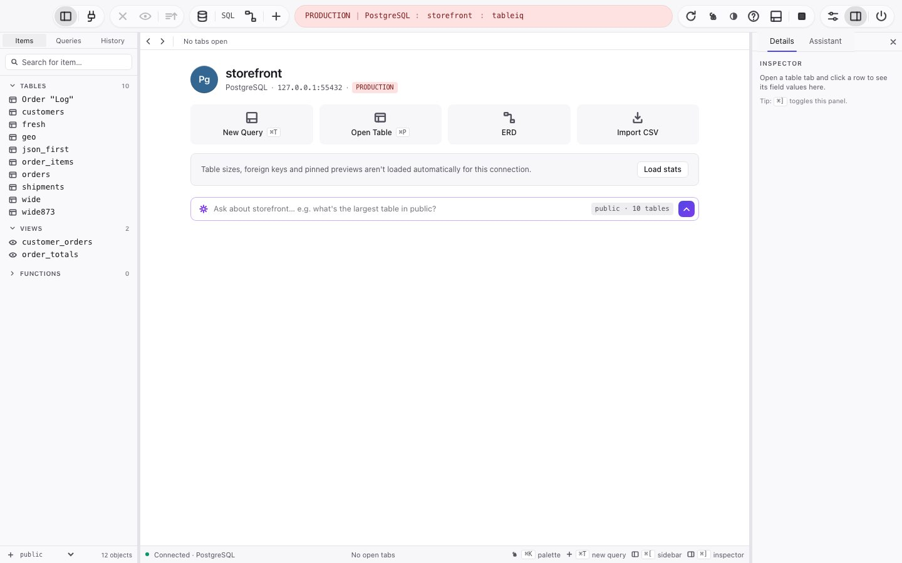 | After "Load stats" 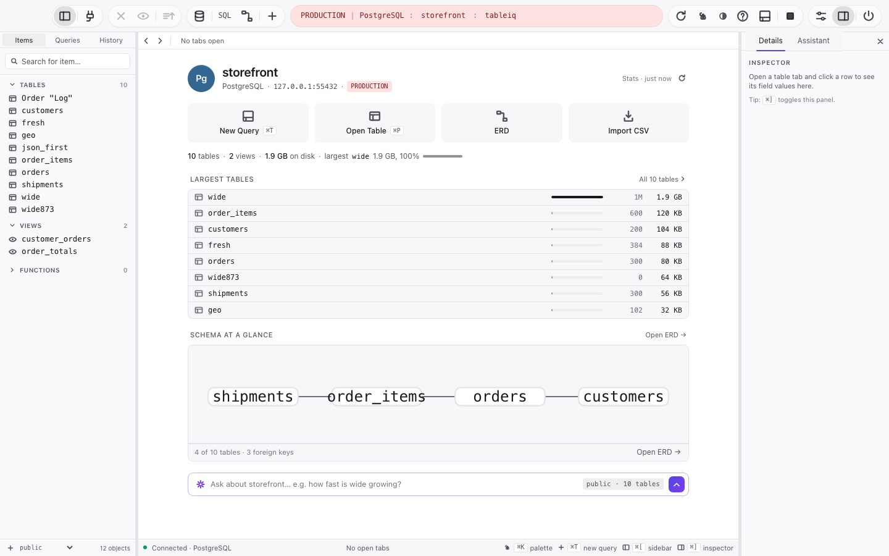 |
| Full lobby (pinned + recent + ERD) 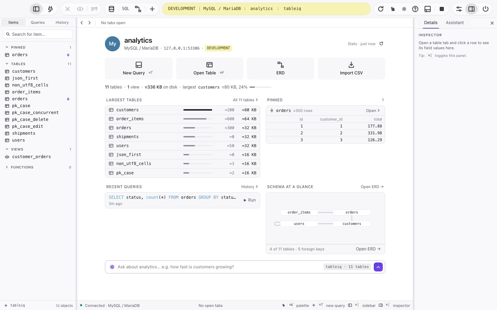 | MySQL dev lobby, `≈` values 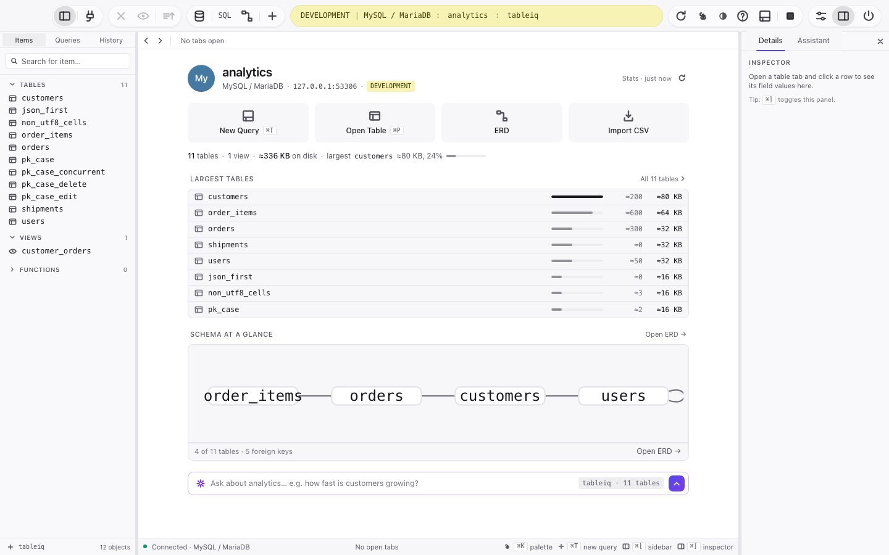 |
| Table view, pill ends in `schema.table` 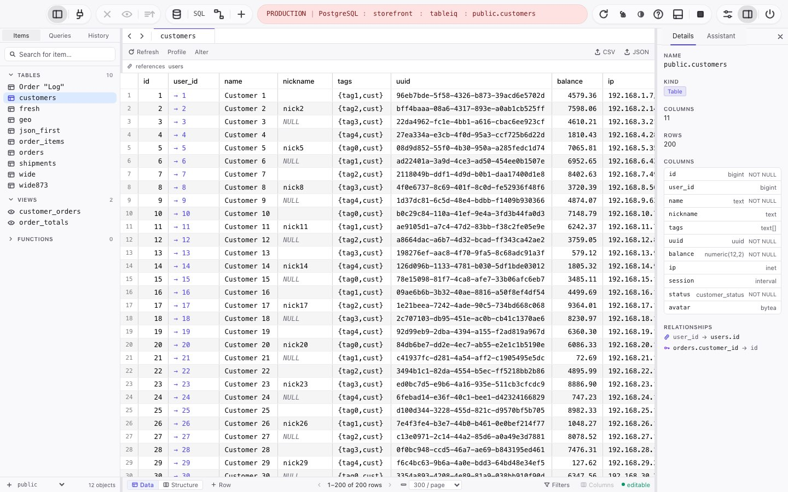 | Staged edit, G2 enabled 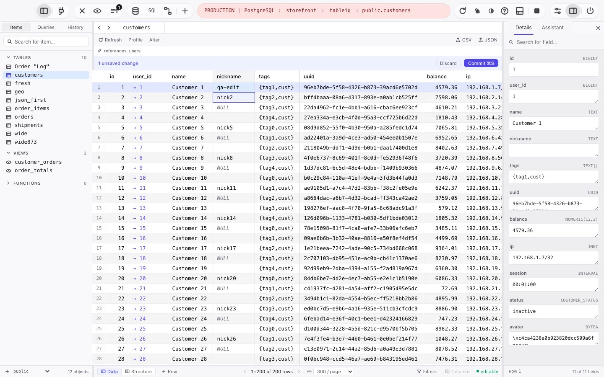 |
| Review popover 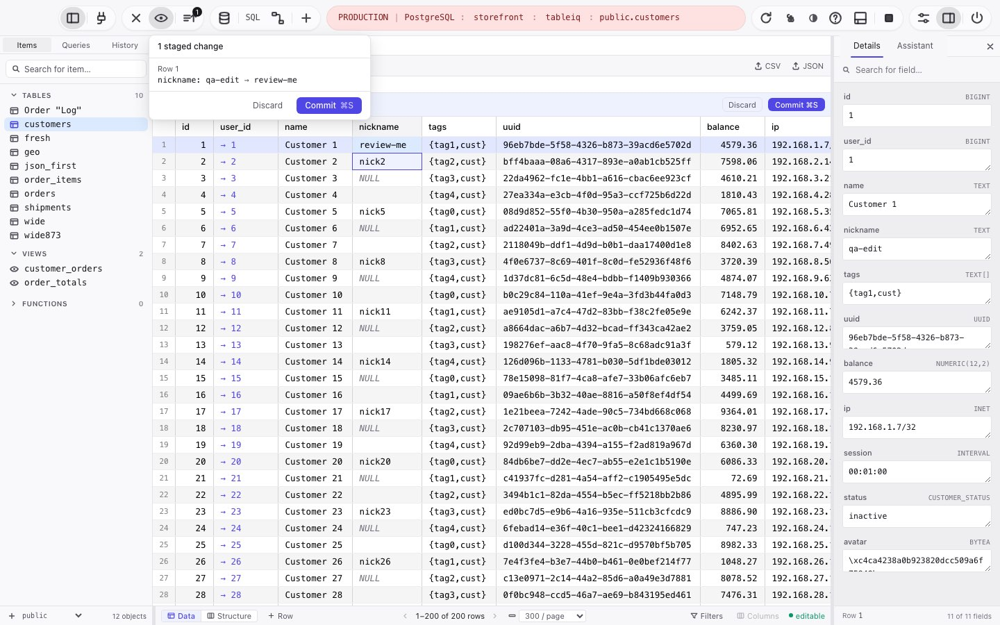 | ⌥⌘2 Structure 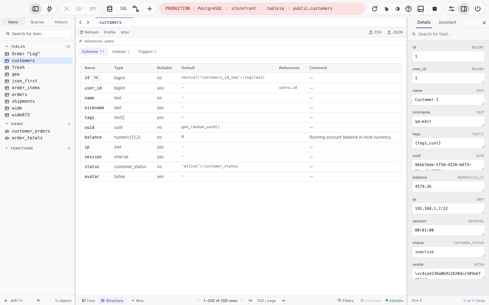 |
| 960px: G4 » 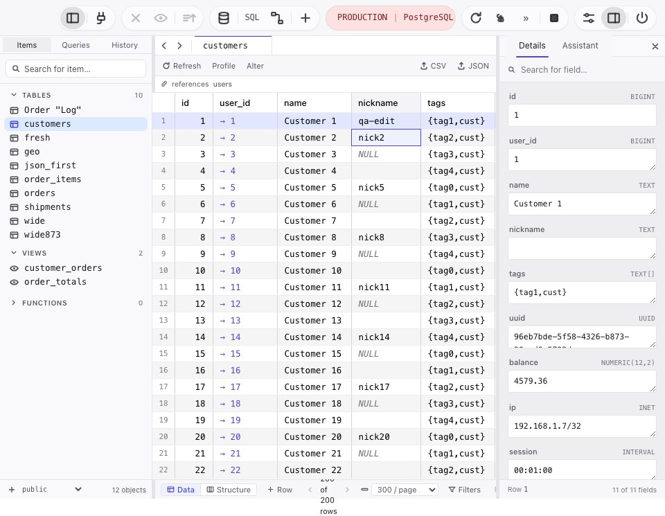 | » overflow menu 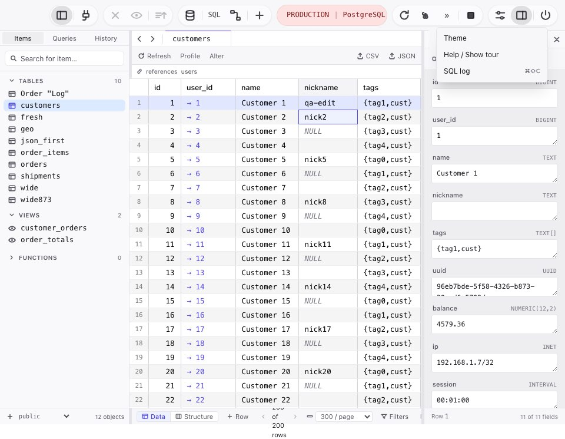 |
| Dark 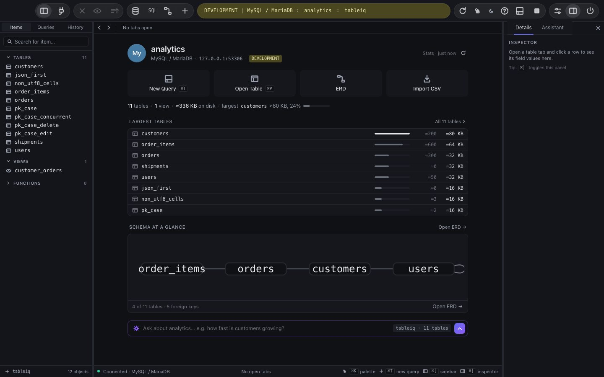 | Pager fixed at 960px 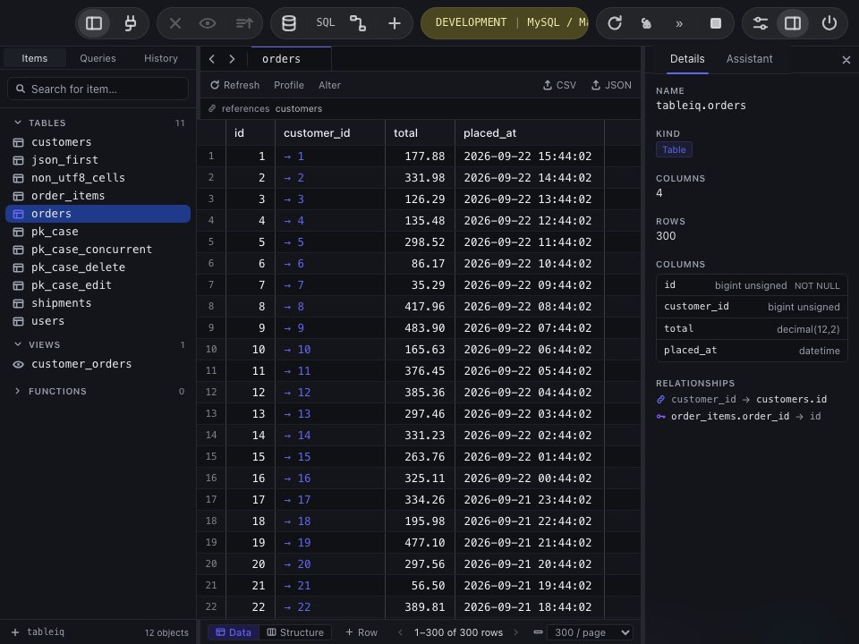 |

## Rulings made during the build (each with its cost if wrong)
1. The lobby `onOpenTable` goes through `tabGuard`. Cost if wrong: none.
2. Later accepted plan blocks supersede earlier ones (eng > dx > design > ceo). Cost if wrong: stale wording, caught by review.
3. The connection list's location tag (`(local)` / `(remote)` / `(ssh)`) is kept alongside the new env field. Cost if wrong: saved-connection rows don't show the env; a one-line follow-up.
4. The tabGuard grep check excludes test files. Cost if wrong: none.
5. "Close others" prompts when the active tab is among the closed ones. Cost if wrong: one extra prompt.
6. `rowOffset` is the first row on screen; committing with 0 staged skips the production prompt. Cost if wrong: none.
7. The plan's third copy of the native-confirm fallback became a `confirmDialog(labels?)` reuse. Cost if wrong: a small refactor.
8. The pill's connecting state is gated on the active connection id. Cost if wrong: none.
9. StagedReview doesn't use `tiq-overlay` (a full-screen backdrop). Cost if wrong: ⌘F can open the filter bar under the popover.
10. The lobby's AI hint appears after the first Ask fails, not on mount, because the keychain state isn't visible to the UI. Cost if wrong: the hint appears one click later.
11. The lobby cache key includes the database name. Cost if wrong: none.
12. Status-bar icons are 11px per DESIGN.md, not the brief's 13px. Cost if wrong: icons 2px smaller.
13. `hasNativeMenu()` is used instead of `inTauri()`, which is also true under the bridge. Cost if wrong: none.
14. The native menu is macOS only. Cost if wrong: Windows and Linux keep no menu bar, as before.
15. ⌘⇧P also opens the palette (parked). Cost if wrong: one extra alias.
16. The mini ERD uses its own two-column ring instead of the layered ERD layout (QA). Cost if wrong: the mini view differs in shape from the full ERD.

## Cost by stage
Subagent tokens come from the harness usage reports; the controller session is not included. Wall-clock times include an overnight usage-limit pause during Build.

| Stage | Wall clock (UTC) | Subagent work | Subagent tokens |
|---|---|---|---|
| 1. Brainstorm + design | 2026-09-26 → 27 | design-shotgun rounds 1–4 | not recorded |
| 2. Plan (`/autoplan`) | 27 10:07 → 16:07 | CEO, Design, DX and Eng reviewers | ~156k (Eng; others not recorded) |
| 3. Build (9 tasks) | 27 16:07 → 28 05:42 | 9 implementers + fix rounds; 9 task reviews + 4 re-reviews | ~1.07M implementers + ~0.98M reviewers |
| 4. Final review + fix wave | 28 05:10 → 05:42 | Opus whole-branch review, one fix wave, one re-review | ~0.52M |
| 5. QA (bridge) + fixes | 28 05:42 → 06:00 | controller-driven | — |
| 6. Finalize + rebase onto v0.7.0 | 28 06:00 → | controller | — |
| **Total** | | | **~2.7M subagent tokens** |

## Creds gate
The branch diff (`origin/main...HEAD`) was scanned for hard-coded passwords, tokens and API keys: none found. The only credentials involved are the local Docker test databases (`tableiq`), passed as env URLs to the gated tests, the same as before this branch. No keychain items were deleted during QA; fresh QA connection ids were used instead.
