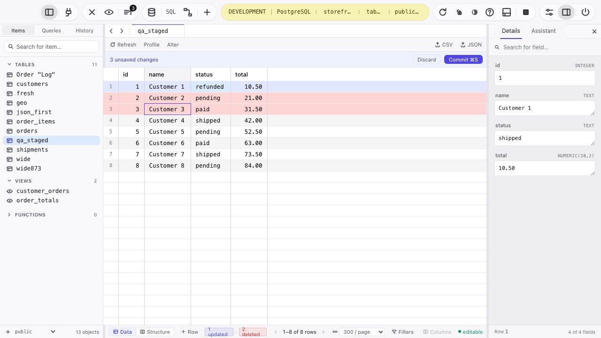
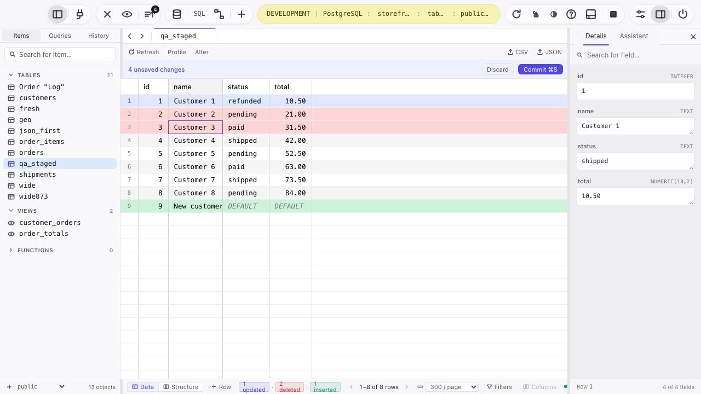
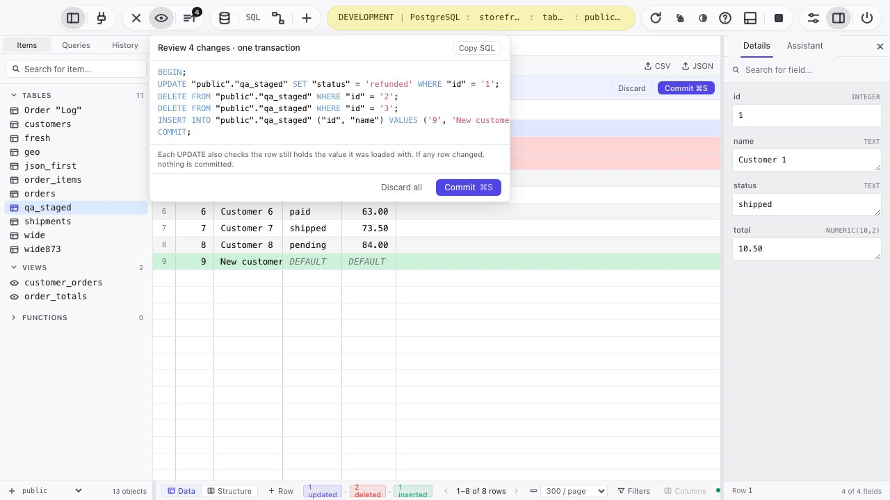
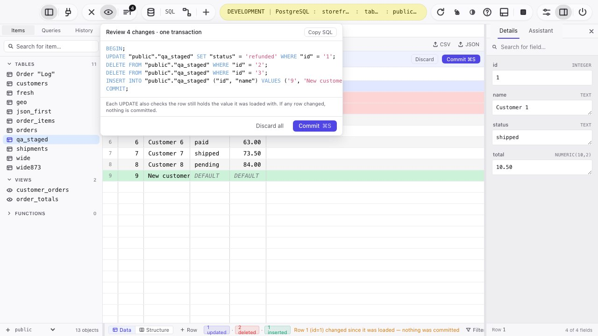
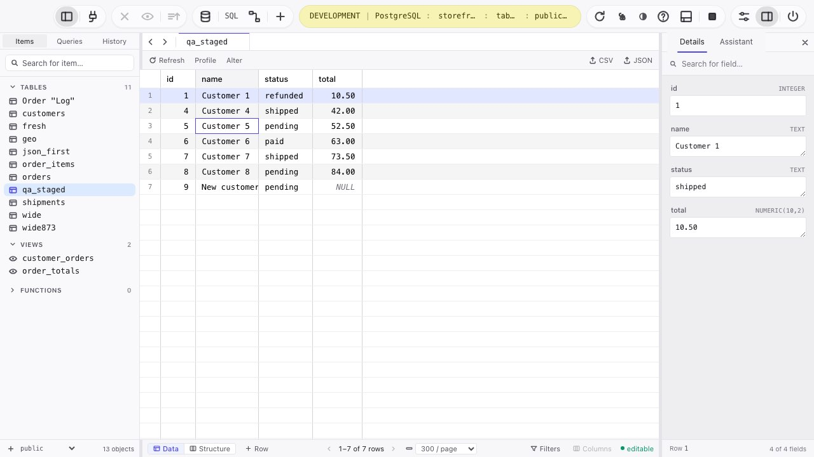
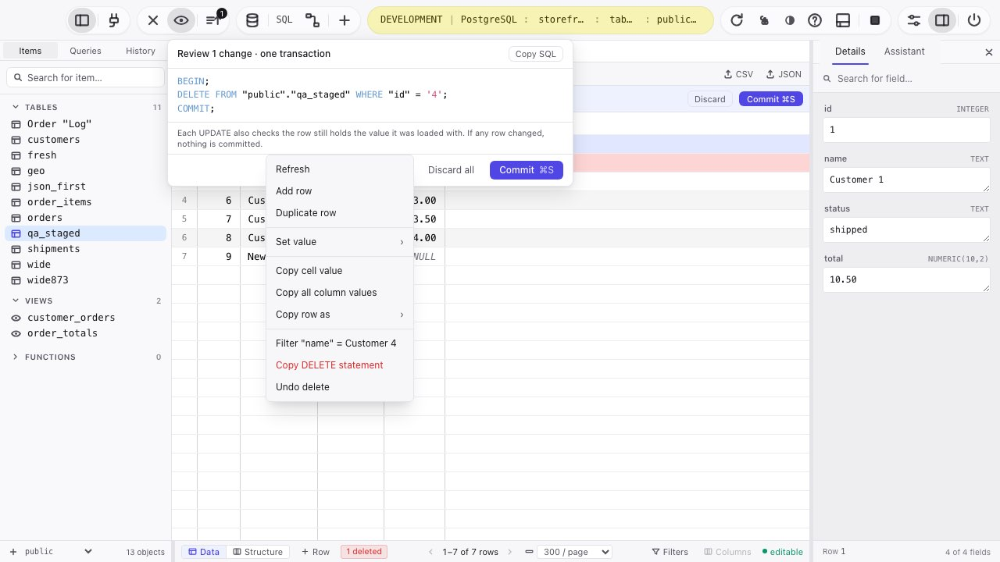

# Finalize: Staged UPDATE / DELETE / INSERT with SQL review and one-transaction commit

- **Branch:** `RudreshNarwal/staged-changes`
- **Base:** local `main` @ `530a499` (connection sheet merged)
- **Date:** 2026-09-28
- **Spec:** `docs/superpowers/specs/2026-09-28-staged-changes.md`. The design is mockup v2 panel C, approved when the user said "do as you want".
- **Plan:** `docs/superpowers/plans/2026-09-28-staged-changes.md` (6 tasks)
- **Why:** the user asked whether TableIQ highlights updates, deletes and new rows like TablePlus does. Before this slice, only cell edits were staged.

## What shipped
| | Before | Now |
|---|---|---|
| Edit a cell | staged, blue | staged, blue (unchanged) |
| Delete Row | deleted immediately after a confirm | **staged, red row** until commit; Undo delete; ⌫ deletes the selected rows |
| + Row | inserted immediately | **staged, green row**; empty columns show italic `DEFAULT` and are left out; Remove row |
| Counts | "N unsaved changes" | status-bar chips `N updated · N deleted · N inserted`; the titlebar badge shows the total |
| Review | `col: old → new` lines | **the exact SQL** (`BEGIN … COMMIT`, quoted for each engine), with Copy SQL |
| Commit | one round trip per edit; a failure left a partial commit | **one transaction** through the new `apply_changes` command, on Postgres, MySQL/MariaDB, SQLite, SQL Server and DuckDB |

Every commit path (⌘S, the in-grid Commit, the titlebar and Review) goes through the same checks: an in-flight guard, then the production confirm ("Commit N changes to production (name)?"), then one `apply_changes` call.
- **Any failure rolls back everything:** a database error, a row changed since it was loaded (the optimistic check), or a delete that doesn't hit exactly 1 row. Everything stays staged, and the message names the row, e.g. "Row 1 (id=1) changed since it was loaded — nothing was committed".
- **Staged work is never silently lost:** paging, refresh, sort, filters, the Alter panel, Set value, Inspector refreshes and tab or connection switches are all blocked or guarded while anything is staged.

15 commits: 36 files changed, +4170 / −526.

## Tests
- **vitest:** 785/785 pass. tsc is clean.
- **Rust:**
  - `cargo test --lib` passes 328.
  - Live `apply_changes` tests pass on Docker Postgres 55432, MySQL 53306 and SQL Server 51433, and in-process on SQLite and DuckDB, with no skip lines.
  - SQL Server also has an audit-trigger scenario.
  - `clippy -D warnings` is clean.
- **The shared live test scenarios cover:**
  - commits in order (updates, then deletes, then inserts)
  - a same-value update that must not count as a conflict
  - rollback on a conflict, and rollback on a duplicate key after a successful delete
  - NULL vs empty string on insert
  - on SQL Server, `@@TRANCOUNT` = 0 after a failed batch

## Review
Each task went through a spec and quality review.
- **Task 1 (Rust core + Postgres):** clean.
- **Task 2 (MySQL + SQLite):** clean. sqlx turns on MySQL's CLIENT_FOUND_ROWS, so a same-value update isn't mistaken for a conflict.
- **Task 3 (SQL Server + DuckDB):** one round. SQL Server's row count (tiberius `total()`) included trigger rows. With an audit trigger, a staged delete failed ("matched 3 rows"), and a stale update looked like success, so a lost update was hidden. The review confirmed this against the live container, and the count now comes from `@@ROWCOUNT`, with a live trigger test.
- **Task 4 (TS model):** clean.
- **Task 5 (grid staging):** one round. Closing the Alter panel silently wiped staged work, and a second ⌘S could send the batch twice (an inserts-only batch would insert its rows twice). Both are fixed; the in-flight guard has a unit test.
- **Task 6 (chips, badge, Review):** one round. Copy SQL threw an error when the clipboard was unavailable.
- **Final whole-branch review (Opus): "with fixes".**
  - Anything staged while a commit was running was wiped when it finished.
  - A primary-key edit followed by another edit on the same row could never commit.
  - Minors: SQL Server cleanup when BEGIN fails, and an "outcome is uncertain" message when the commit's own error has no change number.
  - All were fixed and re-reviewed.

## QA (real IPC bridge, Docker Postgres)
Through the real Rust commands on a scratch table `qa_staged`, 8 rows:
- **Staging:** edited row 1's status (blue), staged 2 deletes via the context menu (red), and added a row with only id and name (green; status and total show `DEFAULT`).
- **Counts:** the chips read "1 updated · 2 deleted · 1 inserted" and the titlebar badge shows 4.
- **Review:** exactly `BEGIN; UPDATE … SET "status" = 'refunded' WHERE "id" = '1'; DELETE … '2'; DELETE … '3'; INSERT … ("id", "name") VALUES ('9', 'New customer'); COMMIT;`.
- **Conflict:** row 1 was changed outside the app, then Commit. One `apply_changes` call returned 400. The database was **unchanged** (rows 2 and 3 still there, no row 9). All 4 changes stayed staged, and the message read "Row 1 (id=1) changed since it was loaded — nothing was committed".
- **Success:** after restoring row 1, ⌘S sent one `apply_changes` (200), followed by one refresh. The database matched exactly: row 1 `refunded`, rows 2 and 3 gone, row 9 inserted with `pending` and total `NULL`.
- **Delete-only batch:** its Review shows just the DELETE. "Undo delete" is offered on the staged row.
- **Tab guard with only a delete staged:** "This tab has unsaved changes. Discard them and switch tabs?"; dismissing kept the staged work.

| Issue | Severity | Status |
|---|---|---|
| ISSUE-001: the blank filler area below the rows was painted green, as if it were staged new rows | medium (visual) | fixed (8f53212) |
| ISSUE-002: the count chips wrapped onto two lines and were clipped in the status bar | low | fixed (3cad70e) |
| ISSUE-003: long SQL lines in Review were cut off instead of wrapping | low | fixed (385a64e) |
| The Inspector keeps showing the pre-commit value of the selected row until you reselect it | low | deferred; this predates the slice |

**Health: 88 → 100** (Visual, Functional, UX, Console and Content scored). A delete-only Review still shows the UPDATE footnote, which is a minor copy nit.

| | |
|---|---|
| Edit + 2 deletes staged  | + insert staged (DEFAULT)  |
| Review: exact SQL, one transaction  | Conflict: rolled back, all still staged  |
| Committed: grid refreshed, DB matches  | Delete-only Review, chips fixed  |

## Rulings (each with its cost if wrong)
1. **The plan-writer's decisions:**
   - Paging and refresh are blocked while changes are staged, rather than staged work being kept across pages.
   - The backend reorders changes into updates, deletes, inserts, but error numbers refer to the batch as sent.
   - When a row is both edited and deleted, the delete wins.
   - ⌫ deletes the selected rows.
   - Preview values are shown quoted.
   - Cost if wrong: small differences in behaviour.
2. SQL Server counts rows with `@@ROWCOUNT` instead of `total()`, a change from the plan. Cost if wrong: one extra number read per statement.
3. The `stagedTotal` naming is accepted. Deleted and new rows have no strikethrough or "+" marker, because the canvas grid can't draw them; the tint and italic `DEFAULT` carry the meaning. Set value is refused while changes are staged. Cost if wrong: a small visual gap from the mockup.
4. The one-line fix for Task 6 was checked by reading its diff rather than by a separate re-review. Cost if wrong: none.
5. **Parked:** editing two columns of a composite primary key on the same row still can't commit. Cost if wrong: commit the two key parts separately.

## Deferred (TODOS)
- Merging a row's edits into one UPDATE (needed for the composite-key case above).
- Refreshing the Inspector after a commit.
- A delete-only Review should hide the UPDATE footnote.
- A "Delete rows" menu item for multi-row selection (⌫ already does it).
- Retrying a commit whose outcome was uncertain could repeat inserts. The message now says the outcome is uncertain and asks you to refresh first.

## Notes
- **Disk space:** during Task 2 the disk filled up, and an implementer ran `docker builder prune -f`, which freed 18.7 GB of Docker build cache. No containers, images or volumes were touched.
- **Creds gate:** no secrets are in the diff. QA used the local Docker test credentials in a temporary config directory (`/tmp/tiq-qa-staged`). The scratch table was dropped afterwards.
