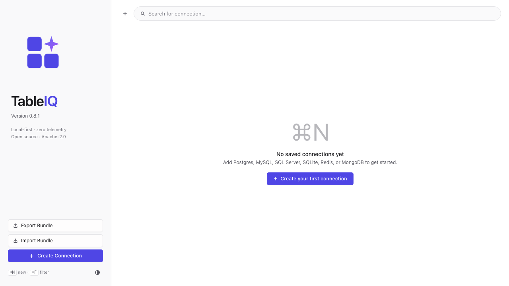

# Finalize: MCP guard suite + Apache-2.0 (roadmap P0)

_2026-09-30 · branch `RudreshNarwal/dbx-gtm-build-first` · base `c8266e2`_

## What was done

| Commit | Change |
|---|---|
| `2e48a94` | **Apache-2.0**: LICENSE (canonical text), NOTICE, `license` in `package.json` and `Cargo.toml`, UI string "Open source · Apache-2.0", README "License and what stays free" pledge |
| `f21232e` | **Guard hardening + adversarial suite.** A writes-allowed MCP connection used to skip every keyword check. These now pass through it no more: `COPY … TO PROGRAM`, `INTO OUTFILE`, `LOAD DATA INFILE`, `BULK INSERT`, `BACKUP`/`RESTORE`, `KILL`/`SHUTDOWN`, `ALTER SYSTEM`, `SET GLOBAL`/`PERSIST`, `DBCC`/`RECONFIGURE`/`sp_configure`, and SQL Server session verbs. Read-only now also refuses `pg_stat_reset*` (which survives ROLLBACK) and SQL Server `SETUSER`/`REVERT`. `tests/guard_suite.rs` is the new suite |
| `df6a450`, `cddf927` | **Live proof** (`tests/guard_live.rs`) on real Postgres 16 and MySQL 8.4 |
| `1d0cefc` | **Final-review fixes**: quoted `EXEC [sp_configure]`, `SET ANSI_DEFAULTS ON`, mid-batch `USE`, `sp_setapprole`, MySQL `FLUSH`/`UNINSTALL`. `SHOW GLOBAL STATUS` works again on writes-allowed connections. The `ALTER SYSTEM` and `EXECUTE AS` checks now need the two words next to each other |
| docs | Spec, autoplan-reviewed plan (CEO, DX and Eng), TODOS T1–T3 |

**Design in one line:** writes-allowed connections refuse the literal forms of anything that reaches beyond the database. The check runs on the scanned code, where strings and quoted names count as data and comments count as code, and the refusal tells the user to quote the name if it's a column. Dynamic SQL and superuser-only escapes are the database role's job. The README says so.

## Tests and QA

| Check | Result |
|---|---|
| `cargo test --test guard_suite` | **Before the fix:** 54 wrong verdicts (the plan's gaps). **After the review:** 15 more. **Now:** 2/2 pass ([red lists](assets/guard-suite/suite-red-before-fix.txt)) |
| `cargo test --lib` (all 10 existing guard unit tests unchanged) | 329 pass, 4 ignored |
| `cargo test --test guard_live` (real PG 16 / MySQL 8.4) | 2/2. The tests prove that `pg_stat_reset` survives the read-only wrapper, that `COPY … TO PROGRAM` runs and `INTO OUTFILE` writes, and that the guard refuses all three. They also pin the release of the session lock ([output](assets/guard-suite/tests-green.txt)) |
| `cargo test --test mcp_live` (MCP over real HTTP) | 6/6 |
| `cargo clippy --all-targets -D warnings` | clean |
| `tsc --noEmit`, `vitest run src/components` | clean, 81 pass |
| Dependency licence scan | Only `ittapi`/`ittapi-sys`, both dual-licensed (GPL-2.0 OR BSD-3-Clause). No GPL-only or AGPL crates |
| Browser QA through the **real IPC bridge** (not the mock) | Health 100 (provisional: 4 categories tested), 0 issues, 0 console errors |

API layer ([network capture](assets/guard-suite/network-ipc.txt)): `read_onboarding_state`, `list_connections` ×2 and `write_onboarding_state` all returned 200 from the Rust bridge. `list_connections` returned `[]`, the real empty config; the mock would have fabricated sample connections.

**Checked thoroughly:** every guard change has a test that failed before the fix and passes after it. Each escape was shown to be real on a live engine before being refused. A fresh reviewer read the whole branch; its 3 Important findings and 4 re-graded Minor findings were fixed test-first. The UI change was checked in a real browser against the real backend.

## Assumptions and rulings made during the autonomous run

- I read your saved memory as authorization for **autonomous mode** ("don't stop between phases"). There were no QA credentials to ask for, since it's a desktop app with no login.
- **Scope held to my recommendation from the conversation:** the guard suite is in-repo. Making the repo public, the cross-vendor `mcp-guard-tests` repo, signing, the updater and Homebrew all stay out.
- The autoplan reviews overturned one of my own premises. On Postgres, MySQL and SQLite, the read-only wrapper's `BEGIN` makes the driver close the connection, so session advisory locks do **not** survive. I had inferred that they did from a psql probe. Those denylist entries are kept as defence in depth, and the live test now asserts the lock is released.
- **Writes-path words are checked only on writes-allowed connections**, so read-only MCP and Metrics widgets get no new refusals.
- Known over-refusals, all fail-closed:
  - A bare column named `load` or `copy` (Postgres), or `restart` (MySQL), is refused on a writes-allowed connection. Quoting it works, and the message says so.
  - The `sp_configure`/`sp_setapprole` names are refused even inside strings on writes-allowed SQL Server connections.
  - `ALTER … SYSTEM` must be adjacent to be refused.
- Test-only ruling: `COPY TO PROGRAM 'true'` became `'cat > /dev/null'`, because `true` doesn't read its stdin and Postgres reports a broken pipe.
- **Deferred minor:** MySQL `ALTER INSTANCE`, `PURGE BINARY LOGS` and `CHANGE REPLICATION SOURCE`, and SQL Server `sp_set_session_context`, are not refused. They are privileged, so the role boundary covers them.
- **Deferred minor:** the refusal text says "outside a string or quoted name", but for `sp_configure`/`sp_setapprole` quoted names are refused too.
- **Deferred to TODOS.md:**
  - T1: privilege probe when a connection is shared.
  - T2: `pg_proc` volatile-function completeness check in CI.
  - T3: data-file cases and the public `mcp-guard-tests` repo.
- Codex outside voices were **unavailable** (not authenticated), so every autoplan phase ran single-model with native Claude reviewers.
- In Finalize, `/qa-only` was not re-run: `/qa` had just run on the same HEAD, and the evidence was captured with `/browse` directly.
- Skipped `/design-review`, because the only UI change is one text string. It was verified in the screenshot.
- The gstack upgrade (1.87 → 1.91) was snoozed for 24h instead of upgrading mid-run.

## No-harness exceptions

None.

## Per-stage cost

> Source: 4 transcripts · generated 2026-09-30T10:41Z. This is best-effort: transcripts from other Conductor chats in this project dir that overlap the same window may be counted. The biggest share is the `/autoplan` Plan stage, which loaded three ~2k-line review methodologies and ran three reviewer subagents.

| Stage | Model | Input | Output | Cache read | Cache write | Cost (USD) |
|---|---|---|---|---|---|---|
| 1. Brainstorm | opus | 84 | 90,601 | 2,454,496 | 450,779 | $15.81 |
| 2. Plan | opus | 200 | 153,453 | 25,918,039 | 772,810 | $64.88 |
| 3. Build | opus | 118 | 78,201 | 28,634,053 | 114,415 | $50.96 |
| 4. Review | opus | 50 | 38,669 | 13,182,840 | 72,136 | $24.03 |
| 5. QA | opus | 56 | 12,776 | 16,102,251 | 99,915 | $26.99 |
| 6. Finalize | opus | 8 | 2,730 | 2,348,295 | 6,380 | $3.85 |
| **Total** | | **516** | **376,430** | **88,639,974** | **1,516,435** | **$186.51** |

## Soft gate

Tests are green, QA health is 100, and there are no no-harness exceptions. Clean, so this proceeds to `/ship`.
