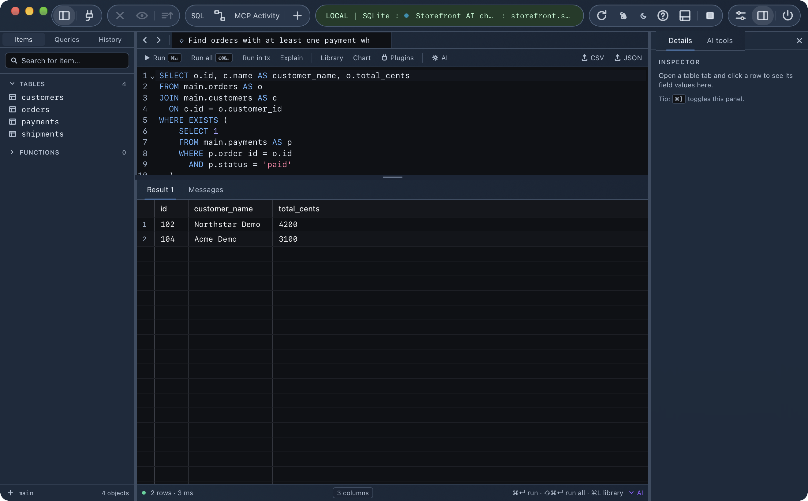

# Native Gemini acceptance — November 16, 2026

**Passed one controlled native workflow.** The installed TableIQ 0.8.17 developer preview generated SQL through Gemini `gemini-4-hydrogen`, opened it in the SQL editor without running it, and returned the expected rows after a manual Run. This is one fixture outcome, not a model accuracy rate or a comparison with other providers.

## Setup and limits

- Actual installed Apple silicon app, source `25bf8d31bb663dd7f6f85fe080ba5cb95c750e71`, macOS 27.0.1.
- Isolated QA configuration and disposable SQLite database; no production connection or customer data.
- [Repository fixture](../demo/seed.sql), extended with customer 4 (`No Orders Demo`) and a second paid payment for order 104. These extensions check that unrelated customers and duplicate payment records do not change this question's answer.
- The owner-authorized key authenticated a direct Google model-catalog request. The exact value was then installed in the existing OS Keychain entry through the macOS Security API, without reading the previous secret or changing its access controls. The native app used its normal credential-read and provider paths.
- Native automation was unreliable while filling text fields. Settings credential entry is not claimed as independently accepted by this test. The old saved value was not compared, so the original HTTP 401's precise cause remains unproven. That error was not reproduced with the known credential in this run. No provider code change was required.
- Existing films still show AI configuration only. This new still records a separate genuine native result.

## Actual question

> Find orders with at least one payment whose status is 'paid' and no shipment whose status is 'shipped'. Return each order once with its id, customer name and total_cents, ordered by order id.

The question supplies business status meanings but does not supply the answer SQL, expected IDs, totals or customer names. The app supplied schema/dialect/relationship metadata through its normal AI generation command.

## Generated SQL

Shown below as captured from the native editor, with whitespace flattened by accessibility extraction. It was not replaced with the sample answer query.

```sql
SELECT o.id, c.name AS customer_name, o.total_cents FROM main.orders AS o JOIN main.customers AS c   ON c.id = o.customer_id WHERE EXISTS (     SELECT 1     FROM main.payments AS p     WHERE p.order_id = o.id       AND p.status = 'paid'   )   AND NOT EXISTS (     SELECT 1     FROM main.shipments AS s     WHERE s.order_id = o.id       AND s.status = 'shipped'   ) ORDER BY o.id;
```

The `EXISTS` payment predicate avoids multiplying orders when several payments match; `NOT EXISTS` excludes a shipped order. The editor was idle with no result table before execution. The Run button was then clicked manually.

## Observed result

| id | customer_name | total_cents |
| --- | --- | --- |
| 102 | Northstar Demo | 4200 |
| 104 | Acme Demo | 3100 |

The native result grid showed these exact two rows, totalling **7,300 cents**, with no duplicate order. The captured SQL separately produced the same tuples against a read-only connection to the same fixture. The native grid's displayed SQL execution time is not AI-generation latency or comparative performance evidence.



The unchanged screenshot's SHA-256 is `ae4122243a4d1fefaaeb4540ec88ac158168557b6114d79aeb87fe1d6703111d`. It contains only synthetic data. No API credential is part of this report, screenshot or repository. OpenAI, Claude and OpenRouter live inference remain unverified because no keys for those providers were supplied.
